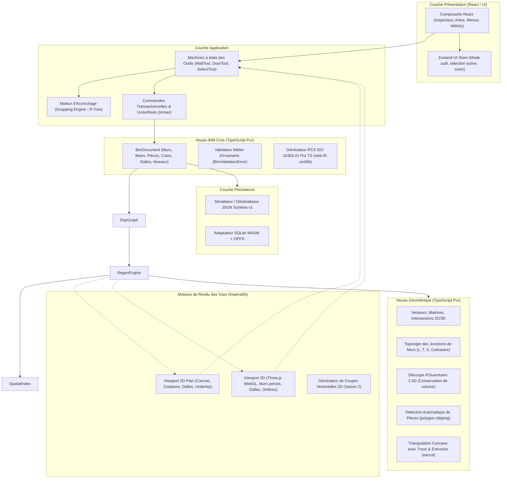
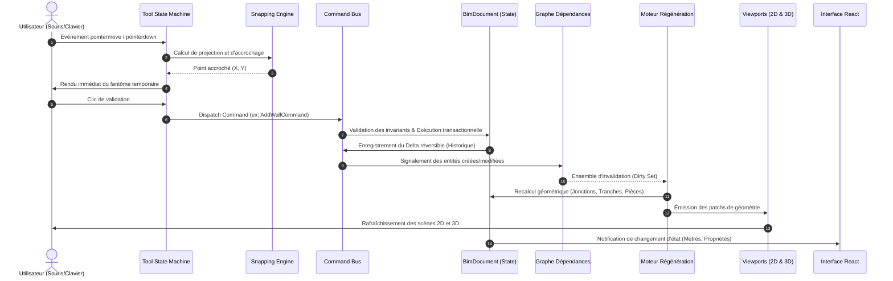

# ARCHITECTURE SYSTÈME — MINI-BIM

**Statut :** Spécification d'Architecture Validée  
**Date :** 13 novembre 2026  
**Auteur :** Ingénieur Principal & Architecte Logiciel

---

## 1. Vision et Principes Directeurs Non Négociables

Mini-BIM est conçu comme un système de modélisation de données du bâtiment (BIM) paramétrique. Il repose sur cinq principes directeurs stricts :

1. **Le Modèle BIM est la Source de Vérité Unique :**  
   Les données du projet sont détenues sous forme d'entités sémantiques normalisées. Les représentations 2D (plans) et 3D (maillages Three.js) ne sont que des **vues de projection et des caches dérivés**, recalculés à la demande.
2. **Découplage Strict UI / Métier / Rendu :**  
   L'interface React n'exécute aucune règle métier BIM. Le moteur de rendu Three.js n'émet aucune décision architecturale. Les packages centraux (`@mini-bim/geometry` et `@mini-bim/core`) sont en TypeScript pur, sans aucune dépendance au DOM ni aux bibliothèques de rendu.
3. **Modifications par Commandes Transactionnelles Atomiques :**  
   Toute mutation du modèle passe obligatoirement par un bus de commandes. Chaque commande est validée, exécutée, journalisée et inversible (Undo/Redo déterministe).
4. **Propagation Réactive Incrémentale par Graphe de Dépendances (DAG) :**  
   La modification d'une entité n'entraîne pas la reconstruction complète du bâtiment. Seules les entités affectées et leurs dépendants directs sont marqués « sales » (`dirty set`) et recalculés.
5. **Local-First et Persistance Stable :**  
   Le système fonctionne hors-ligne dans le navigateur, stocke son état sous forme normalisée, versionnée et diffable, et assure une intégrité totale entre sessions de travail.

---

## 2. Architecture Globale et Découpage Modulaire

Le projet est organisé sous la forme d'un monorepo modulaire (pnpm workspaces) à dépendances strictement unidirectionnelles.

---

## 3. Responsabilités des Modules

### 3.1 `@mini-bim/geometry` (Noyau Géométrique)

- **Rôle :** Fonctions mathématiques et algorithmiques pures.
- **Dépendances :** Aucune dépendance externe de rendu. Utilise `earcut` (triangulation) et à terme `clipper2-wasm`.
- **Responsabilités :**
  - Primitives mathématiques : `Vec2`, `Vec3`, `Mat3`, `Box2`, `Box3`.
  - Calculs vectoriels : produit scalaire, produit vectoriel 2D/3D, distance point-segment, projection.
  - Découpage géométrique : calcul des décalages de faces (location lines), biseautage des jonctions d'angle (onglets), aboutements en T, coupes d'extrémité droites.
  - Soustraction d'ouvertures par tranches verticales 2.5D.
  - Calculs de polygones : aire signée, périmètre, centroïde, orientation CCW, test point-dans-polygone.

### 3.2 `@mini-bim/core` (Domaine BIM)

- **Rôle :** Représentation des concepts architecturaux, cohérence du modèle et cycle de vie des entités.
- **Dépendances :** `@mini-bim/geometry`. Aucune dépendance graphique.
- **Responsabilités :**
  - Modèle de données normalisé : `Project`, `Building`, `Level`, `Category`, `ElementType`, `ElementInstance`, `Wall`, `Door`, `Window`, `Slab`, `Roof`, `Room`, `Material`.
  - Gestion des identifiants stables (ULID).
  - Graphe de dépendances dirigé acyclique (DAG) reliant hôtes, éléments hébergés et limites de pièces.
  - Moteur de régénération incrémentale : calcul des ensembles d'entités sales (`dirty set`) et orchestration des générateurs géométriques.
  - Calcul des métriques et quantités (surfaces brutes/nettes, volumes, longueurs de linéaire).

### 3.3 `@mini-bim/app` (Couche Application & Outils)

- **Rôle :** Orchestration des flux utilisateurs, outillage interactif et historique.
- **Dépendances :** `@mini-bim/core`, `@mini-bim/geometry`.
- **Responsabilités :**
  - Bus de commandes : `execute(command)`, `undo()`, `redo()`.
  - Commandes transactionnelles typées : `AddWallCommand`, `MoveWallEndpointCommand`, `InsertDoorCommand`, `UpdatePropertyCommand`.
  - Machines à états des outils (`ToolStateMachine`) :
    - `WallTool` : clic de départ, fantôme temps réel, accrochage, clic de fin, émission de commande.
    - `DoorTool` : détection du mur hôte sous le curseur, calcul de la projection le long de l'axe, validation des marges, prévisualisation, émission de commande.
    - `SelectTool` : sélection mono/multi-éléments, boîte de sélection élastique, manipulation de poignées (gizmos/grips).
  - Moteur d'accrochage (`SnappingEngine`) : détection des extrémités, milieux, alignements orthogonaux (axes X/Y) et intersections.

### 3.4 `@mini-bim/view-2d` & `@mini-bim/view-3d` (Moteurs de Vues)

- **Rôle :** Affichage optimisé et capture des interactions de bas niveau.
- **Dépendances :** `@mini-bim/core`, Three.js (uniquement pour 3D), Canvas 2D natif (pour 2D).
- **Règle fondamentale :** Ces modules sont instanciés de façon **impérative** et montés sur des éléments `<canvas>`. Ils s'abonnent aux événements du moteur BIM (`on('patch', ...)`), évitant tout re-rendu superflu du cycle de vie React.
- **Responsabilités 3D :**
  - Scène Three.js avec repère Z-up orienté via groupe racine inversé.
  - Matériaux architecturaux sobres, arêtes nettes (`LineSegments` + `EdgesGeometry`).
  - Accélération du raycasting par BVH (`three-mesh-bvh`).
  - Prise en charge des plans de coupe dynamiques (Section Box).
- **Responsabilités 2D :**
  - Rendu en plan horizontal interactif au niveau de coupe standard (1,20 m au-dessus du niveau actif).
  - Affichage des pochés de murs, symboles normalisés d'ouverture (arcs de débattement de portes), étiquettes de pièces et cotations.

### 3.5 `@mini-bim/persistence` (Stockage et Échange)

- **Rôle :** Sauvegarde, restauration, validation et conversion.
- **Dépendances :** `@mini-bim/core`.
- **Responsabilités :**
  - Validation des structures de données via schémas Zod stricts.
  - Import/Export de snapshots JSON versionnés (`schema_version: 1`).
  - Driver de persistance SQLite WASM avec stockage OPFS (Origin Private File System).
  - Passerelle préparée pour l'export IFC minimal (`IfcWall`, `IfcDoor`, `IfcWindow`, `IfcBuildingStorey`).

---

## 4. Flux de Données et Cycle d'une Modification

Chaque action utilisateur obéit à un pipeline strict et déterministe en 7 étapes :

### Détail des étapes :

1. **Interaction & Accrochage :** Le curseur est projeté sur le plan de travail. Le moteur d'accrochage interroge l'index spatial R-Tree pour capturer les nœuds existants dans un rayon de tolérance.
2. **Émission de la Commande :** L'outil assemble les paramètres requis et soumet une commande typée au `CommandBus`.
3. **Transaction & Invariants :** La commande vérifie les règles métier (longueur minimale, non-dégénérescence). Si valide, l'état normalisé du document est muté et un enregistrement d'annulation est poussé dans la pile Undo.
4. **Expansion des Dépendances :** Le DAG identifie les éléments directement et indirectement impactés (ex: déplacer un mur impacte ses portes hôtes, les murs formant jonction avec lui, et les pièces adjacentes).
5. **Régénération Dérivée :** Seules les géométries sales sont recalculées (emprises 2D, découpes par tranches, maillages, surfaces).
6. **Patch des Vues :** Les viewports mettent à jour uniquement les maillages Three.js et les tracés 2D concernés.
7. **Synchronisation UI :** L'inspecteur de propriétés et le tableau des métrés se synchronisent via des abonnements sélectifs.

---

## 5. Règles de Dépendance et Frontières d'Architecture

Pour préserver l'intégrité du logiciel sur le long terme, les frontières suivantes sont garanties par l'outillage de compilation et de linting :

1. **Règle d'or absolue :**  
   `@mini-bim/geometry` et `@mini-bim/core` ne doivent **jamais** importer `react`, `react-dom`, `three`, ou une quelconque référence à `window` / `document`.
2. **Direction des flux :**  
   Les dépendances vont exclusivement de l'extérieur vers l'intérieur :
   $$\text{UI / React} \longrightarrow \text{App} \longrightarrow \text{Core} \longrightarrow \text{Geometry}$$
3. **Immuabilité de l'API publique :**  
   Toute interaction entre l'interface et le modèle passe par des commandes sérialisables. L'UI ne mute jamais directement une propriété d'une entité du document.

---

## 6. Stratégie d'Évolution et Extensibilité

L'architecture est dès à présent pensée pour absorber les évolutions sans rupture :

- **Régénération en Web Worker (Multi-threading) :**  
  Le moteur de régénération étant totalement découplé du DOM, son exécution pourra être déportée dans un Web Worker dès que le modèle dépasse 1 000 murs. Les échanges se feront par transfert sans copie de `ArrayBuffer` (`Transferable Objects`).
- **Support des Réseaux MEP :**  
  Le système de registre de catégories (`CategoryDef`) permettra d'enregistrer de nouvelles familles d'éléments (tuyaux, gaines, équipements techniques) avec leur propre logique de connecteurs (ports) et de balayage géométrique (`sweep`), sans modifier le noyau architectural central.
- **Persistance Client-Serveur Hybride :**  
  Le format de transaction par commandes permet une transition transparente d'un stockage local (SQLite WASM) vers une synchronisation serveur (PostgreSQL) par envoi de flux d'opérations (Event Sourcing / Change Data Capture).
