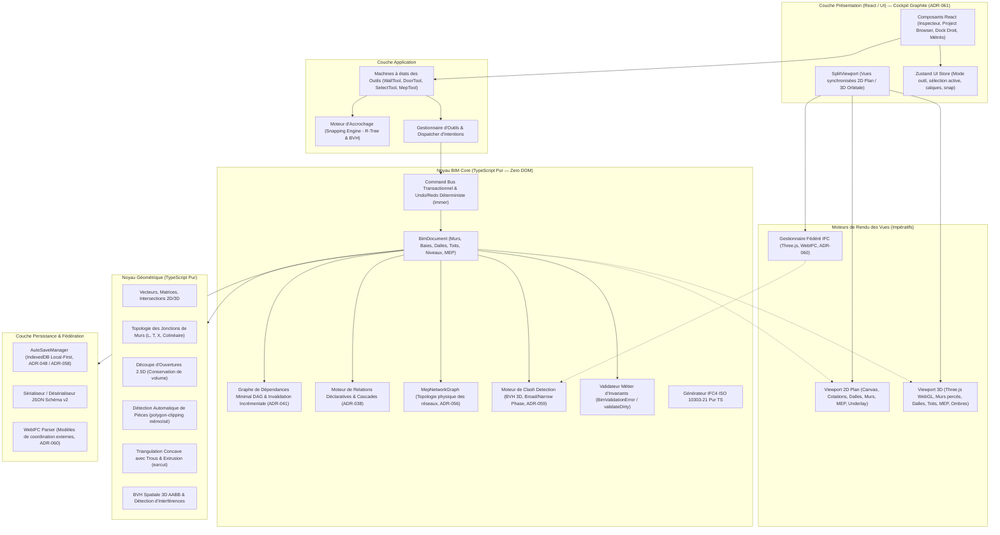
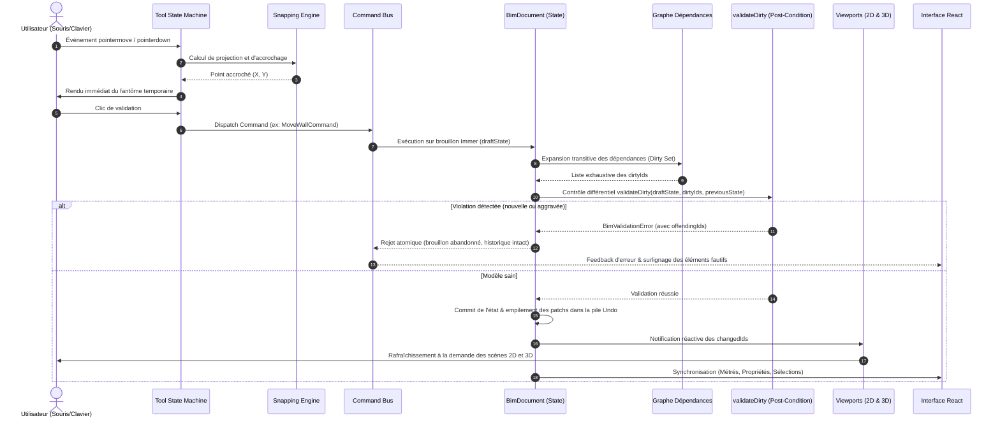

# ARCHITECTURE SYSTÈME — MINI-BIM

**Statut :** Spécification d'Architecture Validée  
**Date :** 15 novembre 2026  
**Auteur :** Ingénieur Principal & Architecte Logiciel

---

## 1. Vision et Principes Directeurs Non Négociables

Mini-BIM est conçu comme un système de modélisation de données du bâtiment (BIM) paramétrique. Il repose sur cinq principes directeurs stricts :

1. **Le Modèle BIM est la Source de Vérité Unique :**  
   Les données du projet sont détenues sous forme d'entités sémantiques normalisées. Les représentations 2D (plans) et 3D (maillages Three.js) ne sont que des **vues de projection et des caches dérivés**, recalculés à la demande.
2. **Découplage Strict UI / Métier / Rendu :**  
   L'interface React n'exécute aucune règle métier BIM. Le moteur de rendu Three.js n'émet aucune décision architecturale. Les packages centraux (`@mini-bim/geometry` et `@mini-bim/core`) sont en TypeScript pur, sans aucune dépendance au DOM ni aux bibliothèques de rendu.
3. **Modifications par Commandes Transactionnelles Atomiques :**  
   Toute mutation du modèle passe obligatoirement par un bus de commandes. Chaque commande est validée, exécutée, journalisée et inversible (Undo/Redo déterministe).
4. **Propagation Réactive Incrémentale par Graphe de Dépendances (DAG) :**  
   La modification d'une entité n'entraîne pas la reconstruction complète du bâtiment. Seules les entités affectées et leurs dépendants directs sont marqués « sales » (`dirty set`) et recalculés.
5. **Local-First et Persistance Stable :**  
   Le système fonctionne hors-ligne dans le navigateur, stocke son état sous forme normalisée, versionnée et diffable, et assure une intégrité totale entre sessions de travail.

---

## 2. Architecture Globale et Découpage Modulaire

Le projet est organisé sous la forme d'un monorepo modulaire (pnpm workspaces) à dépendances strictement unidirectionnelles.

---

## 3. Responsabilités des Modules

### 3.1 `@mini-bim/geometry` (Noyau Géométrique)

- **Rôle :** Fonctions mathématiques et algorithmiques pures.
- **Dépendances :** Aucune dépendance externe de rendu. Utilise `earcut` (triangulation) et à terme `clipper2-wasm`.
- **Responsabilités :**
  - Primitives mathématiques : `Vec2`, `Vec3`, `Mat3`, `Box2`, `Box3`.
  - Calculs vectoriels : produit scalaire, produit vectoriel 2D/3D, distance point-segment, projection.
  - Découpage géométrique : calcul des décalages de faces (location lines), biseautage des jonctions d'angle (onglets), aboutements en T, coupes d'extrémité droites.
  - Soustraction d'ouvertures par tranches verticales 2.5D.
  - Calculs de polygones : aire signée, périmètre, centroïde, orientation CCW, test point-dans-polygone.

### 3.2 `@mini-bim/core` (Domaine BIM & Coordination)

- **Rôle :** Représentation des concepts architecturaux, structurels, MEP et coordination spatiale.
- **Dépendances :** `@mini-bim/geometry`. Aucune dépendance graphique ni DOM.
- **Responsabilités :**
  - Modèle de données normalisé Schéma v2 (25 catégories d'entités) : `Project`, `Building`, `Level`, `Wall`, `Door`, `Window`, `Slab`, `Roof`, `Stair`, `Component`, `Room`, `Dimension`, et le graphe technique MEP (`Pipe`, `Duct`, `CableTray`, `MepFitting`, `MepEquipment`, `MepSystem`, `MepConnector`).
  - Graphe de dépendances acyclique DAG minimal (ADR-041) avec invalidation réactive et maintenance incrémentale différentielle.
  - Réseau topologique MEP (`MepNetworkGraph`, ADR-056) découplé du DAG d'invalidation hiérarchique.
  - Moteur de détection de conflits (`ClashEngine`, `BvhSpatialIndex`, `ClashMatrix`, ADR-059) avec classification sémantique (Hard, Soft, Clearance, Contact légitime).
  - Caches purs mémoïsés par `WeakMap` indexés sur les références immuables `BimState` et `Slab` (`detectRooms`, `resolveWallGeometry`, polygones effectifs de dalles).
  - Validation transactionnelle différentielle d'invariants (`validateDirty(draft, changedIds)`).
  - Calcul des métriques et quantités (surfaces brutes/nettes, volumes, linéaires, détection de doublons `redundant`).

### 3.3 Couche Application & Outils (`apps/web/src/tools` & CommandBus)

- **Rôle :** Orchestration des flux utilisateurs, outillage interactif et historique.
- **Dépendances :** `@mini-bim/core`, `@mini-bim/geometry`.
- **Responsabilités :**
  - Bus de commandes : `execute(command)`, `undo()`, `redo()`.
  - Commandes transactionnelles typées : `AddWallCommand`, `MoveWallCommand`, `MoveOpeningCommand`, `AddDoorCommand`, `MepToolCommand`, etc.
  - Machines à états des outils pures (`Tool`) :
    - `WallTool`, `DoorTool`, `WindowTool`, `SlabTool`, `RoofTool`, `StairTool`, `ComponentTool`.
    - `MepTool` : tracé de segments fluides/aérauliques/électriques, auto-routage géométrique coudes/tés (ADR-058), connexion sur ports.
    - `SelectTool` : sélection mono/multi-éléments, boîte élastique, gizmos et translation différentielle.
  - Moteur d'accrochage (`SnappingEngine`) : détection des extrémités, milieux, alignements et ports MEP en pixels écran.

### 3.4 `@mini-bim/view-2d` & `@mini-bim/view-3d` (Moteurs de Vues & Coordination)

- **Rôle :** Affichage optimisé et capture des interactions de bas niveau.
- **Dépendances :** Types géométriques neutres (`@mini-bim/geometry`), Three.js (uniquement pour 3D), Canvas 2D natif (pour 2D). **Zéro dépendance vers l'état mutable de `@mini-bim/core`**.
- **Règle fondamentale :** Ces modules sont instanciés de façon **impérative** et montés sur des éléments `<canvas>`.
- **Responsabilités 3D :**
  - Scène Three.js avec repère Z-up orienté via groupe racine inversé.
  - Rendu architectural et réseaux MEP unifiés avec matériaux d'ingénierie sobres et arêtes nettes.
  - Gestionnaire de maquettes fédérées externes (`FederatedIfcManager`, ADR-060) alimenté par WebIFC sans polluer le modèle natif.
  - Visualisation des boîtes de collision de clashs (volumes d'interférence et sphères d'impact).
- **Responsabilités 2D :**
  - Rendu en plan horizontal interactif au niveau de coupe standard (1,20 m au-dessus du niveau actif).
  - Indexation spatiale par niveau avec frustum culling 2D garantissant $P_{95} < 16,67\text{ ms}$ (ADR-057).
  - Tracé vectoriel optimisé des murs, pièces, dalles, cotations, symboles MEP et Underlay N-1.

### 3.5 Persistance et Échange (`apps/web/src/persistence` & `@mini-bim/core/ifc`)

- **Rôle :** Sauvegarde locale continue, restauration, validation et conversion.
- **Dépendances :** `@mini-bim/core`.
- **Responsabilités :**
  - Persistance automatique réactive par `AutoSaveManager` dans IndexedDB (ADR-048 / ADR-058), avec détection de conflits et restauration déterministe.
  - Import/Export de snapshots JSON versionnés (`schemaVersion: 2`).
  - Migration ascendante sans perte `migrateSchemaV1toV2` (ADR-043).
  - Générateur IFC4 STEP ISO 10303-21 natif pur TypeScript (`IfcWall`, `IfcDoor`, `IfcWindow`, `IfcSlab`, `IfcSpace`, `IfcBuildingStorey`).
  - Importation et inspection fédérée de maquettes IFC externes via `web-ifc` (ADR-060).

---

## 4. Flux de Données et Cycle d'une Modification

Chaque action utilisateur obéit à un pipeline strict et déterministe en 7 étapes :

### Détail des étapes :

1. **Interaction & Accrochage :** Le curseur est projeté sur le plan de travail. Le moteur d'accrochage interroge l'index spatial ou les géométries actives dans un rayon de tolérance ergonomique en pixels écran ($12\text{ px} / \text{scale}$).
2. **Émission de la Commande :** L'outil assemble les paramètres requis et soumet une commande typée au `CommandBus`.
3. **Exécution sur Brouillon Immer :** La commande applique ses modifications sur un brouillon immuable (`draftState`) généré par Immer et identifie les entités directement modifiées.
4. **Expansion par le DAG (Dirty Set) :** Le graphe de dépendances dirigé acyclique propage automatiquement l'impact à tous les dépendants descendants (ouvertures hébergées, cotes associatives, murs contraints sous dalles, niveaux).
5. **Post-Condition Universelle Différentielle (`validateDirty`) :** L'intégrité de toutes les entités du dirty set est vérifiée de manière différentielle par rapport à l'état initial. Si une nouvelle violation de règle apparaît ou s'aggrave, la transaction est annulée atomiquement avant toute modification de l'historique et l'erreur fournit les `offendingIds` pour ciblage visuel immédiat.
6. **Commit Transactionnel & Empilement Undo :** Si et seulement si la post-condition est satisfaite, le draft devient le nouvel état officiel, les patchs différentiels RFC 6902 inverses sont empilés dans `undoStack`, et la pile `redoStack` est purgée.
7. **Régénération Dérivée & Notification :** Les viewports 2D/3D et l'UI sont notifiés avec la liste consolidée des `changedIds`, déclenchant à la demande le re-maillage GPU et la mise à jour des panneaux d'inspection.

---

## 5. Règles de Dépendance et Frontières d'Architecture

Pour préserver l'intégrité du logiciel sur le long terme, les frontières suivantes sont garanties par l'outillage de compilation et de linting :

1. **Règle d'or absolue :**  
   `@mini-bim/geometry` et `@mini-bim/core` ne doivent **jamais** importer `react`, `react-dom`, `three`, ou une quelconque référence à `window` / `document`.
2. **Direction des flux (ADR-052) :**  
   Les dépendances vont de l'extérieur vers l'intérieur :
   $$\text{apps/web} \longrightarrow \text{view-2d / view-3d} \longrightarrow \text{core} \longrightarrow \text{geometry}$$
   Conformément à ADR-052, `@mini-bim/view-2d` importe des fonctions pures de dérivation géométrique depuis `@mini-bim/core` (`resolveWallGeometry`, `computeStairGeometry`, etc.) sans jamais dépendre de l'état mutable ni du bus de commandes.
3. **Immuabilité de l'API publique :**  
   Toute interaction entre l'interface et le modèle passe par des commandes sérialisables. L'UI ne mute jamais directement une propriété d'une entité du document.

---

## 6. Stratégie d'Évolution et Extensibilité

L'architecture est dès à présent pensée pour absorber les évolutions sans rupture :

- **Régénération en Web Worker (Multi-threading) :**  
  Le moteur de régénération étant totalement découplé du DOM, son exécution pourra être déportée dans un Web Worker dès que le modèle dépasse 1 000 murs. Les échanges se feront par transfert sans copie de `ArrayBuffer` (`Transferable Objects`).
- **Support des Réseaux MEP :**  
  Le système de registre de catégories (`CategoryDef`) permettra d'enregistrer de nouvelles familles d'éléments (tuyaux, gaines, équipements techniques) avec leur propre logique de connecteurs (ports) et de balayage géométrique (`sweep`), sans modifier le noyau architectural central.
- **Persistance Client-Serveur Hybride :**  
  Le format de transaction par commandes permet une transition transparente d'un stockage local (SQLite WASM) vers une synchronisation serveur (PostgreSQL) par envoi de flux d'opérations (Event Sourcing / Change Data Capture).
