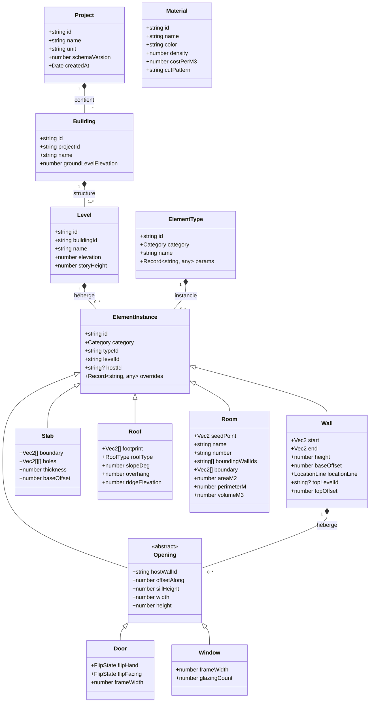

# MODÈLE DE DOMAINE BIM — MINI-BIM

**Statut :** Spécification Métier Validée  
**Date :** 13 novembre 2026  
**Auteur :** Ingénieur Principal & Architecte Logiciel

---

## 1. Principes et Structure Générale du Modèle

Le modèle de domaine de **Mini-BIM** formalise la sémantique architecturale selon les standards internationaux du BIM (ISO 16739 / IFC) tout en conservant une simplicité d'implémentation maximale adaptée à un noyau modulaire en TypeScript.

### 1.1 Séparation Type / Instance

Le modèle applique rigoureusement le modèle fondamental de Revit et de l'IFC :

- **`ElementType` (Définition partagée) :** Décrit la nature constructive réutilisable d'un objet (ex: « Mur Porteur Parpaing 200 + ITE 140 », « Porte Bois Isoplane 830×2040 »), sa composition multicouche, ses dimensions par défaut et ses propriétés physiques/matériaux.
- **`ElementInstance` (Occurrence physique) :** Représente l'objet unique placé dans le bâtiment, avec sa localisation spatiale (points de départ et de fin, niveau de rattachement, décalages), son hôte éventuel, et d'éventuelles surcharges de paramètres.

### 1.2 Hiérarchie Spatiale de Contention

La structure spatiale est stricte et hiérarchisée :
$$\text{Project} \longrightarrow \text{Building} \longrightarrow \text{Level} \longrightarrow \text{ElementInstance}$$

---

## 2. Inventaire et Justification des Entités

Chaque entité du modèle répond à un besoin fonctionnel et technique précis :

---

## 3. Spécification Détaillée des Entités

### 3.1 `Project` (Projet Global)

- **Raison d'être :** Racine unique du document BIM, identité globale et métadonnées du fichier.
- **Propriétés :**
  - `id: string` (ULID unique).
  - `name: string` (Ex: "Pavillon Résidentiel R+1").
  - `unit: 'mm'` (Unité interne universelle float64).
  - `schemaVersion: number` (Entier incrémental, actuellement `1`).
  - `createdAt: string`, `updatedAt: string` (Timestamps ISO).
- **Invariants :** L'unité interne est invariablement `mm`. Le schéma version doit correspondre à la version supportée ou déclencher une migration.

### 3.2 `Building` (Bâtiment)

- **Raison d'être :** Représente l'édifice physique. Permet de séparer plusieurs corps de bâtiment sur un même site et d'ancrer le système d'élévation générale.
- **Propriétés :**
  - `id: string` (ULID).
  - `projectId: string` (Clé étrangère vers `Project`).
  - `name: string` (Ex: "Bâtiment Principal").
  - `groundElevation: number` (Altitude de référence en mm, ex: 0 ou NGF).
- **Invariants :** Au moins un `Building` par projet.

### 3.3 `Level` (Niveau d'Étage)

- **Raison d'être :** Plan horizontal de référence infini servant de repère altimétrique pour l'accrochage vertical des murs, dalles et toitures.
- **Propriétés :**
  - `id: string` (ULID).
  - `buildingId: string` (Clé étrangère vers `Building`).
  - `name: string` (Ex: "RDC", "R+1", "Combles").
  - `elevation: number` (Altimétrie en mm par rapport au sol du bâtiment).
  - `storyHeight: number` (Hauteur libre par défaut vers le niveau supérieur, ex: 2800 mm).
- **Invariants :**
  - Deux niveaux d'un même bâtiment ne peuvent avoir la même altitude (`elevation` unique).
  - La modification de l'`elevation` d'un niveau déplace automatiquement tous les éléments rattachés sans altérer leur géométrie intrinsèque.

### 3.4 `Material` (Matériau Constructif)

- **Raison d'être :** Définit les propriétés physiques, visuelles et économiques des composants (béton, brique, plâtre, isolant, verre).
- **Propriétés :**
  - `id: string` (ULID).
  - `name: string`.
  - `color: string` (Code hexadécimal pour l'affichage 3D).
  - `density: number` (Masse volumique en $\text{kg/m}^3$).
  - `costPerM3: number` (Prix unitaire pour estimation budgétaire).
  - `cutPattern: string` (Identifiant du motif de hachure 2D en coupe).
- **Invariants :** `density >= 0`, `costPerM3 >= 0`.

### 3.5 `ElementType` & `WallType` (Types d'Éléments et de Murs)

- **Raison d'être :** Modélise la composition constructive réutilisable.
- **Propriétés de `WallType` :**
  - `id: string` (ULID).
  - `category: 'wall'`.
  - `name: string` (Ex: "Mur Extérieur 300mm").
  - `layers: Layer[]` :
    - `materialId: string` (Référence vers `Material`).
    - `thickness: number` (Épaisseur de la couche en mm > 0).
    - `function: 'structure' | 'insulation' | 'finish'`.
  - `totalThickness: number` (Somme dérivée des épaisseurs des couches).
- **Invariants :** Au moins une couche structurelle. Épaisseur totale strictement positive ($> 0$).

### 3.6 `Wall` (Mur Paramétrique)

- **Raison d'être :** Élément architectural linéaire vertical délimitant l'espace et portant les ouvertures.
- **Propriétés :**
  - `id: string` (ULID).
  - `category: 'wall'`.
  - `typeId: string` (Référence vers `WallType`).
  - `levelId: string` (Niveau de base).
  - `start: Vec2` (Point de départ $[x, y]$ en mm).
  - `end: Vec2` (Point d'arrivée $[x, y]$ en mm).
  - `height: number` (Hauteur en mm, ex: 2800).
  - `baseOffset: number` (Décalage vertical par rapport au niveau, ex: 0).
  - `topLevelId?: string` (Niveau supérieur pour contrainte d'attache automatique).
  - `topOffset?: number` (Décalage par rapport au niveau supérieur).
  - `locationLine: 'center' | 'exterior' | 'interior'` (Ligne de repère de justification de l'axe).
- **Invariants :**
  - Longueur $\text{dist}(start, end) \ge \text{MIN\_WALL\_LENGTH}$ (50 mm). Les murs de longueur nulle sont interdits.
  - Hauteur $height > 0$.

### 3.7 `Opening`, `Door` & `Window` (Ouvertures Hébergées)

- **Raison d'être :** Éléments fonctionnels de passage ou de lumière qui percent obligatoirement un mur porteur.
- **Propriétés de `Opening` (Abstraite) :**
  - `id: string` (ULID).
  - `hostWallId: string` (Référence obligatoire vers le mur hôte).
  - `offsetAlong: number` (Abscisse curviligne en mm le long de l'axe du mur hôte).
  - `sillHeight: number` (Hauteur d'allège par rapport à la base du mur ; 0 pour une porte standard).
  - `width: number` (Largeur de découpe en mm).
  - `height: number` (Hauteur de découpe en mm).
- **Propriétés spécifiques de `Door` :**
  - `flipHand: boolean` (Inversion gauche/droite du vantail).
  - `flipFacing: boolean` (Inversion intérieur/extérieur).
- **Invariants :**
  - L'ouverture doit être géométriquement contenue dans le mur hôte :  
    $$\text{offsetAlong} \ge \text{CLEARANCE\_MARGIN}$$  
    $$\text{offsetAlong} + \text{width} \le \text{hostWall.length} - \text{CLEARANCE\_MARGIN}$$  
    $$\text{sillHeight} + \text{height} \le \text{hostWall.height}$$
  - Deux ouvertures hébergées par le même mur ne peuvent pas se chevaucher horizontalement ($\text{Interval}_1 \cap \text{Interval}_2 = \emptyset$).
  - La suppression du mur hôte entraîne en cascade la suppression de toutes ses ouvertures hébergées.

### 3.8 `Slab` (Dalle / Plancher)

- **Raison d'être :** Surface horizontale structurelle fermant les niveaux par le bas ou créant les étages intermédiaires.
- **Propriétés :**
  - `id: string` (ULID).
  - `category: 'slab'`.
  - `levelId: string`.
  - `typeId: string`.
  - `boundary: Vec2[]` (Contour extérieur fermé CCW).
  - `holes: Vec2[][]` (Contours intérieurs fermés CW pour trémies d'escalier ou gaines).
  - `thickness: number` (Épaisseur en mm, orientée vers le bas par rapport à l'élévation du niveau).
  - `baseOffset: number`.
- **Invariants :** Le contour extérieur doit être simple (sans auto-intersection) et non dégénéré ($\text{Aire} > 0,1 \text{ m}^2$). Les trous doivent être strictement inclus dans le contour extérieur.

### 3.9 `Roof` (Toiture)

- **Raison d'être :** Clôture supérieure du bâtiment assurant la protection aux intempéries.
- **Propriétés (MVP : Toit plat ou 2 pans) :**
  - `id: string` (ULID).
  - `category: 'roof'`.
  - `levelId: string`.
  - `footprint: Vec2[]` (Emprise au sol polygonale).
  - `roofType: 'flat' | 'gable'` (Toit plat ou toit à deux pans).
  - `slopeDeg: number` (Pente en degrés, ex: 35°).
  - `overhang: number` (Débord de toit en mm, ex: 300).
  - `ridgeAxisAngleDeg: number` (Orientation de l'axe de faîtage pour le toit à deux pans).
- **Invariants :** Pente comprise entre $0^\circ$ (plat) et $60^\circ$.

### 3.10 `Room` (Pièce / Espace Dérivé)

- **Raison d'être :** Entité spatiale calculée représentant un volume intérieur délimité par des murs (séjour, chambre, cuisine).
- **Propriétés :**
  - `id: string` (ULID stable).
  - `levelId: string`.
  - `name: string` (Ex: "Chambre 1").
  - `number: string` (Ex: "101").
  - `seedPoint: Vec2` (Point représentatif intérieur, base de l'étiquette et de la ré-association).
  - **Propriétés calculées (Caches dérivés) :**
    - `boundary: Vec2[]` (Contour fermé du périmètre intérieur).
    - `boundingWallIds: string[]` (Liste des identifiants des murs formant la frontière).
    - `areaM2: number` (Surface habitable nette en $\text{m}^2$).
    - `perimeterM: number` (Périmètre net en mètres).
    - `volumeM3: number` (Volume net calculé avec la hauteur sous plafond).
- **Invariants :** Si les murs bougent, l'identité (`id`, `name`, `number`) est préservée tant que le `seedPoint` reste à l'intérieur du polygone reconstruit. Si la pièce n'est plus fermée (« fuite »), son statut passe à `unclosed` et la surface devient indéterminée.

---

## 4. Relations et Règles de Cascade

| Action                       | Cible      | Effet en Cascade                                                                                                                                                                                    |
| :--------------------------- | :--------- | :-------------------------------------------------------------------------------------------------------------------------------------------------------------------------------------------------- |
| **Suppression**              | `Level`    | Supprime ou détache tous les murs, dalles et pièces associés (avec invite de confirmation).                                                                                                         |
| **Déplacement altimétrique** | `Level`    | Déplace la coordonnée $Z$ de tous les éléments rattachés. Les hauteurs de murs contraints entre deux niveaux sont recalculées.                                                                      |
| **Suppression**              | `Wall`     | 1. Supprime toutes les `Door` et `Window` hébergées. 2. Invalide les jonctions avec les murs connectés. 3. Déclenche le recalcul des pièces adjacentes.                                       |
| **Déplacement**              | `Wall`     | 1. Met à jour les coordonnées spatiales des portes et fenêtres hébergées. 2. Recalcule les onglets d'extrémité des murs voisins. 3. Recalcule le contour et la surface des pièces délimitées. |
| **Modification Type**        | `WallType` | Tous les murs instanciant ce type héritent immédiatement de la nouvelle épaisseur et des couches sans modifier leur axe.                                                                            |
