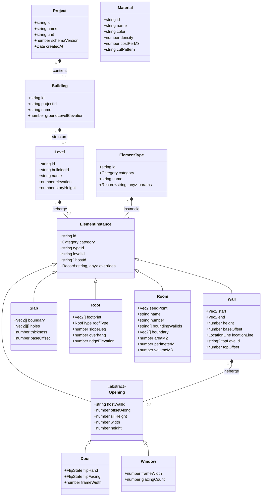

# MODÈLE DE DOMAINE BIM — MINI-BIM

**Statut :** Spécification Métier Validée  
**Date :** 13 novembre 2026  
**Auteur :** Ingénieur Principal & Architecte Logiciel

---

## 1. Principes et Structure Générale du Modèle

Le modèle de domaine de **Mini-BIM** formalise la sémantique architecturale selon les standards internationaux du BIM (ISO 16739 / IFC) tout en conservant une simplicité d'implémentation maximale adaptée à un noyau modulaire en TypeScript.

### 1.1 Séparation Type / Instance

Le modèle applique rigoureusement le modèle fondamental de Revit et de l'IFC :

- **`ElementType` (Définition partagée) :** Décrit la nature constructive réutilisable d'un objet (ex: « Mur Porteur Parpaing 200 + ITE 140 », « Porte Bois Isoplane 830×2040 »), sa composition multicouche, ses dimensions par défaut et ses propriétés physiques/matériaux.
- **`ElementInstance` (Occurrence physique) :** Représente l'objet unique placé dans le bâtiment, avec sa localisation spatiale (points de départ et de fin, niveau de rattachement, décalages), son hôte éventuel, et d'éventuelles surcharges de paramètres.

### 1.2 Hiérarchie Spatiale de Contention

La structure spatiale est stricte et hiérarchisée :
$$\text{Project} \longrightarrow \text{Building} \longrightarrow \text{Level} \longrightarrow \text{ElementInstance}$$

---

## 2. Inventaire et Justification des Entités

Chaque entité du modèle répond à un besoin fonctionnel et technique précis :

---

## 3. Spécification Détaillée des Entités

> [!NOTE]
> En Phase 7 (schéma `BimState` v2), `Project` et `Building` sont traités comme des singletons implicites ancrés dans le document (`BimDocument`) et matérialisés dans la hiérarchie spatiale IFC (`IfcProject` -> `IfcSite` -> `IfcBuilding`). La gestion d'une arborescence multi-bâtiments explicite dans l'UI et le state est différée à la Saison 3.

### 3.1 `Project` (Projet Global)

- **Raison d'être :** Racine unique du document BIM, identité globale et métadonnées du fichier.
- **Propriétés :**
  - `id: string` (ULID unique).
  - `name: string` (Ex: "Pavillon Résidentiel R+1").
  - `unit: 'mm'` (Unité interne universelle float64).
  - `schemaVersion: number` (Entier incrémental, actuellement `1`).
  - `createdAt: string`, `updatedAt: string` (Timestamps ISO).
- **Invariants :** L'unité interne est invariablement `mm`. Le schéma version doit correspondre à la version supportée ou déclencher une migration.

### 3.2 `Building` (Bâtiment)

- **Raison d'être :** Représente l'édifice physique. Permet de séparer plusieurs corps de bâtiment sur un même site et d'ancrer le système d'élévation générale.
- **Propriétés :**
  - `id: string` (ULID).
  - `projectId: string` (Clé étrangère vers `Project`).
  - `name: string` (Ex: "Bâtiment Principal").
  - `groundElevation: number` (Altitude de référence en mm, ex: 0 ou NGF).
- **Invariants :** Au moins un `Building` par projet.

### 3.3 `Level` (Niveau d'Étage)

- **Raison d'être :** Plan horizontal de référence infini servant de repère altimétrique pour l'accrochage vertical des murs, dalles et toitures.
- **Propriétés :**
  - `id: string` (ULID).
  - `buildingId: string` (Clé étrangère vers `Building`).
  - `name: string` (Ex: "RDC", "R+1", "Combles").
  - `elevation: number` (Altimétrie en mm par rapport au sol du bâtiment).
  - `storyHeight: number` (Hauteur libre par défaut vers le niveau supérieur, ex: 2800 mm).
- **Invariants :**
  - Deux niveaux d'un même bâtiment ne peuvent avoir la même altitude (`elevation` unique).
  - La modification de l'`elevation` d'un niveau déplace automatiquement tous les éléments rattachés sans altérer leur géométrie intrinsèque.

### 3.4 `Material` (Matériau Constructif)

- **Raison d'être :** Définit les propriétés physiques, visuelles et économiques des composants (béton, brique, plâtre, isolant, verre).
- **Propriétés :**
  - `id: string` (ULID).
  - `name: string`.
  - `color: string` (Code hexadécimal pour l'affichage 3D).
  - `density: number` (Masse volumique en $\text{kg/m}^3$).
  - `costPerM3: number` (Prix unitaire pour estimation budgétaire).
  - `cutPattern: string` (Identifiant du motif de hachure 2D en coupe).
- **Invariants :** `density >= 0`, `costPerM3 >= 0`.

### 3.5 `ElementType` & `WallType` (Types d'Éléments et de Murs)

- **Raison d'être :** Modélise la composition constructive réutilisable.
- **Propriétés de `WallType` :**
  - `id: string` (ULID).
  - `category: 'wall'`.
  - `name: string` (Ex: "Mur Extérieur 300mm").
  - `layers: Layer[]` :
    - `materialId: string` (Référence vers `Material`).
    - `thickness: number` (Épaisseur de la couche en mm > 0).
    - `function: 'structure' | 'insulation' | 'finish'`.
  - `totalThickness: number` (Somme dérivée des épaisseurs des couches).
- **Invariants :** Au moins une couche structurelle. Épaisseur totale strictement positive ($> 0$).

### 3.6 `Wall` (Mur Paramétrique)

- **Raison d'être :** Élément architectural linéaire vertical délimitant l'espace et portant les ouvertures.
- **Propriétés (Schéma v2 / ADR-045 / ADR-053) :**
  - `id: string` (ULID).
  - `category: 'wall'`.
  - `typeId: string` (Référence vers `WallType`).
  - `levelId: string` (Niveau de base).
  - `start: Vec2` (Point de départ $[x, y]$ en mm).
  - `end: Vec2` (Point d'arrivée $[x, y]$ en mm).
  - `baseOffset?: number` (Décalage vertical par rapport au niveau, ex: 0).
  - `heightOverride?: number` (Hauteur fixe explicite en mm, court-circuitant la contrainte supérieure).
  - `topConstraint?: WallTopConstraint` (Contrainte vers un niveau ou une toiture sous-jacente).
  - `isExternal?: boolean` (Surcharge d'appartenance à l'enveloppe extérieure, sinon héritée du type).
  - `loadBearing?: boolean` (Surcharge de fonction porteuse, sinon héritée du type).
- **Invariants :**
  - Longueur $\text{dist}(start, end) > 0$.
  - Hauteur effective $\ge 0$.

### 3.7 `Door` & `Window` (Ouvertures Hébergées — Schéma v2)

- **Raison d'être :** Éléments fonctionnels de passage ou de lumière perçant un mur hôte.
- **Propriétés communes (`OpeningBase`) :**
  - `id: string` (ULID).
  - `hostWallId: string` (Référence obligatoire vers le mur hôte).
  - `offsetAlong: number` (Distance le long de l'axe du mur hôte depuis `wall.start`).
- **Propriétés spécifiques de `Door` (Schéma v2 / ADR-042) :**
  - `category: 'door'`.
  - `doorTypeId: string` (Référence vers `DoorType` portant `width` et `height`).
  - `swing: { side: 'left' | 'right', direction: 'in' | 'out' }` (Orientation normalisée du battement).
- **Propriétés spécifiques de `Window` (Schéma v2 / ADR-042) :**
  - `category: 'window'`.
  - `windowTypeId: string` (Référence vers `WindowType` portant `width`, `height`, `defaultSillHeight`).
  - `sillHeight: number` (Hauteur d'allège propre à l'instance).
- **Invariants :**
  - L'ouverture doit être géométriquement contenue dans le mur hôte sans dépasser de ses extrémités ni de sa hauteur libre locale.
  - Deux ouvertures sur le même mur ne peuvent se chevaucher horizontalement ($\text{distance} \ge \text{MIN\_OPENING\_CLEARANCE} = 50\text{ mm}$).

### 3.8 `Slab` (Dalle Structurelle — Schéma v2)

- **Propriétés :**
  - `id: string` (ULID).
  - `category: 'slab'`.
  - `levelId: string`.
  - `slabTypeId: string`.
  - `boundary: Vec2[]` (Contour extérieur fermé).
  - `holes: Vec2[][]` (Contours intérieurs fermés pour trémies ou gaines).
  - `openings?: SlabOpening[]` (Réservations associées).
  - `baseOffset?: number`.

### 3.9 `Stair` (Escalier Paramétrique — ADR-048)

- **Propriétés :**
  - `id: string` (ULID).
  - `category: 'stair'`.
  - `stairTypeId: string`.
  - `bottomLevelId: string`.
  - `topLevelId: string`.
  - `start: Vec2`.
  - `end: Vec2`.

### 3.10 `Roof` (Toiture — ADR-053)

- **Propriétés :**
  - `id: string` (ULID).
  - `category: 'roof'`.
  - `roofTypeId: string`.
  - `levelId: string`.
  - `boundary: Vec2[]` (Polygone fermé d'emprise).
  - `gableEdgeIndex?: number` (Indice de l'arête de référence pour toiture à 2 pans).

### 3.11 `Component` (Composants & Mobilier — Phase 8)

- **Propriétés :**
  - `id: string` (ULID).
  - `category: 'component'`.
  - `typeId: string` (Référence vers `ComponentType`).
  - `levelId: string`.
  - `placement: ComponentPlacement` ($x, y$, rotation, élévation, mur hôte optionnel).
  - `dimensions?: ComponentDimensionsOverride` (Surcharges dimensionnelles d'occurrence).

### 3.10 `Room` (Pièce / Espace Dérivé)

- **Raison d'être :** Entité spatiale calculée représentant un volume intérieur délimité par des murs (séjour, chambre, cuisine).
- **Propriétés :**
  - `id: string` (ULID stable).
  - `levelId: string`.
  - `name: string` (Ex: "Chambre 1").
  - `number: string` (Ex: "101").
  - `seedPoint: Vec2` (Point représentatif intérieur, base de l'étiquette et de la ré-association).
  - **Propriétés calculées (Caches dérivés) :**
    - `boundary: Vec2[]` (Contour fermé du périmètre intérieur).
    - `boundingWallIds: string[]` (Liste des identifiants des murs formant la frontière).
    - `areaM2: number` (Surface habitable nette en $\text{m}^2$).
    - `perimeterM: number` (Périmètre net en mètres).
    - `volumeM3: number` (Volume net calculé avec la hauteur sous plafond).
- **Invariants :** Si les murs bougent, l'identité (`id`, `name`, `number`) est préservée tant que le `seedPoint` reste à l'intérieur du polygone reconstruit. Si la pièce n'est plus fermée (« fuite »), son statut passe à `unclosed` et la surface devient indéterminée.

---

## 4. Relations et Règles de Cascade

| Action                       | Cible      | Effet en Cascade                                                                                                                                                                                    |
| :--------------------------- | :--------- | :-------------------------------------------------------------------------------------------------------------------------------------------------------------------------------------------------- |
| **Suppression**              | `Level`    | Supprime ou détache tous les murs, dalles et pièces associés (avec invite de confirmation).                                                                                                         |
| **Déplacement altimétrique** | `Level`    | Déplace la coordonnée $Z$ de tous les éléments rattachés. Les hauteurs de murs contraints entre deux niveaux sont recalculées.                                                                      |
| **Suppression**              | `Wall`     | 1. Supprime toutes les `Door` et `Window` hébergées. 2. Invalide les jonctions avec les murs connectés. 3. Déclenche le recalcul des pièces adjacentes.                                       |
| **Déplacement**              | `Wall`     | 1. Met à jour les coordonnées spatiales des portes et fenêtres hébergées. 2. Recalcule les onglets d'extrémité des murs voisins. 3. Recalcule le contour et la surface des pièces délimitées. |
| **Modification Type**        | `WallType` | Tous les murs instanciant ce type héritent immédiatement de la nouvelle épaisseur et des couches sans modifier leur axe.                                                                            |
