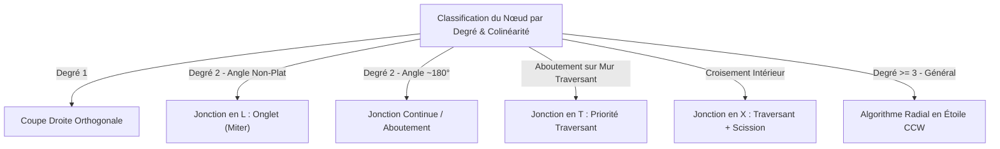
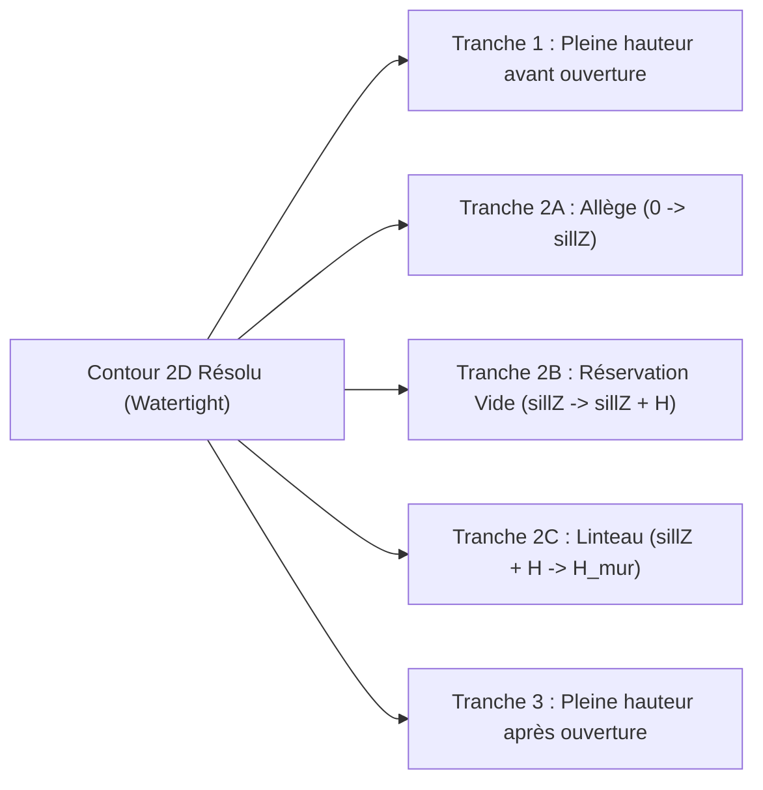

# SPÉCIFICATION GÉOMÉTRIQUE ET ALGORITHMIQUE — MINI-BIM

**Statut :** Spécification Technique Validée  
**Date :** 13 novembre 2026  
**Auteur :** Ingénieur Principal & Spécialiste Géométrie Computationnelle

---

## 1. Conventions, Repères et Cadre Numérique

### 1.1 Unités et Représentation Numérique

- **Unité interne unique :** Millimètres (`mm`).
- **Précision :** Nombres flottants 64 bits (`number` / standard IEEE 754 double précision, 53 bits de mantisse).
- **Angles internes :** Radians (conversions en degrés uniquement dans l'interface utilisateur).

### 1.2 Hiérarchie Stricte des Tolérances et Justifications Mathématiques

Une erreur classique en CAO consiste à confondre le zéro machine, le seuil de coïncidence géométrique et la tolérance de capture topologique. Le moteur géométrique sépare rigoureusement ces quatre niveaux :

```ts
export const GEOM_CONFIG = {
  // 1. Tolérance arithmétique flottante (adimensionnelle / calculatoire)
  EPSILON_NUMERICAL: 1e-9,

  // 2. Tolérance de coïncidence géométrique continue (en millimètres)
  EPSILON_DISTANCE: 1e-4, // 0.1 micron (0.0001 mm)

  // 3. Tolérance angulaire de colinéarité / parallélisme (en radians)
  EPSILON_COLLINEAR: 1e-6, // ~0.000057°

  // 4. Tolérances métier et architecturales (au niveau domaine / application)
  VERTEX_MERGE_TOLERANCE: 1.0, // mm (utilisé uniquement au niveau du graphe topologique)
  MIN_WALL_LENGTH: 50.0, // mm (longueur minimale constructive d'un mur)
  MIN_OPENING_CLEARANCE: 50.0, // mm (distance minimale ouverture - extrémité de mur)
  MITER_LIMIT_RATIO: 4.0, // rapport miter max avant biseau (~28.96°)
  MIN_ROOM_AREA: 20_000.0, // mm² (0.02 m², seuil de détection des pièces)
} as const;
```

#### Justification Mathématique de `EPSILON_DISTANCE = 1e-4 mm` (0.1 micron)

- En IEEE 754 float64, pour des coordonnées de bâtiment allant jusqu'à $10^6\text{ mm}$ (1 kilomètre), l'espacement entre deux flottants successifs ($ULP$) vaut environ $10^6 \times 2.22 \times 10^{-16} \approx 2.22 \times 10^{-10}\text{ mm}$.
- Le seuil de $10^{-4}\text{ mm}$ ($100\text{ nm}$) est situé **$450\,000$ fois au-dessus du bruit d'arrondi machine**, ce qui élimine toute instabilité numérique due à l'annulation catastrophique.
- Parallèlement, $10^{-4}\text{ mm}$ est **$1\,000$ fois plus précis que le dixième de millimètre** ($0.1\text{ mm}$), qui est la tolérance physique la plus fine de l'industrie du bâtiment. Cela garantit qu'aucun point distinct constructif n'est confondu à tort.

#### Proscription Formelle de l'Arrondi Systématique à 1 mm dans `@mini-bim/geometry`

- **Démonstration de la défaillance de l'arrondi prématuré :**  
  Considérons un mur orienté à $45^\circ$ d'épaisseur $200\text{ mm}$. Le demi-décalage normal exact vaut $(-100 \sin 45^\circ, 100 \cos 45^\circ) \approx (-70.710678..., 70.710678...)$.  
  Si ces coordonnées sont arrondies à $(-71, 71)$, l'épaisseur calculée devient $2 \times \sqrt{71^2 + 71^2} \approx 200.818\text{ mm}$, soit une distorsion de **$+0.82\text{ mm}$** sur l'épaisseur du mur.  
  Pour deux segments sécants avec un angle aigu ($5^\circ$), arrondir les sommets au millimètre entier peut déplacer leur point d'intersection calculé de **plusieurs centimètres**, voire intervertir l'ordre topologique de points voisins !
- **Règle absolue :** Toutes les opérations du package `@mini-bim/geometry` opèrent en espace continu `float64` sans aucune quantification. L'arrondi au millimètre est réservé exclusivement à l'affichage dans l'UI ou à la quantification interne requise par des moteurs booléens spécifiques (comme Clipper2 avec scaling entier).

#### Rôle et Isolement de `VERTEX_MERGE_TOLERANCE = 1.0 mm`

- `VERTEX_MERGE_TOLERANCE` n'est **jamais** utilisé dans les calculs vectoriels bas niveau de `@mini-bim/geometry`.
- Ce seuil est réservé à la couche applicative (`@mini-bim/core` / `BimDocument`) pour regrouper les extrémités de murs dessinées à la souris au sein d'un même nœud topologique. Appliquer $1\text{ mm}$ au niveau vectoriel pur déformerait les angles des petits segments (sur un mur de $50\text{ mm}$, une variation de $1\text{ mm}$ génère un écart angulaire de $\arcsin(1/50) \approx 1.15^\circ$).

### 1.3 Repères et Transformations

- **Repère Monde BIM :** Repère cartésien direct (Main Droite) :
  - $+X$ = Est / Droite
  - $+Y$ = Nord / Profondeur
  - $+Z$ = Haut (Verticale gravitationnelle)
- **Repère Three.js :** Repère $Y$-Up standard :
  - $+X$ = Droite
  - $+Y$ = Haut
  - $+Z$ = Vers l'observateur
- **Matrice de Passage BIM $\to$ Three.js :**
  Pour afficher le modèle sans réécrire les buffers de coordonnées, la scène Three.js accueille un nœud racine `modelRoot` configuré par :
  $$R_x(-\pi/2) = \begin{pmatrix} 1 & 0 & 0 \\ 0 & 0 & 1 \\ 0 & -1 & 0 \end{pmatrix}, \quad S = \begin{pmatrix} 10^{-3} & 0 & 0 \\ 0 & 10^{-3} & 0 \\ 0 & 0 & 10^{-3} \end{pmatrix}$$
  Tout point $(X, Y, Z)$ en millimètres devient un point $(X/1000, Z/1000, -Y/1000)$ en mètres dans Three.js. La parité du repère direct est conservée sans inversion de normale.

- **Repère 2D Plan (HTML5 Canvas) :**
  - Axe $X$ écran = $+X$ monde.
  - Axe $Y$ écran = $-Y$ monde (inversion verticale du plan de vue Canvas).
  - Transformation de vue : $(u, v) = (s \cdot (X - c_x) + w/2, \; -s \cdot (Y - c_y) + h/2)$ où $s$ est le facteur de zoom et $(c_x, c_y)$ le centre de la vue.

### 1.3 Conventions de Polygones

- **Orientation extérieure :** Sens trigonométrique anti-horaire (**CCW** - Counter-Clockwise).
- **Orientation des trous intérieurs :** Sens horaire (**CW** - Clockwise).
- **Aire signée (Formule du lacet de Gauss) :**
  $$A_{\text{signée}} = \frac{1}{2} \sum_{i=0}^{n-1} (x_i y_{i+1} - x_{i+1} y_i), \quad \text{avec } (x_n, y_n) = (x_0, y_0)$$
  - Si $A_{\text{signée}} > 0 \implies \text{CCW}$ (contour extérieur).
  - Si $A_{\text{signée}} < 0 \implies \text{CW}$ (trou intérieur).

---

## 2. Géométrie 2D Fondamentale et Algorithmique Linéaire

### 2.1 Algèbre Vectorielle 2D (`Vec2`)

Un vecteur $\vec{v} \in \mathbb{R}^2$ est représenté par l'interface immuable `{ readonly x: number, readonly y: number }`.
Pour deux vecteurs $\vec{a} = (a_x, a_y)$ et $\vec{b} = (b_x, b_y)$ :

- Addition : $\vec{a} + \vec{b} = (a_x + b_x, a_y + b_y)$
- Soustraction : $\vec{a} - \vec{b} = (a_x - b_x, a_y - b_y)$
- Multiplication scalaire : $k \vec{a} = (k a_x, k a_y)$
- Produit scalaire : $\vec{a} \cdot \vec{b} = a_x b_x + a_y b_y$
- Produit vectoriel 2D (déterminant) : $\vec{a} \times \vec{b} = a_x b_y - a_y b_x$
- Norme au carré : $\|\vec{a}\|^2 = a_x^2 + a_y^2$
- Norme euclidienne : $\|\vec{a}\| = \sqrt{a_x^2 + a_y^2}$
- Distance entre points : $\text{dist}(A, B) = \|B - A\|$
- Normale unitaire gauche (rotation $+90^\circ$ directe) :
  $$\vec{n}_{\text{gauche}} = \left(-\frac{d_y}{\|\vec{d}\|}, \frac{d_x}{\|\vec{d}\|}\right), \quad \text{avec } \vec{d} = B - A$$

#### Gestion Rigoureuse des Vecteurs Nuls et Entrées Invalides

1. **Normalisation de vecteur nul :** Si $\|\vec{v}\| \le \text{EPSILON\_NUMERICAL}$, la fonction `normalize(v)` retourne de façon déterministe le vecteur nul `{ x: 0, y: 0 }` sans lancer d'exception et sans générer de valeurs `NaN` ou `Infinity`.
2. **Perpendiculaire de vecteur nul :** `perp(v)` retourne `{ x: -v.y, v.x }` ; pour `{ x: 0, y: 0 }`, le résultat est `{ x: 0, y: 0 }`.
3. **Protection contre `NaN` / `Infinity` :** Toute fonction vectorielle recevant des composantes non finies lève une erreur explicite ou propage un résultat sécurisé identifiable.

---

### 2.2 Géométrie Linéaire : Droites et Segments

Une droite infinie est paramétrée par un point d'ancrage $P$ et un vecteur directeur $\vec{d}$ : $L(t) = P + t \vec{d}$.  
Un segment fini est délimité par ses deux extrémités $A$ et $B$ : $S(t) = A + t (B - A)$ avec $t \in [0, 1]$.

#### A. Parallélisme et Colinéarité

Soient deux directions $\vec{r}$ et $\vec{s}$ :

- **Parallélisme :** Les droites/segments sont dits parallèles si le sinus de leur angle est nul :
  $$|\vec{r} \times \vec{s}| \le \text{EPSILON\_NUMERICAL} \cdot (\|\vec{r}\| \cdot \|\vec{s}\|)$$
- **Colinéarité :** Deux droites/segments sont colinéaires s'ils sont parallèles ET que le vecteur reliant leurs origines est colinéaire à leur direction :
  $$|\vec{r} \times \vec{s}| \le \text{tolérance} \quad \text{ET} \quad |(Q - P) \times \vec{r}| \le \text{tolérance}$$

#### B. Typage Explicite des Résultats d'Intersection de Droites

L'intersection de deux droites $L_1(P, \vec{r})$ et $L_2(Q, \vec{s})$ ne renvoie pas un type optionnel ambigu, mais un type discriminé :

```ts
export type LineIntersectionResult =
  | { readonly type: 'point'; readonly point: Vec2; readonly t: number; readonly u: number }
  | { readonly type: 'parallel' }
  | { readonly type: 'collinear' }
  | { readonly type: 'degenerate'; readonly reason: 'line1_zero' | 'line2_zero' | 'both_zero' };
```

- Si $\|\vec{r}\| \le \epsilon$ ou $\|\vec{s}\| \le \epsilon \implies$ `type: 'degenerate'`.
- Si droites colinéaires $\implies$ `type: 'collinear'`.
- Si droites parallèles disjointes $\implies$ `type: 'parallel'`.
- Si droites sécantes $\implies$ `type: 'point'` avec calcul exact :
  $$t = \frac{(Q - P) \times \vec{s}}{\vec{r} \times \vec{s}}, \quad u = \frac{(Q - P) \times \vec{r}}{\vec{r} \times \vec{s}}, \quad I = P + t \vec{r}$$

#### C. Typage Explicite des Résultats d'Intersection de Segments

L'intersection de deux segments $S_1[A, B]$ et $S_2[C, D]$ couvre exhaustivement tous les cas géométriques :

```ts
export type SegmentIntersectionResult =
  | { readonly type: 'point'; readonly point: Vec2; readonly t: number; readonly u: number }
  | { readonly type: 'none' }
  | {
      readonly type: 'overlap';
      readonly segment: readonly [Vec2, Vec2]; // sous-segment de chevauchement [start, end]
      readonly tRange: readonly [number, number]; // intervalle [t_min, t_max] sur S1
      readonly uRange: readonly [number, number]; // intervalle [u_min, u_max] sur S2
    }
  | {
      readonly type: 'degenerate';
      readonly reason: 'segment1_zero' | 'segment2_zero' | 'both_zero';
    };
```

##### Algorithme de Résolution des Segments :

1. **Détection de dégénérescence :** Si $\|B - A\| \le \text{EPSILON\_DISTANCE}$ ou $\|D - C\| \le \text{EPSILON\_DISTANCE}$, classifier en `degenerate`.
2. **Cas non parallèle ($|\vec{r} \times \vec{s}| > \text{EPSILON\_COLLINEAR}$) :**
   Calculer $t$ et $u$. L'intersection existe si et seulement si :
   $$-\text{EPSILON\_PARAM} \le t \le 1 + \text{EPSILON\_PARAM} \quad \text{ET} \quad -\text{EPSILON\_PARAM} \le u \le 1 + \text{EPSILON\_PARAM}$$
   (avec $\text{EPSILON\_PARAM} = \text{EPSILON\_DISTANCE} / \text{longueur}$).  
   Si les conditions sont satisfaites, clamper $t, u$ dans $[0, 1]$ et renvoyer `point`. Sinon, renvoyer `none`.
3. **Cas colinéaire :**
   Projeter le segment $S_2[C, D]$ sur l'axe de $S_1[A, B]$ :
   $$t_C = \frac{(C - A) \cdot \vec{r}}{\|\vec{r}\|^2}, \quad t_D = \frac{(D - A) \cdot \vec{r}}{\|\vec{r}\|^2}$$
   L'intervalle couvert sur $S_1$ par $S_2$ est $[\min(t_C, t_D), \max(t_C, t_D)]$.  
   L'intersection d'intervalles avec $[0, 1]$ donne $[t_{\text{start}}, t_{\text{end}}] = [\max(0, t_{\min}), \min(1, t_{\max})]$.
   - Si $t_{\text{end}} < t_{\text{start}} - \epsilon \implies$ `none` (colinéaires disjoints).
   - Si $|t_{\text{end}} - t_{\text{start}}| \le \epsilon \implies$ `point` (contact d'extrémité en un seul point).
   - Si $t_{\text{end}} > t_{\text{start}} + \epsilon \implies$ `overlap` (chevauchement colinéaire le long d'un segment fini non nul).

#### D. Projection et Distance Point-Segment

- **Projection orthogonale d'un point $P$ sur une droite $L(A, B)$ :**
  $$t = \frac{(P - A) \cdot (B - A)}{\|B - A\|^2}, \quad P_{\text{proj}} = A + t (B - A)$$
- **Distance minimale d'un point $P$ à un segment $S[A, B]$ :**
  Le paramètre est clampé à l'intervalle fermé $[0, 1]$ :
  $$t_{\text{clamped}} = \max(0, \min(1, t)), \quad P_{\text{closest}} = A + t_{\text{clamped}} (B - A)$$
  $$\text{dist}(P, S) = \|P - P_{\text{closest}}\| \ge 0$$
  Cette distance est rigoureusement positive ou nulle, continue et symétrique.

---

## 3. Modélisation et Jonctions des Murs

### 3.1 Emprise 2D d'un Mur Droit Isolé

Soit un mur d'axe $A \to B$, d'épaisseur totale $T$, et de vecteur direction unitaire $\vec{d} = (B - A) / \|B - A\|$ et normale gauche $\vec{n} = (-d_y, d_x)$.
La position de l'axe dans l'épaisseur est régie par `locationLine` :

- `center` : décalage $c = 0$
- `exterior` : décalage $c = -T/2$
- `interior` : décalage $c = +T/2$

Les faces gauche et droite sont situées aux décalages scalaires :
$$s_{\text{gauche}} = c + T/2, \quad s_{\text{droite}} = c - T/2$$

Les quatre sommets de base du rectangle d'emprise (ordonnés CCW) :
$$V_0 = A + s_{\text{droite}} \vec{n}, \quad V_1 = B + s_{\text{droite}} \vec{n}, \quad V_2 = B + s_{\text{gauche}} \vec{n}, \quad V_3 = A + s_{\text{gauche}} \vec{n}$$

```
                V3 ------------------------ V2  (Face Gauche / +n)
                   |                      |
            A =====|========== Axe =======|=====> B
                   |                      |
                V0 ------------------------ V1  (Face Droite / -n)
```

---

### 3.2 Topologie et Résolution des Jonctions de Murs

Les jonctions ne modifient pas l'axe du mur (source de vérité) mais calculent les sommets d'emprise adaptés. Un graphe de nœuds regroupe les extrémités de murs situées à moins de `VERTEX_MERGE_TOLERANCE` (1 mm).



#### A. Règle L-Join (Onglet à 2 branches)

Pour deux murs incidents au nœud $O$ de directions sortantes $\vec{v}_1, \vec{v}_2$ :

1. Calcul des bordures latérales gauche et droite via `getWallBoundaryAtEnd`.
2. Calcul de l'angle relatif $\Delta \theta = (\alpha_2 - \alpha_1) \pmod{2\pi}$ :
   - Si $\Delta \theta < \pi$ : l'angle intérieur est formé par la face gauche de $W_1$ et la face droite de $W_2$. L'angle extérieur est formé par la face droite de $W_1$ et la face gauche de $W_2$.
   - Si $\Delta \theta > \pi$ : les rôles sont inversés de façon symétrique.
3. **Contrôle de la limite d'onglet (Miter Limit) :**  
   La distance du coin extérieur à l'origine vaut $\|C - O\| = \frac{T / 2}{\sin(\theta / 2)}$.  
   Si $\|C - O\| > \text{MITER\_LIMIT\_RATIO} \cdot \max(T_1, T_2)$ (avec ratio = 4.0, angle critique $\approx 14.36^\circ$), la pointe d'onglet est biseautée déterministement pour éviter une projection disproportionnée.

#### B. Règle T-Join (Aboutement en T)

Un mur secondaire $W_{\text{stem}}$ aboutit sur la face d'un mur traversant $W_{\text{through}}$ :

1. Le mur traversant reste intact et conserve son emprise nominale.
2. Détection de la face d'impact via le produit scalaire du vecteur d'approche $\vec{u}_{\text{approach}}$ et de la normale du mur traversant $\vec{n}_{\text{through}}$ :
   - Si $\vec{u}_{\text{approach}} \cdot \vec{n}_{\text{through}} > 0 \implies$ Impact sur la **face intérieure**.
   - Si $\vec{u}_{\text{approach}} \cdot \vec{n}_{\text{through}} < 0 \implies$ Impact sur la **face extérieure**.
3. Les arêtes latérales du mur secondaire sont intersectées avec la droite infinie de la face ciblée, définissant ses deux sommets d'aboutement $[P_{\text{right}}, P_{\text{left}}]$ sans aucun vide ni chevauchement.

#### C. Règle X-Join (Croisement de deux murs)

Deux murs se croisent en un point intérieur $Q$ :

1. Le mur de priorité la plus élevée (ou le premier par ordre déterministe) reste continu.
2. Le mur secondaire est scindé en deux branches autonomes (`branchA` et `branchB`).
3. Chaque branche est raccordée sur les faces opposées du mur traversant selon la règle du T-Join. La surface de croisement est attribuée sans doublon au mur prioritaire.

#### D. Règle Colinéaire (Aboutement aligné)

Deux murs d'axes colinéaires se rejoignant bout-à-bout :

- Si même épaisseur : raccordement plat continu.
- Si épaisseurs différentes : marche orthogonale sur le plan de contact.
- Si superposition partielle : détection d'`overlap` et découpe prioritaire.

#### E. Règle Multi-Murs (Étoile / Y à $\ge 3$ branches)

Pour $m \ge 3$ murs arrivant au même nœud :

1. Tri radial des directions sortantes $\vec{v}_k$ en ordre trigonométrique (CCW).
2. Pour chaque paire consécutive $(k, k+1)$, intersection du bord gauche de $k$ avec le bord droit de $k+1$.
3. Application de la limite d'onglet sur chaque angle.
4. Attribution à chaque mur de son sommet droit et gauche, garantissant une étanchéité surfacique totale.

---

## 4. Soustraction des Ouvertures (Découpe en Tranches 2.5D)

Pour éviter les instabilités numériques et la lenteur des moteurs booléens 3D généralistes (CSG), le découpage d'ouvertures rectangulaires (portes et fenêtres) dans des murs s'effectue par **partition longitudinale en tranches 2.5D** via l'algorithme d'écrêtage de Sutherland-Hodgman.

### 4.1 Modèle de Données `OpeningInput`

Toutes les coordonnées et grandeurs physiques sont exprimées en millimètres (`float64`) dans le repère universel Z-up :

```ts
export interface OpeningInput {
  readonly id: string;
  readonly hostWallId: string;
  readonly u: number; // Abscisse du centre le long de l'axe de référence [0, L] (mm)
  readonly width: number; // Largeur nominale de baie W > 0 (mm)
  readonly height: number; // Hauteur nominale H > 0 (mm)
  readonly sillZ: number; // Hauteur d'allège depuis la base du mur (mm, >= 0)
  readonly kind: 'window' | 'door';
  readonly swing?: {
    readonly side: 'left' | 'right';
    readonly direction: 'in' | 'out';
  };
}
```

### 4.2 Pipeline Algorithmique 2.5D



1. **Tri longitudinal :** Les $k$ ouvertures du mur sont triées par abscisse de début croissante $u_{\text{start}} = u - W/2$.
2. **Écrêtage par demi-plan (Sutherland-Hodgman) :**  
   Pour chaque coordonnée de coupe $u_c$, le plan vertical perpendiculaire à l'axe $\vec{d}$ définit deux demi-plans :
   - Demi-plan aval ($u \ge u_c$) : $\{ P \in \mathbb{R}^2 \mid (P - P(u_c)) \cdot \vec{d} \ge -\epsilon \}$
   - Demi-plan amont ($u \le u_c$) : $\{ P \in \mathbb{R}^2 \mid (P - P(u_c)) \cdot (-\vec{d}) \ge -\epsilon \}$  
     où $P(u_c) = \vec{A} + u_c \vec{d}$.
3. **Partition des tranches :**
   - Tranche initiale pleine hauteur : $u \in [0, u_{\text{start}, 0}]$.
   - Pour chaque ouverture $i \in [0, k-1]$ : bande $u \in [u_{\text{start}, i}, u_{\text{end}, i}]$ partitionnée verticalement en :
     - Allège (`sill`) : si $Z_{\text{allège}} > 0$, de $Z = 0$ à $Z = Z_{\text{allège}}$.
     - Réservation vide (`void`) : de $Z = Z_{\text{allège}}$ à $Z = Z_{\text{allège}} + H$.
     - Linteau (`lintel`) : si $Z_{\text{linteau}} < H_{\text{mur}}$, de $Z = Z_{\text{linteau}}$ à $Z = H_{\text{mur}}$.
   - Tranches pleines intermédiaires : $u \in [u_{\text{end}, i}, u_{\text{start}, i+1}]$ pour chaque paire contiguë.
   - Tranche finale pleine hauteur : $u \in [u_{\text{end}, k-1}, L]$.

### 4.3 Analyse de Complexité Formelle

La complexité temporelle du partitionnement est strictement :
$$\mathcal{O}(k \cdot m)$$
où :

- $k$ est le nombre d'ouvertures hébergées par le mur hôte ($k \in [1, 10]$ en architecture usuelle).
- $m$ est le nombre de sommets du polygone résolu du mur ($m \in [4, 8]$ après résolution des jonctions en onglet/biseau).

Chaque demi-plan coupe le polygone en temps linéaire $\mathcal{O}(m)$, et le nombre total de découpes est borné par $2k$. Pour une maison individuelle, le calcul prend moins de $0.05\text{ ms}$ par mur sur un thread CPU JavaScript standard.

### 4.4 Règles de Validation et Gardes Architecturales

La fonction pure `validateOpenings` applique les règles déterministes suivantes :

1. **Garde minimale aux extrémités (`MIN_OPENING_CLEARANCE = 50.0 mm`) :**
   $$u - \frac{W}{2} \ge \text{MIN\_OPENING\_CLEARANCE}$$
   $$u + \frac{W}{2} \le L - \text{MIN\_OPENING\_CLEARANCE}$$
2. **Rejet de sévèrement de mur (`SEVERS_WALL`) :**
   - Si $W \ge L$ : l'ouverture détruit le mur.
   - Si $L < W + 2 \times \text{MIN\_OPENING\_CLEARANCE}$ : mur trop court pour accueillir la baie et ses trumeaux d'extrémité.
3. **Non-chevauchement et trumeau minimal entre baies contiguës :**
   $$u_{\text{start}, i+1} \ge u_{\text{end}, i} + \text{MIN\_OPENING\_CLEARANCE}$$
4. **Contrôle d'altitude linteau (`HEIGHT_EXCEEDS_WALL`) :**
   $$Z_{\text{allège}} \ge 0 \quad \text{et} \quad Z_{\text{allège}} + H \le H_{\text{mur}}$$

### 4.5 Cas Limites Validés

- **Ouverture adjacente à une tête en onglet à $45^\circ$ :** La tranche 1 absorbe la pointe d'onglet biseautée sans discontinuité et présente une face d'ébrasement parfaitement orthogonale à $u = 50\text{ mm}$.
- **Ouverture toute hauteur :** $Z_{\text{allège}} = 0$ et $H = H_{\text{mur}}$ $\implies$ les tranches d'allège et de linteau sont omises, seul le vide est généré.
- **Porte standard :** $Z_{\text{allège}} = 0 \implies$ allège omise, linteau conservé.
- **Conservation d'aire et de volume :**
  $$\sum \text{Volume}(\text{solides}) = \text{Volume}(\text{mur}) - \sum \text{Volume}(\text{vides}) \quad (\pm 10^{-6}\text{ mm}^3)$$

---

## 5. Algorithme de Détection Automatique des Pièces

Une pièce architecturale fermée est calculée à partir des limites de murs intérieurs et extérieurs :

### 5.1 Pipeline de Calcul

1. **Extraction des emprises de murs :** Collecte des polygones d'emprise de tous les murs du niveau (sans découpe des portes).
2. **Quantification sur grille entière :** Les coordonnées sont arrondies au millimètre entier (`Math.round`) pour éliminer les micro-fissures d'arrondi flottant.
3. **Union Booléenne 2D :** Réalisation de l'union des polygones de murs via `polygon-clipping` ou `Clipper2`.
4. **Extraction des trous intérieurs :**
   - Le résultat de l'union est un ensemble de polygones extérieurs avec trous intérieurs (`holes`).
   - Tout trou intérieur dont l'aire absolue est supérieure à $\text{MIN\_ROOM\_AREA}$ ($0,02 \text{ m}^2$) est une **pièce candidate**.
5. **Appariement avec les `Room` existantes :**
   - Pour chaque objet `Room` en base, un test de `pointInPolygon(seedPoint, hole)` est effectué.
   - Si correspondance unique : mise à jour du contour, calcul de l'aire nette, du périmètre et du volume.
   - Si aucune `Room` n'est présente dans un trou : émission d'une proposition de création automatique avec positionnement de l'étiquette au pôle d'inaccessibilité (`polylabel`).

---

## 6. Génération de Maillage et Triangulation

### 6.1 Extrusion Convexe des Tranches de Murs

Pour chaque polygone de tranche (quadrilatère convexe ordonné CCW) :

- Sommets supérieurs : $(x_i, y_i, Z_{\text{haut}})$ pour $i \in [0, n-1]$.
- Sommets inférieurs : $(x_i, y_i, Z_{\text{base}})$ pour $i \in [0, n-1]$.
- Face supérieure : triangulation en éventail avec normale $+Z$.
- Face inférieure : triangulation en éventail avec normale $-Z$.
- Faces latérales : pour chaque arête $[(x_i, y_i), (x_{i+1}, y_{i+1})]$, génération d'un quad composé de 2 triangles orientés vers l'extérieur.

### 6.2 Triangulation Concave pour Dalles et Pièces (Earcut)

Pour les polygones quelconques pouvant comporter des trémies (trous) :

- Les données sont transmises à `earcut` : coordonnées aplaties à 2 composantes $(x, y)$ et tableau d'indices de début de chaque trou.
- `earcut` génère un tableau d'indices de triangles sans aucun point d'auto-intersection.

---

## 7. Matrice des Cas Limites et Stratégie de Test

| Cas Limite                                    | Risque Algorithmique                                   | Comportement Attendu et Traitement                                            |
| :-------------------------------------------- | :----------------------------------------------------- | :---------------------------------------------------------------------------- |
| **Mur de longueur nulle ($A = B$)**           | Division par zéro dans le calcul de direction unitaire | Rejet immédiat au niveau de la commande (`dist >= 50 mm`).                    |
| **Murs colinéaires en contact ($180^\circ$)** | Déterminant nul $\vec{r} \times \vec{s} = 0$           | Détection de colinéarité ; raccord continu sans onglet.                       |
| **Angle extrêmement aigu ($< 15^\circ$)**     | Explosion de la pointe d'onglet vers l'infini          | Détection $\|C - O\| > \text{miterLimit}$ ; troncature biseautée automatique. |
| **Ouverture débordant du mur**                | Tranches négatives ou géométrie dégénérée              | Validation stricte dans la commande : marge minimale de 50 mm exigée.         |
| **Deux ouvertures superposées**               | Chevauchement d'intervalles $[u_0, u_1]$               | Rejet de la commande d'insertion si collision d'intervalle.                   |
| **Polygone de dalle auto-sécant**             | Échec de triangulation `earcut`                        | Validation par simplification polygonale avant extrusion.                     |
| **Pièce non fermée (fuite de 5 mm)**          | Aucun trou ne se forme dans l'union                    | Marquage de la pièce en statut `unclosed` ; calcul d'aire suspendu.           |

---

## 8. Spécifications de Robustesse Topologique et Clôture des Jonctions (Audit Phase 1)

À l'issue de l'audit approfondi du moteur de jonctions de murs, les règles suivantes sont intégrées à la spécification normative :

### 8.1 Invariants Topologiques Obligatoires pour Tout Polygone Résolu

Tout polygone résultant de `solveWallJunctions` doit satisfaire sans exception les critères formels suivants :

1. **Simplicité de Jordan :** Aucune paire d'arêtes non adjacentes ne doit s'intersecter ($\forall i \neq j \pm 1, S_i \cap S_j = \emptyset$).
2. **Orientation CCW Stricte :** Les sommets extérieurs doivent être ordonnés dans le sens trigonométrique anti-horaire, tel que l'aire signée soit strictement positive ($\text{signedArea}(P) > 0$).
3. **Absence d'Arêtes Dégénérées :** Toute arête dont la longueur est inférieure ou égale à $\text{EPSILON\_DISTANCE} = 10^{-4}\text{ mm}$ est éliminée par `cleanPolygon`.
4. **Conservation de Matière :** La somme des aires nettes des murs résolus doit être égale à l'aire géométrique nominale de l'enveloppe bâtie, sans vide interstitiel ni double comptage aux nœuds d'intersection.

### 8.2 Spécification de Clôture Étanche des Biseaux d'Onglet (Watertight Miter Closure)

Lorsque l'angle entre deux murs en L est inférieur au seuil d'onglet ($\theta < 28.96^\circ$ pour un ratio de 4.0), le prolongement extérieur dépasse la distance limite :
$$d_{\text{ext}} > \text{MITER\_LIMIT\_RATIO} \times \max(t_1, t_2)$$

Dans cette configuration :

- Les deux murs ne doivent pas s'arrêter indépendamment en créant un vide triangulaire.
- La surface extérieure du biseau doit être définie par un plan de coupe orthogonal à la bissectrice d'angle extérieur, positionné exactement à la distance limite de sécurité.
- Les deux polygones de murs doivent partager l'arête reliant le coin intérieur $\vec{V}_{\text{int}}$ au milieu du segment de biseau $\vec{M}_{\text{bisector}}$, assurant une étanchéité géométrique 2D parfaite (zéro fissure, zéro overlap).

### 8.3 Traitement des Cas Dégénérés Angulaires ($0^\circ$ et $180^\circ$)

- **Angle $0^\circ$ (Murs parallèles de même sens partant du même nœud) :** Détecté par $\vec{d}_1 \cdot \vec{d}_2 \ge 1 - \text{EPSILON\_COLLINEAR}$. Ce cas correspond à une superposition anormale. Le moteur doit rejeter ou fusionner selon les priorités, et ne doit jamais tenter un onglet en L qui dégénère par parallélisme des faces.
- **Angle $180^\circ$ dans les Jonctions Multiples :** Deux branches radialement consécutives à $180^\circ$ ont des lignes de bordure parallèles. Le raccord ne doit pas s'effondrer au centre du nœud, mais maintenir la face rectiligne continue.
