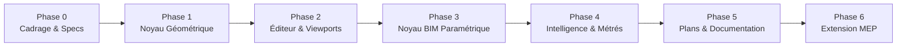

# ROADMAP DE DÉVELOPPEMENT — MINI-BIM

**Statut :** Plan Directeur Validé  
**Date :** 13 novembre 2026  
**Auteur :** Ingénieur Principal & Architecte Logiciel

---

## 1. Vue d'Ensemble des Phases

Le développement de Mini-BIM est structuré selon une progression incrémentale stricte où chaque phase produit un livrable exécutable, testé et documenté avant tout passage à la phase suivante.

---

## 2. Détail par Phase

### Phase 0 — Cadrage, Architecture et Spécifications

- **Objectif :** Poser les bases théoriques, organisationnelles et conceptuelles du projet sans dette technique.
- **Fonctionnalités :**
  - Audit complet du document initial et cadrage des risques.
  - Définition de l'architecture logicielle modulaire et des règles de dépendance.
  - Formalisation du modèle de domaine BIM complet.
  - Établissement de la spécification mathématique et géométrique.
  - Enregistrement des décisions architecturales majeures (ADR).
- **Dépendances :** Aucune.
- **Livrables :**
  - `PROJECT_AUDIT.md`
  - `ARCHITECTURE.md`
  - `DOMAIN_MODEL.md`
  - `GEOMETRY_SPEC.md`
  - `ROADMAP.md`
  - `DECISIONS.md`
- **Tests :** Revue critique contradictoire des spécifications.
- **Critères d'acceptation :**
  - [x] Périmètre MVP clairement borné (Maison individuelle R+1).
  - [x] Principes architecturaux non négociables actés.
  - [x] Absence totale de zone d'ombre sur les conventions géométriques et les tolérances.

---

### Phase 1 — Fondations Géométriques (`@mini-bim/geometry`)

- **Objectif :** Construire une bibliothèque géométrique 2D/3D autonome, ultra-rapide, sans état et couverte à 100% par des tests unitaires.
- **Fonctionnalités :**
  - Algèbre vectorielle 2D et 3D (`Vec2`, `Vec3`, matrices, boîtes englobantes).
  - Primitives : droites, segments, rayons, calculs de projection et de distance point-segment.
  - Moteur d'intersection : droite-droite, segment-segment avec gestion des cas colinéaires et parallèles.
  - Algorithmes polygonaux : calcul d'aire signée (lacet), périmètre, centroïde, orientation CCW forcée.
  - Décalages parallèles de lignes (location lines : center, exterior, interior).
  - Résolution des jonctions de murs : coupes droites, onglets biseautés (L-join avec miter limit), aboutements en T.
  - Découpage par tranches verticales 2.5D (Sutherland-Hodgman) pour soustraction d'ouvertures.
  - Algorithme d'extrusion de polygones convexes vers maillages indexés Three.js.
  - Intégration d'`earcut` pour la triangulation de polygones concaves avec trous.
- **Dépendances :** Aucune (TypeScript pur + `earcut`).
- **Livrables :** Package `@mini-bim/geometry` compilé avec déclarations TypeScript et suite de tests Vitest.
- **Tests :**
  - Tests unitaires paramétrés sur angles remarquables (90°, 45°, 30°, 10°, 179°, 180°).
  - Tests de robustesse sur cas limites : segments colinéaires, longueurs nulles, polygones dégénérés.
  - Tests d'orientation et de normales de faces extrudées.
- **Critères d'acceptation :**
  - 100% des tests unitaires géométriques au vert.
  - Zéro dépendance vers React, Three.js ou le DOM.
  - Exécution complète des tests en moins de 1 seconde.

---

### Phase 2 — Éditeur et Double Visualisation (`@mini-bim/view-2d`, `@mini-bim/view-3d`, `@mini-bim/app`)

- **Objectif :** Fournir un environnement interactif dans le navigateur permettant de tracer et manipuler des éléments géométriques dans deux vues synchronisées (2D Plan et 3D).
- **Fonctionnalités :**
  - Initialisation du monorepo pnpm avec Vite et React.
  - `Viewport3D` : scène Three.js impérative, groupe racine Z-up, caméra orbitale (`OrbitControls`), éclairage architectural et arêtes noires (`EdgesGeometry`).
  - `Viewport2D` : vue en plan Canvas 2D avec gestion fluide du zoom et du pan.
  - Bus de commandes transactionnel avec support complet d'Undo/Redo.
  - Moteur d'accrochage (`SnappingEngine`) : accrochage à la grille paramétrable, aux extrémités de segments et aux milieux.
  - Machine à états des outils de base :
    - `WallTool` : tracé de murs en direct avec aperçu fantôme temps réel.
    - `SelectTool` : sélection 2D et 3D synchronisée, surbrillance bidirectionnelle.
  - Panneau de propriétés inspectant les coordonnées et dimensions de l'élément sélectionné.
- **Dépendances :** Phase 1 (`@mini-bim/geometry`).
- **Livrables :** Application web fonctionnelle (`apps/web`), exécutable localement via `pnpm dev`.
- **Tests :**
  - Tests de régression sur les commandes (Undo/Redo ramène à l'état binaire exact).
  - Tests d'intégration sur l'accrochage géométrique.
- **Critères d'acceptation :**
  - Possibilité de tracer 4 murs formant une pièce fermée à la souris.
  - Synchronisation instantanée entre la vue 2D et la vue 3D (< 16 ms).
  - Annulation (Ctrl+Z) et rétablissement (Ctrl+Y) sans aucun effet de bord visuel.

---

### Phase 3 — Noyau BIM Paramétrique (`@mini-bim/core`, `@mini-bim/persistence`)

- **Objectif :** Transformer le système de dessin géométrique en un véritable modeleur d'objets BIM relationnel.
- **Fonctionnalités :**
  - Modèle de données complet : `Project`, `Building`, `Level`, `ElementType`, `ElementInstance`.
  - Gestionnaire de niveaux : création de niveaux (RDC, R+1), liaison altimétrique des murs (hauteur contrainte ou libre).
  - Catalogue de types de murs multicouches (`WallType` : structure, isolation, finition).
  - Hébergement d'ouvertures : outil `DoorTool` et `WindowTool`, découpage réel du mur hôte par tranches.
  - Éléments horizontaux : dalles de sol (`Slab`) extrudées depuis un contour polygonal.
  - Toitures simples (`Roof` : toit plat ou 2 pans avec pente et débord).
  - Graphe de dépendances (DAG) et moteur de régénération incrémentale (`dirty set`).
  - Persistance locale : sauvegarde/chargement au format JSON validé par schéma Zod.
- **Dépendances :** Phase 2.
- **Livrables :** Packages `@mini-bim/core` et `@mini-bim/persistence`.
- **Tests :**
  - Déplacement d'un mur hôte $\implies$ déplacement solidaire des ouvertures hébergées.
  - Modification de l'altitude d'un niveau $\implies$ mise à jour des hauteurs de murs contraints.
  - Cycle de sauvegarde / fermeture / restauration sans aucune altération de données.
- **Critères d'acceptation :**
  - Maison individuelle R+1 complète modélisée avec portes, fenêtres, dalles et toiture.
  - Modification d'un type de mur propageant l'épaisseur à toutes ses instances.
  - Temps de propagation d'une modification < 50 ms.

---

### Phase 4 — Intelligence Architecturale et Métrés

- **Objectif :** Extraire automatiquement la sémantique spatiale et les quantités constructives du modèle.
- **Fonctionnalités :**
  - Détection automatique des pièces fermées à partir de l'union des emprises de murs.
  - Calcul en direct des aires nettes ($m^2$), périmètres ($m$) et volumes ($m^3$) des pièces.
  - Placement automatique des étiquettes de pièces au pôle d'inaccessibilité (`polylabel`).
  - Tableau de métrés en direct : surfaces nettes de murs (déduction des baies), cubatures de béton, surfaces d'isolant.
  - Export des nomenclatures au format CSV.
  - Détection et signalement visuel des pièces non fermées (« fuites » de contour).
- **Dépendances :** Phase 3.
- **Livrables :** Module de calcul spatial et panneau UI de métrés.
- **Tests :**
  - Vérification de l'aire calculée sur des formes de pièces simples et en L avec valeurs théoriques connues.
  - Recalcul immédiat de l'aire lors du déplacement d'une cloison.
- **Critères d'acceptation :**
  - Déplacement d'un mur réajustant automatiquement la surface des deux pièces contiguës.
  - Tableau de bord des quantités synchronisé en temps réel sans blocage du thread principal.

---

### Phase 5 — Documentation et Échanges

- **Objectif :** Produire des livrables de plans architecturaux normalisés et assurer l'interopérabilité.
- **Fonctionnalités :**
  - Outil de cotation manuelle linéaire et alignée en vue 2D.
  - Rendu architectural normalisé en 2D (arbres de poché, sens d'ouverture des portes en arc de cercle).
  - Coupe dynamique 3D (Section Box) avec plans de clipping.
  - Génération de coupes verticales 2D.
  - Export vectoriel des plans en SVG et PDF à l'échelle.
  - Export IFC 4 minimal (`IfcProject`, `IfcBuildingStorey`, `IfcWallStandardCase`, `IfcDoor`, `IfcWindow`, `IfcSlab`).
- **Dépendances :** Phase 4.
- **Livrables :** Module de mise en page et pipeline d'export IFC.
- **Critères d'acceptation :**
  - Plan 2D imprimable avec cotations associatives.
  - Fichier IFC généré importable et validé dans un viewer BIM standard (ex: Solibri, BIMcollab ou BlenderBIM).

---

### Phase 6 — Extension Réseaux MEP (Post-MVP)

- **Objectif :** Intégrer la coordination 3D des réseaux techniques (plomberie, ventilation, électricité).
- **Fonctionnalités :**
  - Enregistrement des catégories MEP via le registre de catégories (`CategoryDef`).
  - Définition des systèmes de distribution (`mep_system` : eau froide, évacuation, gaines C1).
  - Modélisation de tronçons (segments ronds et rectangulaires) via balayage (`sweep`) et instanciation 3D.
  - Connecteurs paramétriques (ports) et graphe de connexions de réseaux.
  - Génération des réservations et traversées automatiques dans les murs et dalles.
  - Détection des collisions (Clash Detection) entre réseaux et éléments de structure.
- **Dépendances :** Phase 5 validée et stabilisée.
- **Livrables :** Package `@mini-bim/mep`.
- **Critères d'acceptation :**
  - Réseau complet modélisé sous plafond, avec détection automatique des pénétrations de cloisons.
  - Panneau cliquable recensant les collisions physiques détectées.
