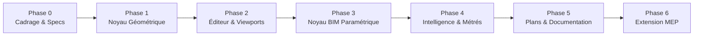

# ROADMAP DE DÉVELOPPEMENT — MINI-BIM

**Statut :** Plan Directeur Validé  
**Date :** 13 novembre 2026  
**Auteur :** Ingénieur Principal & Architecte Logiciel

---

## 1. Vue d'Ensemble des Phases

Le développement de Mini-BIM est structuré selon une progression incrémentale stricte où chaque phase produit un livrable exécutable, testé et documenté avant tout passage à la phase suivante.

---

## 2. Détail par Phase

### Phase 0 — Cadrage, Architecture et Spécifications

- **Objectif :** Poser les bases théoriques, organisationnelles et conceptuelles du projet sans dette technique.
- **Fonctionnalités :**
  - Audit complet du document initial et cadrage des risques.
  - Définition de l'architecture logicielle modulaire et des règles de dépendance.
  - Formalisation du modèle de domaine BIM complet.
  - Établissement de la spécification mathématique et géométrique.
  - Enregistrement des décisions architecturales majeures (ADR).
- **Dépendances :** Aucune.
- **Livrables :**
  - `PROJECT_AUDIT.md`
  - `ARCHITECTURE.md`
  - `DOMAIN_MODEL.md`
  - `GEOMETRY_SPEC.md`
  - `ROADMAP.md`
  - `DECISIONS.md`
- **Tests :** Revue critique contradictoire des spécifications.
- **Critères d'acceptation :**
  - [x] Périmètre MVP clairement borné (Maison individuelle R+1).
  - [x] Principes architecturaux non négociables actés.
  - [x] Absence totale de zone d'ombre sur les conventions géométriques et les tolérances.

---

### Phase 1 — Fondations Géométriques (`@mini-bim/geometry`)

- **Objectif :** Construire une bibliothèque géométrique 2D/3D autonome, ultra-rapide, sans état et couverte à 100% par des tests unitaires.
- **Fonctionnalités :**
  - Algèbre vectorielle 2D et 3D (`Vec2`, `Vec3`, matrices, boîtes englobantes).
  - Primitives : droites, segments, rayons, calculs de projection et de distance point-segment.
  - Moteur d'intersection : droite-droite, segment-segment avec gestion des cas colinéaires et parallèles.
  - Algorithmes polygonaux : calcul d'aire signée (lacet), périmètre, centroïde, orientation CCW forcée.
  - Décalages parallèles de lignes (location lines : center, exterior, interior).
  - Résolution des jonctions de murs : coupes droites, onglets biseautés (L-join avec miter limit), aboutements en T.
  - Découpage par tranches verticales 2.5D (Sutherland-Hodgman) pour soustraction d'ouvertures.
  - Algorithme d'extrusion de polygones convexes vers maillages indexés Three.js.
  - Intégration d'`earcut` pour la triangulation de polygones concaves avec trous.
- **Dépendances :** Aucune (TypeScript pur + `earcut`).
- **Livrables :** Package `@mini-bim/geometry` compilé avec déclarations TypeScript et suite de tests Vitest.
- **Tests :**
  - Tests unitaires paramétrés sur angles remarquables (90°, 45°, 30°, 10°, 179°, 180°).
  - Tests de robustesse sur cas limites : segments colinéaires, longueurs nulles, polygones dégénérés.
  - Tests d'orientation et de normales de faces extrudées.
- **Critères d'acceptation :**
  - 100% des tests unitaires géométriques au vert.
  - Zéro dépendance vers React, Three.js ou le DOM.
  - Exécution complète des tests en moins de 1 seconde.

#### Notes de durcissement reportées :

- **Test Float32 à 1 km sur coordonnées fractionnaires (Phase 1.5) :** Le test actuel valide des coordonnées entières ($1\,000\,000\text{ mm} < 2^{24}$), représentées de manière exacte. Un test sur coordonnées fractionnaires (offset $1\,000\,000.1\text{ mm}$) sera ajouté pour mesurer la troncature réelle de la mantisse simple précision.
- **Soudure topologique globale (B-Rep welding) des sous-volumes assemblés (Phase 5 IFC & Phase 6 Booléens) :** Chaque tranche solide est manifold et watertight individuellement (ADR-017). La suppression des faces internes de contact coplanaires pour former une B-Rep unifiée sera opérée lors des exports IFC ou opérations booléennes volumiques.

---

### Phase 1.4 — Package de Visualisation 3D Three.js (`@mini-bim/view-3d`) [LIVRÉ]

- **Objectif :** Fournir le visualiseur 3D Three.js impératif consommant les `RawMeshData` issus de `@mini-bim/geometry`.
- **Fonctionnalités :**
  - `MeshAdapter` : conversion instantanée en `THREE.BufferGeometry` sans recalcul de normales ni de boîtes englobantes.
  - `Scene3D` : contrôleur impératif sans React, caméra perspective Z-up, grille de sol XY ($Z=0$), contrôles orbitaux (`OrbitControls`).
  - Rendu à la demande (_Demand-Driven Rendering_) : zéro boucle RAF continue, CPU/GPU à 0% au repos.
  - Matériau PBR standard avec Backface Culling (`THREE.FrontSide`, ADR-017 / ADR-018).
  - Gestion stricte du cycle de vie et libération des ressources GPU (`dispose()`).
- **Tests :** 13 tests automatisés (MeshAdapter, Scene3D lifecycle, OrbitControls Z-up, render à la demande, absence de RAF).

---

### Phase 1.5 — Noyau BIM Minimal (`@mini-bim/core`) [LIVRÉ]

- **Objectif :** Fournir la source unique de vérité du modèle BIM (état documentaire, transactions par commandes, historique Undo/Redo via Immer).
- **Fonctionnalités :**
  - `BimDocument` : gestionnaire central d'état documentaire immuable normalisé (`BimState`).
  - `CommandBus` : commandes transactionnelles `AddWall`, `UpdateWall`, `DeleteWall`, `AddLevel`, etc.
  - `HistoryStack` : Undo / Redo basé sur les patchs différentiels Immer (complexité mémoire $\mathcal{O}(k)$).
  - Règles métier et intégrité référentielle (`rules.ts`) : protection contre la suppression de niveaux ou types en cours d'utilisation, longueur de mur $> 0$.
  - Stratégie d'identifiants ULID (`ids.ts`, ADR-020).
  - Sérialisation et désérialisation JSON stricte (`serialization.ts`).
- **Tests :** 23 tests automatisés (cycle de vie, transactions, annulations multiples, intégrité, sérialisation).

---

### Phase 2 — Éditeur et Double Visualisation Découpée

_Dépendances : Phase 1.1 à 1.3 (`@mini-bim/geometry`), Phase 1.4 (`@mini-bim/view-3d`), Phase 1.5 (`@mini-bim/core`)._

#### Phase 2.1 — Package de Vue 2D (`@mini-bim/view-2d`) [LIVRÉ]

- **Objectif :** Fournir le visualiseur en plan 2D impératif en Canvas 2D API pure (sans React, sans Three.js).
- **Fonctionnalités :**
  - `Transform2D` : conversion cartésienne monde (mm, Y-up) vers écran (px, Y-down) strictement inversible ($\Delta < 10^{-9}$), zoom centré sur le curseur avec point invariant, pan fluide, recadrage automatique `zoomToFit`.
  - Moteur de rendu architectural (`renderer.ts`) : consommation obligatoire de `computeWallFootprint2d`, poché gris clair, contour d'arête vue/coupée, axe central en tirets alternés `[6, 4]`, grille adaptative anti-saturation (`minPixelSpacing`), axes X/Y distincts.
  - Contrôleur impératif `View2D` : cycle de vie canvas, rendu à la demande (Demand-Driven Rendering), synchronisation de sélection (`onSelectionChanged`).
  - Découplage du Hit-Testing (`hit-test.ts`) : module pur extrait (`findWallAtScreen`, `hitTestWall`, `isPointInsideOrNearFootprint`) exporté et immédiatement réutilisable par `WallTool` en Phase 2.2 sans duplication.
  - **Règle d'or respectée :** Zéro mutation directe de `BimDocument`, preuve d'immutabilité stricte au clic (`toJSON()` identique), émission d'intentions de commande via `onCommandRequested(cb)`.
- **Tests :** 35 tests automatisés (inversion mathématique Y-up/Y-down sur cas asymétriques, poché, grille, surbrillance, hit-testing découplé, zoom/pan, émission de commandes, non-mutation de document, déconnexion du ResizeObserver).

#### Phase 2.2 — Application Web & Squelette Double Viewport React (`apps/web`) [LIVRÉ]

- **Objectif :** Initialiser l'application web React / Vite et héberger les deux viewports 2D/3D côte à côte avec le document de démonstration.
- **Fonctionnalités :**
  - Architecture monorepo mise à jour : ajout de `apps/*` dans `pnpm-workspace.yaml`, scripts racine configurés.
  - Contexte documentaire React (`BimDocumentContext`) : conservation de l'instance impérative de `BimDocument` dans un `useRef`, exposition exclusive du `BimState` immuable via `useState` et abonnement réactif `doc.subscribe()`.
  - Wrapper `<Viewport2D />` : instanciation impérative unique de `View2D` dans `useEffect([], ...)`, cadrage automatique initial `zoomToFit()`, re-rendu à la demande sur notification d'état documentaire, libération propre des écouteurs et du ResizeObserver via `dispose()`.
  - Wrapper `<Viewport3D />` : instanciation impérative unique de `Scene3D` dans `useEffect([], ...)`, conversion et ajout des maillages de murs initiaux via `createWallMesh` de `@mini-bim/view-3d`, synchronisation différentielle des maillages (add/update/remove) lors des mutations de state, libération GPU via `dispose()`.
  - Layout d'interface applicative `<App />` : barre d'outils supérieure (`Toolbar`), grille responsive 50/50 à deux colonnes (Vue 2D plan à gauche, Vue 3D orbitale Z-up à droite), barre d'état inférieure (`StatusBar`) affichant le nombre de murs, niveaux et le niveau actif.
  - **Règles d'or respectées :** Zéro import de `@mini-bim/geometry` dans `apps/web`, zéro réinstanciation des contrôleurs graphiques lors des re-renders React, zéro fuite mémoire démontrée sur 10 cycles consécutifs de mount / unmount.
- **Tests :** 10 tests automatisés (cycle de vie du contexte, instanciation unique des viewports 2D/3D, libération mémoire, intégration globale de l'App).

#### Phase 2.3 — Outils Interactifs 2D (`WallTool`, `SelectTool`) [LIVRÉ]

- **Objectif :** Fournir les machines à états d'interaction 2D découplées du DOM pour la sélection et le tracé interactif de murs.
- **Fonctionnalités :**
  - `SelectTool` : machine à états pure (`idle`, `selecting`, `selected`), hit-testing délégué à `@mini-bim/view-2d/hit-test`, sélection au clic gauche, désélection au clic dans le vide ou touche `Escape`.
  - `WallTool` : machine à états pure (`idle`, `drawing`, `finished`), tracé par clic-glisser, prévisualisation élastique (rubber-band) en temps réel, aimantation angulaire 45° exacte via `snapAngle45` avec la touche `Shift`, contrainte de longueur minimale ($L \ge 100\text{ mm}$), validation par relâchement ou `Enter`, annulation par `Escape`, émission d'instances typées de `AddWallCommand`.
  - `snapAngle45` : aimantation angulaire déterministe via table de vecteurs unitaires précalculés pour les 8 secteurs de 45°, éliminant toute dérive de virgule flottante ($0^\circ, 45^\circ, 90^\circ, 135^\circ, 180^\circ, -135^\circ, -90^\circ, -45^\circ$).
  - Pont DOM normalisé (`toolGlue.ts`) : conversion rigoureuse des `PointerEvent`s et `KeyboardEvent`s en `ToolEvent`s relatifs au canvas.
  - Hook React d'orchestration (`useActiveTool`) : gestion de l'outil actif (`'select' | 'wall'`), réinitialisation systématique de l'outil sortant.
  - Évolution de `@mini-bim/view-2d` : support des formes temporaires de prévisualisation `PreviewShape` (`line`, `rect`), rendu dédié `drawPreview`, accesseurs `setPreview` / `getPreview`, délégation de sélection avec `enableInternalSelection: false`.
  - Intégration UI complète : boutons actifs dans `Toolbar` avec raccourcis clavier globaux `S` et `W`, retour textuel en temps réel dans `StatusBar` (longueur millimétrique du tracé, statut), curseur adaptatif (`crosshair` vs `default`).
  - **Règles d'or respectées :** Zéro import de `react`, `three` ou `@mini-bim/geometry` dans les classes de machines à états, nettoyage systématique des écouteurs et du preview lors du démontage ou du changement d'outil.
- **Tests :** 48 tests automatisés dans `apps/web` (+34 tests ajoutés : 10 snap 45°, 3 toolGlue, 6 SelectTool, 8 WallTool, 2 useActiveTool, 6 Viewport2D, 5 App), 37 tests dans `view-2d` (+2 tests Preview). Total monorepo : 334 tests réussis.

#### Phase 2.4 — Synchronisation des Sélections 2D ↔ 3D, Undo/Redo UI et Persistance JSON [LIVRÉ]

- **Objectif :** Coordonner la sélection bidirectionnelle entre les deux vues, offrir l'historique transactionnel (Undo/Redo) dans l'UI et permettre la sauvegarde/restauration de projets au format JSON.
- **Fonctionnalités :**
  - **Sélection Partagée Bidirectionnelle :** État d'interface éphémère hébergé dans `useState<readonly string[]>([])` au niveau `AppContent` (ADR-025), préservant la pureté du `BimDocument`.
  - **Picking 3D Déterministe (`Scene3D.raycast`) :** Raycasting précis via `THREE.Raycaster` sur les maillages portant `userData.elementId` (ADR-026). Filtrage des clics stationnaires ($\Delta \le 5\text{ px}$) pour éliminer tout conflit d'interaction avec les rotations de caméra `OrbitControls`.
  - **Surbrillance 3D Économique (`Scene3D.setHighlight`) :** Permutation instantanée de référence de matériau entre `defaultMaterial` et un `highlightMaterial` partagé (émissif bleu vif `#2563eb`), sans aucune allocation GPU ni recompilation de shader lors des sélections.
  - **Historique Transactionnel UI (Undo / Redo) :** Boutons "Annuler" et "Rétablir" dans la `Toolbar` avec état `disabled` réactif reflétant `canUndo()` et `canRedo()`. Raccourcis clavier globaux (`Ctrl+Z` / `Cmd+Z`, `Ctrl+Shift+Z` / `Cmd+Shift+Z`, `Ctrl+Y` sous Windows, `Escape` pour désélectionner) avec exclusion des champs de saisie.
  - **Persistance JSON & Export/Import (`jsonIO.ts`) :** Sérialisation/désérialisation conforme au schéma `BimState` v1 (`PERSISTENCE_SPEC.md`). Export client direct par téléchargement de fichier Blob, import asynchrone par `input[type="file"]`, validation d'intégrité stricte (`BimValidationError`), égalité bit-à-bit vérifiée lors du round-trip.
  - **Remplacement de Document sans Perte de Contexte (`setDocument`) :** Méthode `setDocument(newDoc)` dans le contexte React préservant l'intégrité des contextes Canvas 2D et WebGL (ADR-027). Bandeau d'erreur rouge non-bloquant en cas d'import de fichier corrompu.
- **Tests :** 72 tests automatisés dans `apps/web` (+24 tests), 17 tests dans `view-3d` (+2 tests), 43 tests dans `core`. Total monorepo : 360 tests réussis.

---

### Phase 2.5 — Panneau d'Inspection des Propriétés et Édition d'Attributs [PROCHAINE ÉTAPE]

- Panneau latéral rétractable d'inspection des propriétés de l'élément sélectionné (dimensions, coordonnées, type de mur, niveau).
- Modification en direct des paramètres d'un mur sélectionné via `UpdateWallCommand` avec répercussion instantanée dans les vues 2D et 3D.
- Sélecteur de niveau actif pour le tracé de nouveaux murs.

---

### Phase 3 — Noyau BIM Paramétrique (`@mini-bim/core`, `@mini-bim/persistence`)

- **Objectif :** Transformer le système de dessin géométrique en un véritable modeleur d'objets BIM relationnel.
- **Fonctionnalités :**
  - Modèle de données complet : `Project`, `Building`, `Level`, `ElementType`, `ElementInstance`.
  - Gestionnaire de niveaux : création de niveaux (RDC, R+1), liaison altimétrique des murs (hauteur contrainte ou libre).
  - Catalogue de types de murs multicouches (`WallType` : structure, isolation, finition).
  - Hébergement d'ouvertures : outil `DoorTool` et `WindowTool`, découpage réel du mur hôte par tranches.
  - Éléments horizontaux : dalles de sol (`Slab`) extrudées depuis un contour polygonal.
  - Toitures simples (`Roof` : toit plat ou 2 pans avec pente et débord).
  - Graphe de dépendances (DAG) et moteur de régénération incrémentale (`dirty set`).
  - Persistance locale : sauvegarde/chargement au format JSON validé par schéma Zod.
- **Dépendances :** Phase 2.
- **Livrables :** Packages `@mini-bim/core` et `@mini-bim/persistence`.
- **Tests :**
  - Déplacement d'un mur hôte $\implies$ déplacement solidaire des ouvertures hébergées.
  - Modification de l'altitude d'un niveau $\implies$ mise à jour des hauteurs de murs contraints.
  - Cycle de sauvegarde / fermeture / restauration sans aucune altération de données.
- **Critères d'acceptation :**
  - Maison individuelle R+1 complète modélisée avec portes, fenêtres, dalles et toiture.
  - Modification d'un type de mur propageant l'épaisseur à toutes ses instances.
  - Temps de propagation d'une modification < 50 ms.

---

### Phase 4 — Intelligence Architecturale et Métrés

- **Objectif :** Extraire automatiquement la sémantique spatiale et les quantités constructives du modèle.
- **Fonctionnalités :**
  - Détection automatique des pièces fermées à partir de l'union des emprises de murs.
  - Calcul en direct des aires nettes ($m^2$), périmètres ($m$) et volumes ($m^3$) des pièces.
  - Placement automatique des étiquettes de pièces au pôle d'inaccessibilité (`polylabel`).
  - Tableau de métrés en direct : surfaces nettes de murs (déduction des baies), cubatures de béton, surfaces d'isolant.
  - Export des nomenclatures au format CSV.
  - Détection et signalement visuel des pièces non fermées (« fuites » de contour).
- **Dépendances :** Phase 3.
- **Livrables :** Module de calcul spatial et panneau UI de métrés.
- **Tests :**
  - Vérification de l'aire calculée sur des formes de pièces simples et en L avec valeurs théoriques connues.
  - Recalcul immédiat de l'aire lors du déplacement d'une cloison.
- **Critères d'acceptation :**
  - Déplacement d'un mur réajustant automatiquement la surface des deux pièces contiguës.
  - Tableau de bord des quantités synchronisé en temps réel sans blocage du thread principal.

---

### Phase 5 — Documentation et Échanges

- **Objectif :** Produire des livrables de plans architecturaux normalisés et assurer l'interopérabilité.
- **Fonctionnalités :**
  - Outil de cotation manuelle linéaire et alignée en vue 2D.
  - Rendu architectural normalisé en 2D (arbres de poché, sens d'ouverture des portes en arc de cercle).
  - Coupe dynamique 3D (Section Box) avec plans de clipping.
  - Génération de coupes verticales 2D.
  - Export vectoriel des plans en SVG et PDF à l'échelle.
  - Export IFC 4 minimal (`IfcProject`, `IfcBuildingStorey`, `IfcWallStandardCase`, `IfcDoor`, `IfcWindow`, `IfcSlab`).
- **Dépendances :** Phase 4.
- **Livrables :** Module de mise en page et pipeline d'export IFC.
- **Critères d'acceptation :**
  - Plan 2D imprimable avec cotations associatives.
  - Fichier IFC généré importable et validé dans un viewer BIM standard (ex: Solibri, BIMcollab ou BlenderBIM).

---

### Phase 6 — Extension Réseaux MEP (Post-MVP)

- **Objectif :** Intégrer la coordination 3D des réseaux techniques (plomberie, ventilation, électricité).
- **Fonctionnalités :**
  - Enregistrement des catégories MEP via le registre de catégories (`CategoryDef`).
  - Définition des systèmes de distribution (`mep_system` : eau froide, évacuation, gaines C1).
  - Modélisation de tronçons (segments ronds et rectangulaires) via balayage (`sweep`) et instanciation 3D.
  - Connecteurs paramétriques (ports) et graphe de connexions de réseaux.
  - Génération des réservations et traversées automatiques dans les murs et dalles.
  - Détection des collisions (Clash Detection) entre réseaux et éléments de structure.
- **Dépendances :** Phase 5 validée et stabilisée.
- **Livrables :** Package `@mini-bim/mep`.
- **Critères d'acceptation :**
  - Réseau complet modélisé sous plafond, avec détection automatique des pénétrations de cloisons.
  - Panneau cliquable recensant les collisions physiques détectées.
