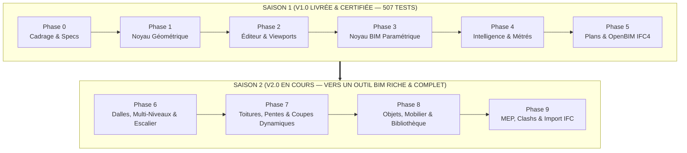
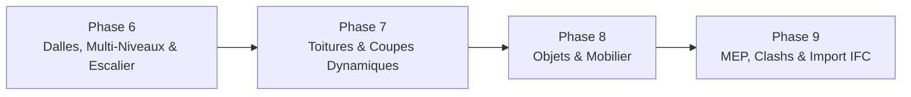

# ROADMAP DE DÉVELOPPEMENT — MINI-BIM

**Statut :** Plan Directeur Validé  
**Date :** 13 novembre 2026  
**Auteur :** Ingénieur Principal & Architecte Logiciel

---

## 1. Vue d'Ensemble des Phases

Le développement de Mini-BIM est structuré en deux grandes saisons selon une progression incrémentale stricte où chaque phase produit un livrable exécutable, testé et documenté avant tout passage à la phase suivante.

---

## 2. Détail par Phase

### Phase 0 — Cadrage, Architecture et Spécifications

- **Objectif :** Poser les bases théoriques, organisationnelles et conceptuelles du projet sans dette technique.
- **Fonctionnalités :**
  - Audit complet du document initial et cadrage des risques.
  - Définition de l'architecture logicielle modulaire et des règles de dépendance.
  - Formalisation du modèle de domaine BIM complet.
  - Établissement de la spécification mathématique et géométrique.
  - Enregistrement des décisions architecturales majeures (ADR).
- **Dépendances :** Aucune.
- **Livrables :**
  - `PROJECT_AUDIT.md`
  - `ARCHITECTURE.md`
  - `DOMAIN_MODEL.md`
  - `GEOMETRY_SPEC.md`
  - `ROADMAP.md`
  - `DECISIONS.md`
- **Tests :** Revue critique contradictoire des spécifications.
- **Critères d'acceptation :**
  - [x] Périmètre MVP clairement borné (Maison individuelle R+1).
  - [x] Principes architecturaux non négociables actés.
  - [x] Absence totale de zone d'ombre sur les conventions géométriques et les tolérances.

---

### Phase 1 — Fondations Géométriques (`@mini-bim/geometry`)

- **Objectif :** Construire une bibliothèque géométrique 2D/3D autonome, ultra-rapide, sans état et couverte à 100% par des tests unitaires.
- **Fonctionnalités :**
  - Algèbre vectorielle 2D et 3D (`Vec2`, `Vec3`, matrices, boîtes englobantes).
  - Primitives : droites, segments, rayons, calculs de projection et de distance point-segment.
  - Moteur d'intersection : droite-droite, segment-segment avec gestion des cas colinéaires et parallèles.
  - Algorithmes polygonaux : calcul d'aire signée (lacet), périmètre, centroïde, orientation CCW forcée.
  - Décalages parallèles de lignes (location lines : center, exterior, interior).
  - Résolution des jonctions de murs : coupes droites, onglets biseautés (L-join avec miter limit), aboutements en T.
  - Découpage par tranches verticales 2.5D (Sutherland-Hodgman) pour soustraction d'ouvertures.
  - Algorithme d'extrusion de polygones convexes vers maillages indexés Three.js.
  - Intégration d'`earcut` pour la triangulation de polygones concaves avec trous.
- **Dépendances :** Aucune (TypeScript pur + `earcut`).
- **Livrables :** Package `@mini-bim/geometry` compilé avec déclarations TypeScript et suite de tests Vitest.
- **Tests :**
  - Tests unitaires paramétrés sur angles remarquables (90°, 45°, 30°, 10°, 179°, 180°).
  - Tests de robustesse sur cas limites : segments colinéaires, longueurs nulles, polygones dégénérés.
  - Tests d'orientation et de normales de faces extrudées.
- **Critères d'acceptation :**
  - 100% des tests unitaires géométriques au vert.
  - Zéro dépendance vers React, Three.js ou le DOM.
  - Exécution complète des tests en moins de 1 seconde.

#### Notes de durcissement reportées :

- **Test Float32 à 1 km sur coordonnées fractionnaires (Phase 1.5) :** Le test actuel valide des coordonnées entières ($1\,000\,000\text{ mm} < 2^{24}$), représentées de manière exacte. Un test sur coordonnées fractionnaires (offset $1\,000\,000.1\text{ mm}$) sera ajouté pour mesurer la troncature réelle de la mantisse simple précision.
- **Soudure topologique globale (B-Rep welding) des sous-volumes assemblés (Phase 5 IFC & Phase 6 Booléens) :** Chaque tranche solide est manifold et watertight individuellement (ADR-017). La suppression des faces internes de contact coplanaires pour former une B-Rep unifiée sera opérée lors des exports IFC ou opérations booléennes volumiques.

---

### Phase 1.4 — Package de Visualisation 3D Three.js (`@mini-bim/view-3d`) [LIVRÉ]

- **Objectif :** Fournir le visualiseur 3D Three.js impératif consommant les `RawMeshData` issus de `@mini-bim/geometry`.
- **Fonctionnalités :**
  - `MeshAdapter` : conversion instantanée en `THREE.BufferGeometry` sans recalcul de normales ni de boîtes englobantes.
  - `Scene3D` : contrôleur impératif sans React, caméra perspective Z-up, grille de sol XY ($Z=0$), contrôles orbitaux (`OrbitControls`).
  - Rendu à la demande (_Demand-Driven Rendering_) : zéro boucle RAF continue, CPU/GPU à 0% au repos.
  - Matériau PBR standard avec Backface Culling (`THREE.FrontSide`, ADR-017 / ADR-018).
  - Gestion stricte du cycle de vie et libération des ressources GPU (`dispose()`).
- **Tests :** 13 tests automatisés (MeshAdapter, Scene3D lifecycle, OrbitControls Z-up, render à la demande, absence de RAF).

---

### Phase 1.5 — Noyau BIM Minimal (`@mini-bim/core`) [LIVRÉ]

- **Objectif :** Fournir la source unique de vérité du modèle BIM (état documentaire, transactions par commandes, historique Undo/Redo via Immer).
- **Fonctionnalités :**
  - `BimDocument` : gestionnaire central d'état documentaire immuable normalisé (`BimState`).
  - `CommandBus` : commandes transactionnelles `AddWall`, `UpdateWall`, `DeleteWall`, `AddLevel`, etc.
  - `HistoryStack` : Undo / Redo basé sur les patchs différentiels Immer (complexité mémoire $\mathcal{O}(k)$).
  - Règles métier et intégrité référentielle (`rules.ts`) : protection contre la suppression de niveaux ou types en cours d'utilisation, longueur de mur $> 0$.
  - Stratégie d'identifiants ULID (`ids.ts`, ADR-020).
  - Sérialisation et désérialisation JSON stricte (`serialization.ts`).
- **Tests :** 23 tests automatisés (cycle de vie, transactions, annulations multiples, intégrité, sérialisation).

---

### Phase 2 — Éditeur et Double Visualisation Découpée

_Dépendances : Phase 1.1 à 1.3 (`@mini-bim/geometry`), Phase 1.4 (`@mini-bim/view-3d`), Phase 1.5 (`@mini-bim/core`)._

#### Phase 2.1 — Package de Vue 2D (`@mini-bim/view-2d`) [LIVRÉ]

- **Objectif :** Fournir le visualiseur en plan 2D impératif en Canvas 2D API pure (sans React, sans Three.js).
- **Fonctionnalités :**
  - `Transform2D` : conversion cartésienne monde (mm, Y-up) vers écran (px, Y-down) strictement inversible ($\Delta < 10^{-9}$), zoom centré sur le curseur avec point invariant, pan fluide, recadrage automatique `zoomToFit`.
  - Moteur de rendu architectural (`renderer.ts`) : consommation obligatoire de `computeWallFootprint2d`, poché gris clair, contour d'arête vue/coupée, axe central en tirets alternés `[6, 4]`, grille adaptative anti-saturation (`minPixelSpacing`), axes X/Y distincts.
  - Contrôleur impératif `View2D` : cycle de vie canvas, rendu à la demande (Demand-Driven Rendering), synchronisation de sélection (`onSelectionChanged`).
  - Découplage du Hit-Testing (`hit-test.ts`) : module pur extrait (`findWallAtScreen`, `hitTestWall`, `isPointInsideOrNearFootprint`) exporté et immédiatement réutilisable par `WallTool` en Phase 2.2 sans duplication.
  - **Règle d'or respectée :** Zéro mutation directe de `BimDocument`, preuve d'immutabilité stricte au clic (`toJSON()` identique), émission d'intentions de commande via `onCommandRequested(cb)`.
- **Tests :** 35 tests automatisés (inversion mathématique Y-up/Y-down sur cas asymétriques, poché, grille, surbrillance, hit-testing découplé, zoom/pan, émission de commandes, non-mutation de document, déconnexion du ResizeObserver).

#### Phase 2.2 — Application Web & Squelette Double Viewport React (`apps/web`) [LIVRÉ]

- **Objectif :** Initialiser l'application web React / Vite et héberger les deux viewports 2D/3D côte à côte avec le document de démonstration.
- **Fonctionnalités :**
  - Architecture monorepo mise à jour : ajout de `apps/*` dans `pnpm-workspace.yaml`, scripts racine configurés.
  - Contexte documentaire React (`BimDocumentContext`) : conservation de l'instance impérative de `BimDocument` dans un `useRef`, exposition exclusive du `BimState` immuable via `useState` et abonnement réactif `doc.subscribe()`.
  - Wrapper `<Viewport2D />` : instanciation impérative unique de `View2D` dans `useEffect([], ...)`, cadrage automatique initial `zoomToFit()`, re-rendu à la demande sur notification d'état documentaire, libération propre des écouteurs et du ResizeObserver via `dispose()`.
  - Wrapper `<Viewport3D />` : instanciation impérative unique de `Scene3D` dans `useEffect([], ...)`, conversion et ajout des maillages de murs initiaux via `createWallMesh` de `@mini-bim/view-3d`, synchronisation différentielle des maillages (add/update/remove) lors des mutations de state, libération GPU via `dispose()`.
  - Layout d'interface applicative `<App />` : barre d'outils supérieure (`Toolbar`), grille responsive 50/50 à deux colonnes (Vue 2D plan à gauche, Vue 3D orbitale Z-up à droite), barre d'état inférieure (`StatusBar`) affichant le nombre de murs, niveaux et le niveau actif.
  - **Règles d'or respectées :** Zéro import de `@mini-bim/geometry` dans `apps/web`, zéro réinstanciation des contrôleurs graphiques lors des re-renders React, zéro fuite mémoire démontrée sur 10 cycles consécutifs de mount / unmount.
- **Tests :** 10 tests automatisés (cycle de vie du contexte, instanciation unique des viewports 2D/3D, libération mémoire, intégration globale de l'App).

#### Phase 2.3 — Outils Interactifs 2D (`WallTool`, `SelectTool`) [LIVRÉ]

- **Objectif :** Fournir les machines à états d'interaction 2D découplées du DOM pour la sélection et le tracé interactif de murs.
- **Fonctionnalités :**
  - `SelectTool` : machine à états pure (`idle`, `selecting`, `selected`), hit-testing délégué à `@mini-bim/view-2d/hit-test`, sélection au clic gauche, désélection au clic dans le vide ou touche `Escape`.
  - `WallTool` : machine à états pure (`idle`, `drawing`, `finished`), tracé par clic-glisser, prévisualisation élastique (rubber-band) en temps réel, aimantation angulaire 45° exacte via `snapAngle45` avec la touche `Shift`, contrainte de longueur minimale ($L \ge 100\text{ mm}$), validation par relâchement ou `Enter`, annulation par `Escape`, émission d'instances typées de `AddWallCommand`.
  - `snapAngle45` : aimantation angulaire déterministe via table de vecteurs unitaires précalculés pour les 8 secteurs de 45°, éliminant toute dérive de virgule flottante ($0^\circ, 45^\circ, 90^\circ, 135^\circ, 180^\circ, -135^\circ, -90^\circ, -45^\circ$).
  - Pont DOM normalisé (`toolGlue.ts`) : conversion rigoureuse des `PointerEvent`s et `KeyboardEvent`s en `ToolEvent`s relatifs au canvas.
  - Hook React d'orchestration (`useActiveTool`) : gestion de l'outil actif (`'select' | 'wall'`), réinitialisation systématique de l'outil sortant.
  - Évolution de `@mini-bim/view-2d` : support des formes temporaires de prévisualisation `PreviewShape` (`line`, `rect`), rendu dédié `drawPreview`, accesseurs `setPreview` / `getPreview`, délégation de sélection avec `enableInternalSelection: false`.
  - Intégration UI complète : boutons actifs dans `Toolbar` avec raccourcis clavier globaux `S` et `W`, retour textuel en temps réel dans `StatusBar` (longueur millimétrique du tracé, statut), curseur adaptatif (`crosshair` vs `default`).
  - **Règles d'or respectées :** Zéro import de `react`, `three` ou `@mini-bim/geometry` dans les classes de machines à états, nettoyage systématique des écouteurs et du preview lors du démontage ou du changement d'outil.
- **Tests :** 48 tests automatisés dans `apps/web` (+34 tests ajoutés : 10 snap 45°, 3 toolGlue, 6 SelectTool, 8 WallTool, 2 useActiveTool, 6 Viewport2D, 5 App), 37 tests dans `view-2d` (+2 tests Preview). Total monorepo : 334 tests réussis.

#### Phase 2.4 — Synchronisation des Sélections 2D ↔ 3D, Undo/Redo UI et Persistance JSON [LIVRÉ]

- **Objectif :** Coordonner la sélection bidirectionnelle entre les deux vues, offrir l'historique transactionnel (Undo/Redo) dans l'UI et permettre la sauvegarde/restauration de projets au format JSON.
- **Fonctionnalités :**
  - **Sélection Partagée Bidirectionnelle :** État d'interface éphémère hébergé dans `useState<readonly string[]>([])` au niveau `AppContent` (ADR-025), préservant la pureté du `BimDocument`.
  - **Picking 3D Déterministe (`Scene3D.raycast`) :** Raycasting précis via `THREE.Raycaster` sur les maillages portant `userData.elementId` (ADR-026). Filtrage des clics stationnaires ($\Delta \le 5\text{ px}$) pour éliminer tout conflit d'interaction avec les rotations de caméra `OrbitControls`.
  - **Surbrillance 3D Économique (`Scene3D.setHighlight`) :** Permutation instantanée de référence de matériau entre `defaultMaterial` et un `highlightMaterial` partagé (émissif bleu vif `#2563eb`), sans aucune allocation GPU ni recompilation de shader lors des sélections.
  - **Historique Transactionnel UI (Undo / Redo) :** Boutons "Annuler" et "Rétablir" dans la `Toolbar` avec état `disabled` réactif reflétant `canUndo()` et `canRedo()`. Raccourcis clavier globaux (`Ctrl+Z` / `Cmd+Z`, `Ctrl+Shift+Z` / `Cmd+Shift+Z`, `Ctrl+Y` sous Windows, `Escape` pour désélectionner) avec exclusion des champs de saisie.
  - **Persistance JSON & Export/Import (`jsonIO.ts`) :** Sérialisation/désérialisation conforme au schéma `BimState` v1 (`PERSISTENCE_SPEC.md`). Export client direct par téléchargement de fichier Blob, import asynchrone par `input[type="file"]`, validation d'intégrité stricte (`BimValidationError`), égalité bit-à-bit vérifiée lors du round-trip.
  - **Remplacement de Document sans Perte de Contexte (`setDocument`) :** Méthode `setDocument(newDoc)` dans le contexte React préservant l'intégrité des contextes Canvas 2D et WebGL (ADR-027). Bandeau d'erreur rouge non-bloquant en cas d'import de fichier corrompu.
- **Tests :** 72 tests automatisés dans `apps/web` (+24 tests), 17 tests dans `view-3d` (+2 tests), 43 tests dans `core`. Total monorepo : 360 tests réussis.

---

### Phase 2.5 — Panneau d'Inspection des Propriétés et Édition d'Attributs (Séquencé en Phase 6.1 & 6.3)

- **Statut :** Un premier inspecteur minimal est livré dès la Phase 6.1 (édition du nom, type, épaisseur, niveau/altitude) pour rendre les dalles immédiatement utilisables sans manipulation de JSON brut, puis enrichi en Phase 6.3 pour couvrir l'ensemble des cotes, styles et matériaux.
- Panneau latéral d'inspection des propriétés de l'élément sélectionné : édition en direct des épaisseurs de dalles (`thickness`), cotes de niveaux (`elevation`, `height`), types de murs et cotes de portes/fenêtres via les commandes Immer correspondantes.

---

### Phase 3 — Noyau BIM Paramétrique & Ouvertures Hébergées

- **Objectif :** Transformer le système de dessin géométrique en un véritable modeleur d'objets BIM relationnel avec ouvertures hébergées (portes et fenêtres), découpage géométrique et placement interactif.

#### Phase 3.1 — Modèle BIM Relationnel des Ouvertures Hébergées (`@mini-bim/core`) [LIVRÉ]

- **Objectif :** Intégrer les concepts de portes et fenêtres hébergées dans le modèle documentaire BIM, sécuriser les règles métier, fournir les commandes transactionnelles et garantir l'intégrité référentielle avec suppression en cascade.
- **Fonctionnalités :**
  - Modèle paramétrique 1D (`types.ts`) : `OpeningBase` (`offsetAlong`, `width`, `height`), `Door` (`swing: { side, direction }`), `Window` (`sillHeight`), dictionnaires `doors` et `windows` dans `BimState`.
  - Commandes transactionnelles (`commands.ts`) : `AddDoorCommand`, `AddWindowCommand`, `UpdateDoorCommand`, `UpdateWindowCommand`, `DeleteOpeningCommand`, `MoveOpeningCommand`.
  - Suppression en cascade (`ON DELETE CASCADE`) : `DeleteWallCommand` supprime automatiquement le mur ET toutes ses portes et fenêtres hébergées, avec notification exhaustive dans `getChangedIds()`.
  - Réversibilité Undo/Redo intégrale (`history.ts`) : l'inversion des patchs Immer restaure simultanément le mur et toutes ses ouvertures hébergées en une seule transaction sans perte d'attributs.
  - Validation métier stricte (`rules.ts`) : délégation des calculs de chevauchement et de dégagement à `validateOpenings` et `MIN_OPENING_CLEARANCE` de `@mini-bim/geometry`. Contrôles de débordement 1D $[0, L_{\text{wall}}]$, hauteur sous linteau, allège positive, sens de battement valide.
  - Sérialisation et rétrocompatibilité (`serialization.ts`) : persistance JSON avec préservation de `schemaVersion: 1`, chargement sans encombre des fichiers existants (Phases 1 et 2) avec valeurs par défaut `doors: {}` et `windows: {}`.
- **Tests :** 72 tests automatisés dans `@mini-bim/core` (+29 tests), 389 tests cumulés dans tout le monorepo.

#### Phase 3.2 — Découpage Géométrique et Maillages Percés 2D/3D (`@mini-bim/view-2d`, `@mini-bim/view-3d`, `apps/web`) [LIVRÉ]

- **Objectif :** Connecter `sliceWallWithOpenings` et `extrudeWallPiece` aux couches de rendu pour générer les maillages de murs percés en 3D (panneaux pleins, allèges, linteaux), les placeholders d'ouvertures (bois pour portes, vitrage translucide pour fenêtres) et les empreintes 2D avec évidement de poché, ébrasements et arcs d'ouverture.
- **Fonctionnalités :**
  - **Murs Percés 3D (`mesh-generator.ts`) :** Découpage 2.5D automatique des murs hôtes via `sliceWallWithOpenings` et extrusion en `RawMeshData` multi-pièces. Tous les morceaux solides portent `RawMeshData.elementId = wall.id` pour garantir un picking et une sélection unifiée du mur hôte.
  - **Conservation Stricte du Volume :** Vérification mathématique par le théorème de divergence sur maillage triangulaire ($\sum V_i = V_{\text{plein}} - \sum V_{\text{baies}}$ avec résidu $\Delta < 50\text{ mm}^3$ sur 2.6 milliards de $\text{mm}^3$).
  - **Placeholders 3D d'Ouvertures :** Boîtes 3D orientées de 50 mm (porte, matériau bois `#8b5a2b`) et 30 mm (fenêtre, vitrage translucide `#90caf9`, opacité 0.5) portant `elementId = opening.id`. Restauration automatique du matériau de base lors des désélections dans `Scene3D.setHighlight`.
  - **Rendu Architectural 2D Normalisé (`renderer.ts`) :** Évidement propre du poché de mur sous la baie (`backgroundColor`), tracé des montants d'ébrasement, vantail à 90°, arc de 90° en pointillé avec calcul exact du sens de rotation écran (`counterclockwise`), et double vitrage bleu architectural.
  - **Découplage Architectural Strict (Règles d'or) :** Zéro import de `@mini-bim/core` dans `packages/view-2d/src` et `packages/view-3d/src`. Paramètres neutres structurels (`WallFor2D`, `OpeningGeometryParams`, etc.).
  - **Intégration Applicative Web :** Le `demoDocument` intègre 1 porte sur `wall_south` et 1 fenêtre sur `wall_north`. Synchronisation automatique dans `Viewport3D` et `Viewport2D`. Suppression en cascade reflétée dans les maillages 3D.
- **Tests :** 403 tests automatisés dans tout le monorepo (+14 tests par rapport à Phase 3.1) : 73 dans `core`, 23 dans `view-3d` (+6), 41 dans `view-2d` (+4), 75 dans `apps/web` (+3), 191 dans `geometry`.

#### Phase 3.3 — Outils Interactifs d'Ouvertures & Déplacement de Murs (`apps/web`) [LIVRÉ]

- **Objectif :** Implémenter les machines à états d'outils pures `DoorTool`, `WindowTool`, `MoveWallTool` et `MoveOpeningTool`, avec magnétisme le long de l'axe hôte (snap 50 mm) et translation de murs (snap 10 mm).
- **Livrables :**
  - `DoorTool.ts`, `WindowTool.ts`, `MoveWallTool.ts`, `MoveOpeningTool.ts` purs sans dépendance DOM/moteur.
  - Fonction de picking découplée `findOpeningAtScreen` dans `@mini-bim/view-2d`.
  - Intégration complète dans `useActiveTool`, `Toolbar` (raccourcis D, F, M, O) et `StatusBar`.
  - **Le Test de Crédibilité du BIM :** validation formelle qu'un mur déplacé conserve intact l'`offsetAlong` de ses ouvertures tout en déplaçant automatiquement les ouvertures en 2D et en 3D.
  - 432 tests automatisés passants sur l'ensemble du monorepo.

---

### Phase 4 — Intelligence Architecturale, Pièces Automatiques et Métrés [LIVRÉ]

- **Objectif :** Extraire automatiquement la sémantique spatiale et les quantités constructives du modèle, afficher les pièces en 2D/3D et fournir un tableau de métrés réactif exportable.
- **Fonctionnalités :**
  - **Détection Automatique des Pièces (`detectRooms`) :** Union booléenne des emprises de murs par niveau via `polygon-clipping` et extraction géométrique déterministe des trous intérieurs (surfaces fermées).
  - **Modèle de Pièce Dérivé (`Room`) :** Stockage minimal (`id`, `category: 'room'`, `levelId`, `seed: Vec2`, `name: string`). Zéro géométrie persistée dans `BimDocument` (recalculée à la demande, ADR-001/ADR-031).
  - **Surface Intérieure Strictement Habitable :** Vérification mathématique sur mur de 200 mm d'épaisseur : $3,8\text{ m} \times 2,8\text{ m} = 10,64\text{ m}^2$ (et non l'enveloppe brute extérieure $13,44\text{ m}^2$).
  - **Conservation des Surfaces Nettes de Murs :** Déduction rigoureuse des baies ($S_{\text{nette}} = S_{\text{brute}} - \sum S_{\text{ouvertures}}$). Exemple de référence : mur 6m × 2.8m percé d'une porte (1.89 m²) et d'une fenêtre (1.68 m²) $\implies S_{\text{nette}} = 13,23\text{ m}^2$, $V_{\text{net}} = 2,646\text{ m}^3$.
  - **Cycle de Vie et Cascade (Option B / ADR-032) :** Suppression en cascade des pièces dont l'enceinte est rompue lors de la suppression d'un mur porteur, avec notification complète dans `getChangedIds()` et réversibilité transactionnelle intégrale via `doc.undo()`.
  - **Rendu Architectural 2D (`View2D`) :** Poché pastel translucide avec gestion des îlots/piliers intérieurs (`evenodd`), affichage du nom et de la surface au pôle d'inaccessibilité (`polylabel`).
  - **Rendu 3D Sol (`Scene3D`) :** Dalle de sol plane (1 mm) extrudée à l'élévation du niveau avec palette de couleurs pastel déterministe par pièce.
  - **Tableau de Métrés UI (`<MetricsPanel />`) :** Décompte par catégories (Murs linéaires, surface nette, volume ; Portes quantité et surface ; Fenêtres quantité et surface ; Pièces surface utile, périmètre, volume), debouncing de 200 ms, sélecteur de niveau et export CSV normalisé avec en-têtes et unités explicites (`m`, `m²`, `m³`, `u`).
  - **StatusBar & Retours UX :** Affichage de `Surface : X m²` pour le niveau actif, et affichage immédiat de l'erreur `OPENING_OVERLAP` dans la bannière d'erreur lors d'un clic invalide de `DoorTool` (Note 1).
- **Tests :** 474 tests automatisés passants sur l'ensemble du monorepo (Geometry: 198, Core: 91, View-3D: 27, View-2D: 47, Web: 111).

---

### Phase 5 — Documentation, Plans Cotés et Échanges IFC [LIVRÉ]

- **Objectif :** Produire des livrables de plans architecturaux normalisés, des cotations 2D associatives et assurer l'interopérabilité OpenBIM via un export IFC4 natif.
- **Fonctionnalités :**
  - **Exportation IFC4 ISO 10303-21 STEP (`@mini-bim/core/ifc`) :** Générateur natif pur TypeScript (Option B / ADR-033) produisant un fichier STEP complet avec hiérarchie spatiale (`IfcProject`, `IfcSite`, `IfcBuilding`, `IfcBuildingStorey`), murs extrudés (`IfcWall`, `IfcExtrudedAreaSolid`), réservations découpées (`IfcOpeningElement`), portes et fenêtres avec relations BIM obligatoires (`IfcRelVoidsElement`, `IfcRelFillsElement`), espaces et surfaces habitables (`IfcSpace`, `Qto_SpaceBaseQuantities`), et rattachement d'étage (`IfcRelContainedInSpatialStructure`).
  - **Cotations 2D Associatives (`Dimension` / ADR-034) :** Entité normalisée dans `BimState.dimensions` avec calcul géométrique pur (`computeDimensionValue`). Recalcul automatique lors du déplacement/allongement d'un mur hôte (`UpdateWallCommand`), suppression en cascade lors de la destruction d'un mur (`DeleteWallCommand`), et réversibilité transactionnelle bit-à-bit via `doc.undo()`.
  - **Plans Vectoriels Imprimables SVG (`generatePlanSvg`) :** Export vectoriel de haute précision à l'échelle architecturale normalisée (1:50, 1:100, 1:200) sur format A4/A3 paysage. Rendu conforme avec poché de mur, vitrages, arcs de battement de portes, surfaces pastel des pièces en m², lignes de cote avec ticks à 45°, et cartouche architectural réglementaire (Titre, Échelle, Date, Auteur).
  - **Intégration Web UI (`Toolbar.tsx`) :** Boutons d'export direct « 🏛️ Exporter IFC » et « 📐 Plan (SVG) » avec sélecteur d'échelle intégré, déclenchant le téléchargement instantané côté client.
- **Tests :** 507 tests automatisés passants sur l'ensemble du monorepo (Geometry: 198, Core: 116, View-3D: 27, View-2D: 53, Web: 113), validation de structure et syntaxe STEP ISO 10303-21 par le parser C++/WASM `web-ifc` (That Open Company) avec intégration d'un job de validation IfcOpenShell (`ifcopenshell.validate`) en CI Python, et test de performance d'export (< 50 ms pour 50 murs).

---

## 3. Saison 2 : Feuille de Route vers Mini-BIM V2.0 (Outil BIM Riche & Complet)

La Saison 2 étend le cœur architectural de Mini-BIM vers un outil professionnel complet capable de modéliser des édifices multi-étages avec planchers, toitures à pentes, coupes vectorielles dynamiques, bibliothèque d'équipements et réseaux techniques coordonnés.

---

### Phase 6 — Dalles (Slabs), Multi-Niveaux (Levels R+1) & Escalier (`Stair`)

- **Objectif :** Dépasser le simple niveau unique pour modéliser des édifices multi-étages complets avec leurs planchers horizontaux, trémies et circulations verticales.
- **Sous-phases :**
  - **6.0a Socle DAG Minimal, Registre des Relations & Refactor Pur (`@mini-bim/core`) [LIVRÉ & CERTIFIÉ] :**
    - **Refactor Préalable Sécurisé :** Réingénierie interne sans rupture fonctionnelle ni modification du schéma JSON v1 existant.
    - **Moteur DAG Minimal (ADR-041) :** Implémentation de `DependencyGraph` compact (~100–150 lignes de code pur) gérant la propagation automatique des invalidations pour `getChangedIds()`.
    - **Relations Déclaratives & Cascades Génériques (ADR-038) :** `RELATIONS_REGISTRY` centralisant les dépendances (`door -> wall`, `window -> wall`, `dimension -> wall`, `wall -> level`, `wall -> wallType`). Remplacement de la cascade codée en dur de `DeleteWallCommand` par `resolveCascadeDeletions`.
    - **Unification des Erreurs de Suppression :** Unification sous le code d'erreur `DELETE_RESTRICTED` avec `blockingIds: ElementId[]`.
    - **Garantie de Non-Régression Absolue :** 100% des 507 tests existants restent strictement inchangés et verts.
  - **6.0b Validation Différentielle Post-Condition (`@mini-bim/core`) [LIVRÉ & CERTIFIÉ] :**
    - **Post-Condition Universelle `validateDirty` :** Validation différentielle dans `BimDocument.execute()` : la transaction n'est rejetée que si elle introduit une nouvelle violation sur le dirty set ou aggrave une violation existante, évitant de bloquer des opérations innocentes sur des modèles avec des avertissements pré-existants.
    - **Erreurs Enrichies :** Erreurs `BimValidationError` enrichies de `offendingIds: ElementId[]` permettant le surlignage immédiat dans l'interface utilisateur.
    - **Intégrité Altimétrique des Niveaux :** Règle de stricte unicité et d'élévations distinctes (`DUPLICATE_LEVEL_ELEVATION`). Helper métier `setStoryHeight(state, levelIndex, height)`.
  - **6.0c Maintien de Connectivité des Jonctions & Étirement des Murs (`@mini-bim/geometry`, `@mini-bim/core`, `apps/web`) [LIVRÉ & CERTIFIÉ] :**
    - **Détection Point-Segment :** Détection de connectivité dynamique basée sur la distance point-segment ($\text{dist}(P_i, \text{segment}(w_j)) \le 1.0\text{ mm}$), capturant aussi les branches de T-jonctions connectées au milieu d'un mur déplacé.
    - **Calcul des Sommets Communs (ADR-044) :** Option α (suivi rigide de l'extrémité $P_B' = P_A + \vec{\Delta}$) et Option β (projection monde de la baie hébergée sur le voisin $\text{offsetAlong}' = (M - P_B') \cdot \vec{u}_B'$). Intersection de droites directrices $\mathcal{D}_B \cap \mathcal{D}_{A'}$ pour les connexions en T (`mid`).
    - **Garde-Fous d'Élasticité :** Rejet de l'effondrement uniquement si la longueur passe sous le seuil UX de 100 mm **et** diminue ($L' < 100\text{ mm} \land L' < L$), rejet du retournement d'orientation ($\vec{v}' \cdot \vec{v} \le 0$), garde-fou de parallélisme $|\sin \theta| < 0.05$ pour les T-junctions, et détection de cycle avec Set d'ancêtres.
    - **Préservation Non-Destructive des Pièces (ADR-039) :** Rejet d'aucune Room en cas d'ouverture d'enceinte ; la pièce passe à `status: 'unenclosed'`, surface 0, sans suppression dans le state.
    - **MoveWallCommand & MoveWallTool :** Intégration complète dans l'outil interactif de translation avec snap 10 mm, retour visuel continu et invalidation fine des viewports 2D/3D via `res.changed`.
    - **100% Tests Verts Monorepo :** 620 tests passants (0 régression, 0 échec).
  - **6.1a Modèle Dalles, Types, Migration Schéma v1→v2 & Découpe de Trémies (`@mini-bim/geometry`, `@mini-bim/core`) [LIVRÉ & CERTIFIÉ] :**
    - **Migration Documentaire vers Schéma v2 (ADR-043 / ADR-045 D1) :** Fonction pure `migrateSchemaV1toV2` extrayant automatiquement les familles distinctes de portes $(width, height)$ et fenêtres $(width, height, sillHeight)$ sans aucune perte dimensionnelle. Rétrocompatibilité totale bit-à-bit, conservation des attributs transitoires et préservation des pièces `Room.status` et `Room.area`. Tests de non-régression sur fixtures de référence Phase 5 (`T-MIG-01` à `15`).
    - **Sérialisation Automatique & Validation Stricte (`serialization.ts`) :** Migration à la volée de tout JSON v1 en v2 lors du chargement (`deserializeBimDocument`), validation des types et rejet des versions futures non supportées (`T-SER-01` à `03`).
    - **Découpe Géométrique des Trémies (`@mini-bim/geometry`, ADR-045 D3) :** Algorithme booléen robuste basé sur `polygon-clipping` dans `computeEffectiveSlabPolygon`. Gestion des réservations internes et des trémies en rive (encoches extérieures), détection stricte des scissions (`SLAB_SEVERED`) et évidements intégraux (`SLAB_EMPTY`), normalisation CCW pour l'enveloppe et CW pour les trous (`T-SLAB-POLY-01` à `10`).
    - **Généralisation Type / Instance & Commandes Dalles :** Entités `SlabType` et `Slab`, 6 commandes transactionnelles Immer (`AddSlabCommand`, `UpdateSlabCommand`, `DeleteSlabCommand`, `AddSlabTypeCommand`, `UpdateSlabTypeCommand`, `DeleteSlabTypeCommand`). Règles d'intégrité référentielle (`validateSlab`, `validateSlabType`), blocage de suppression par `DELETE_RESTRICTED` dans le DAG (`T-SLAB-01` à `15`).
    - **Résolution Altimétrique & Arase Supérieure des Murs (ADR-045 D2) :** `computeWallEffectiveHeight` résolvant la priorité 1 (`heightOverride`) > priorité 2 (`topConstraint` avec projection d'emprise de dalles sur `targetLevel` et arrêt sous la sous-face la plus basse $Z_{\text{inf}} = \text{elev}_{N+1} + baseOffset - thickness$, ou nominale si sous trémie traversante) > priorité 3 (`wallType.height`). Tests unitaires `T-WALL-TOP-01` à `08`.
    - **Tests à Base de Propriétés (`fast-check`) :** 4 suites de fuzzing et tests génératifs (`T-FC-01` à `T-FC-04`) : invariance réversible des transactions Undo/Redo, absence totale de crash non géré sur polygones aléatoires dans `validateSlab`, non-interpénétration physique absolue mur/dalle sur 100 configurations aléatoires ($Z_{\text{base}} + H \le Z_{\text{inf\_slab}}$), et round-trip JSON complet.
    - **Total Monorepo :** 675 tests passants (100% verts, +55 tests ajoutés, 0 régression).

  - **6.1b Inspecteur Minimal, Outils UI & Rendu Dalles (`apps/web`, `view-2d`, `view-3d`) [LIVRÉ & CERTIFIÉ] :**
    - **Panneau d'Inspection des Propriétés (`PropertyInspector`) :** Panneau latéral droit rétractable avec bouton collapse et largeur 280px. Inspection et édition en direct du mur (type, bascule « Hauteur : Auto / Fixe », hauteur libre, baseOffset, avertissement non-bloquant de pénétration de dalle), de la dalle (`name`, `slabTypeId`, `baseOffset`, affichage de l'épaisseur), du type de dalle (`thickness` avec recalcul instantané), des portes/fenêtres (dimensions, types) et du niveau (`storyHeight` via `setStoryHeight`). Anti-rebond (debounce 200ms) sur les champs numériques pour la fluidité transactionnelle.
    - **Outil Dalle Découplé (`SlabTool`, Raccourci `L`) :** Machine à états pure (`idle`, `drawing`) découplée du DOM et de Three.js. Tracé polygonal par clics consécutifs avec élastique temps réel (`PreviewShape` polyline), contrainte d'orthogonalité 45° via `Shift`, magnétisme de fermeture sur le premier sommet (tolérance écran 12px), validation par touche `Enter` ou double-clic (minimum 3 sommets non colinéaires), émission de `AddSlabCommand` et réinitialisation vers `SelectTool`.
    - **Sélecteur de Niveau (`LevelSelector`) :** Menu déroulant intégré dans la barre d'outils supérieure synchronisé avec `activeLevelId`. Filtrage en temps réel du plan 2D (`view2d.setActiveLevelId`) et mise à jour de la barre d'état.
    - **Rendu 2D Plan des Dalles (`@mini-bim/view-2d`) :** Poché béton gris très clair (`#f3f4f6`) découpé selon la règle `evenodd`, hachures techniques à 45° espacées de 20px clippées au contour de la dalle, contour extérieur (`#4b5563`), et double diagonale en croix de réservation normalisée sur chaque trémie intérieure.
    - **Rendu 3D Solide des Dalles (`@mini-bim/view-3d`) :** Génération de maillage solide extrudé (`createSlabMesh`) avec arase supérieure $Z_{\text{sup}} = \text{elevation} + baseOffset$ et arase inférieure $Z_{\text{inf}} = Z_{\text{sup}} - thickness$. Triangulation `earcut` des faces supérieure et inférieure et quads de flancs orientés. Support complet du picking raycast et de la surbrillance (`category: 'slab'`).
    - **Export IFC4 `IfcSlab` :** Export réglementaire des dalles en solide extrudé ou profil avec trémies (`IfcArbitraryProfileDefWithVoids`) rattachées à leur `IfcBuildingStorey` avec attribut prédéfini `.FLOOR.`.
    - **Document de Démonstration Enrichi :** Intégration dans `demoDocument.ts` d'une dalle structurelle de 24 m² (4m × 6m, épaisseur 200 mm) au niveau RDC avec une trémie technique de gaine de 1 m² (1m × 1m).
    - **100% Tests Verts Monorepo :** 708 tests passants (+31 tests ajoutés en Phase 6.1b : 3 IFC, 5 View2D, 5 View3D, 3 LevelSelector, 4 SlabTool, 5 PropertyInspector, 5 App/Slab + 1 useActiveTool, 0 régression).
  - **6.2 Vue Fantôme (Underlay) Vectorielle & Purge Définitive des Champs Transitoires V1 (`@mini-bim/core`, `@mini-bim/view-2d`, `apps/web`) [LIVRÉ & CERTIFIÉ] :**
    - **Purge Définitive des Champs Transitoires V1 (ADR-042 / Note 3 Phase 6.1b) :** Suppression définitive des propriétés optionnelles transitoires `Door.kind?`, `Door.width?`, `Door.height?`, `Window.kind?`, `Window.width?`, `Window.height?` dans `types.ts` et alignement exhaustif du code de production et des suites de tests sur la résolution systématique via `doorTypes[door.doorTypeId]` et `windowTypes[window.windowTypeId]`. Vérification formelle par `git grep` (0 occurrence en production). Tests unitaires dédiés dans `purge.test.ts` (`T-PURGE-01` à `04`).
    - **Vue Fantôme (Underlay) Vectorielle & Cache Path2D (ADR-047 D1 = Option β, D2 = Option α, D3 = Option α) :** Module pur dédié `UnderlayCache` sans dépendance DOM/React. Compilation du niveau inférieur ($N-1$) en un `Path2D` composé en coordonnées monde (murs + baies hébergées avec battant à 90°, arc de débattement et ébrasements/vitrages). Invalidation ciblée par `changedIds` (complexité $\mathcal{O}(1)$ lors des pans/zooms sans aucune pixellisation). Rendu normalisé : gris `#9ca3af`, épaisseur constante $1/\text{scale}$ px, tiretés `[4/scale, 4/scale]`, opacité 0.5 (`drawUnderlay`).
    - **Snapping Inter-Niveaux Ergonomique :** Aimantation automatique aux sommets des murs du niveau sous-jacent $N-1$ avec tolérance écran constante de $12\text{ px} / \text{scale}$. Débrayable via `snapToUnderlay: boolean`. Arbitrage déterministe privilégiant le sommet du niveau actif à équidistance (`T-SNAP-U-01` à `07`).
    - **Intégration Web UI :** Bouton bascule dédié dans la barre d'outils supérieure (`underlay-toggle-btn`) activé automatiquement au passage sur un étage supérieur (R+1) et désactivé sur le niveau de base (RDC).
    - **100% Tests Verts Monorepo :** 740 tests passants (+32 tests ajoutés en Phase 6.2 : 4 purge core, 12 underlay cache, 5 underlay view2d, 7 snap underlay, 4 app integration underlay, 0 régression).
  - **6.3 Outils Interactifs UI (`apps/web`) :**
    - `SlabTool` (Raccourci `L`) : dessin polygonal de dalles par clics consécutifs avec magnétisme sur les angles de murs extérieurs.
    - Sélecteur de Niveau UI (`LevelSelector`) dans la barre d'outils supérieure : passage instantané du RDC au R+1, avec synchronisation du plan 2D et de la caméra 3D.
    - Extension du Panneau d'Inspection des Propriétés : gestion des matériaux, couches composites et surcharges graphiques.
  - **6.4 Escalier Paramétrique Droit, Dérivation de Trémie & Rendu 2D/3D (`@mini-bim/core`, `view-2d`, `view-3d`, `apps/web`) [LIVRÉ & CERTIFIÉ] :**
    - **Modèle Paramétrique Droit & Blondel (ADR-048 D1 = Option α, D2 = Option γ, D3 = Option β) :** Entités `StairType` (largeur nominale, matériaux) et `Stair` (`start`, `end`, `bottomLevelId`, `topLevelId`, `widthOverride`). Calcul géométrique complet dans `computeStairGeometry` : dénivellation totale $\Delta Z = Z_{\text{haut}} - Z_{\text{bas}}$, nombre de marches $N = \operatorname{clamp}(\operatorname{round}(\Delta Z / 175), 3, 30)$, hauteur de contremarche $h = \Delta Z / N$, giron $g = L / N$. Formule de Blondel $M = 2h + g$ avec plage de confort $[600, 640]\text{ mm}$ ($h \in [160, 190]$, $g \in [250, 320]$) et plage de sécurité $[560, 680]\text{ mm}$ (avertissements non-bloquants ergonomie/sécurité, rejet strict si $L < \text{width}$, $L > 20000\text{ mm}$ ou $\Delta Z \le 0$).
    - **Dérivation Dynamique de la Trémie (ADR-048 D5) :** Respect strict du principe "Source unique de vérité" (ADR-001) : la trémie n'est jamais stockée dans `slab.holes`. `computeStairShaft` calcule l'emprise projetée au niveau haut avec dégagement latéral de $+50\text{ mm}$ (passage de main courante) et $+100\text{ mm}$ en extrémités, injectée dynamiquement dans `slab.openings` lors du rendu 2D et de la découpe 3D.
    - **Intégration DAG & Invalidation Automatique :** Enregistrement de la relation `stair -> slab(topLevelId)` dans `RELATIONS_REGISTRY` et `DependencyGraph`. Toute mutation d'un escalier marque dirty et régénère automatiquement le maillage de la dalle d'étage.
    - **Rendu 2D Plan & Underlay (`@mini-bim/view-2d`) :** Tracé normalisé de la volée : emprise rectangulaire, $N-1$ nez de marches perpendiculaires espacés de $g$, ligne de foulée axiale fléchée avec pastille d'ancrage en pied (`start`) et flèche directionnelle en tête (`end`). Rendu fantôme sous-jacent en traits pointillés gris (`#9ca3af`) dans `UnderlayCache`.
    - **Maillage 3D Crénelé Étanche (`@mini-bim/view-3d`, ADR-048 D4) :** Génération unifiée (`createStairMesh`) en un seul draw call (`RawMeshData`) comprenant les marches supérieures ($+Z$), contremarches ($-\vec{u}$), dos ($+\vec{u}$), base ($-Z$) et flancs latéraux triangulés sans T-junctions. Étanchéité absolue et caractéristique d'Euler vérifiée $V - E + F = 2$. Support complet du picking raycast (`category: 'stair'`).
    - **Outil Interactif `StairTool` (Raccourci `E`) :** Machine à états pure (`idle` -> `drawing`) supportant à la fois le clic-glisser et le mode deux clics, snapping sur sommets de murs et d'underlay ($12\text{ px} / \text{scale}$), contrainte angulaire 45° via `Shift`, annulation par `Escape` et validation par `Enter` ou clic.
    - **Inspecteur de Propriétés Enrichi (`PropertyInspector`) :** Section complète d'inspection de l'escalier avec sélecteur de famille `StairType`, ajustement de largeur, dénivellation $\Delta Z$, nombre de marches $N$, contremarche $h$, giron $g$, badge ergonomique de Blondel (Vert Confort / Jaune Hors Confort / Rouge Hors Sécurité), liste des avertissements et bouton d'inversion instantanée du sens de montée.
    - **Barre d'Outils & Export IFC4 :** Bouton `Escalier (E)` dans la `Toolbar`. Export IFC4 complet avec entités `IFCSTAIR` (.STRAIGHT_RUN_STAIR.) et `IFCSTAIRFLIGHT` (.STRAIGHT.) liées par `IFCRELAGGREGATES` et rattachées au niveau bas via `IFCRELCONTAINEDINSPATIALSTRUCTURE`.
    - **100% Tests Verts Monorepo :** 784 tests passants (0 fail, 0 skip, 0 régression).

---

### Phase 7 — Toitures (Roofs), Pentes & Biseautage des Murs [LIVRÉ & CERTIFIÉ]

- **Objectif :** Clore l'enveloppe extérieure du bâtiment par le haut avec toitures plates et à 2 pans, biseautage automatique des têtes de murs, rendu 2D/3D étanche ($V - E + F = 2$), outils interactifs et interopérabilité IFC4 (`IfcRoof`).
- **Jalons Livrés (Décisions D1 à D9 / ADR-053) :**
  - **7a — Modèle de Toitures, Résolveur Altimétrique & Biseautage (`@mini-bim/core`) :**
    - Union discriminée `RoofType` (`family: 'flat'` vs `family: 'gable'`), instances `Roof`, entités d'ouvertures dérivées `RoofOpening`.
    - Migration de schéma documentaire `WallTopConstraint` (`{ kind: 'level' }` vs `{ kind: 'roof' }`).
    - Algorithme analytique `computeRoofSlopes` et dérivation non-destructive de trémies `computeEffectiveRoofPolygon`.
    - Extension du résolveur unique `resolveWallGeometry` : arase supérieure sous forme de polyligne 2D locale `topProfile: Vec2[]`.
    - Profils trapézoïdaux sous pan unique et chevrons à 3 sommets pour les murs pignons traversant le faîtage ($Z_{\text{ridge}} = Z_{\text{base}} + W_{\text{half}} \cdot \tan(\alpha)$).
  - **7b — Rendu 2D & Rendu 3D Étanche (`@mini-bim/view-2d`, `@mini-bim/view-3d`) :**
    - Rendu 2D Canvas : contour d'empreinte, débords de toiture en tiretés bleus, axe de faîtage épais, découpes de trémies avec double diagonale en croix.
    - Rendu 3D Three.js : solide étanche de toiture vérifiant la caractéristique d'Euler-Poincaré $V - E + F = 2$, calcul de volume analytique exact $2 \times S_{\text{versant}} \times e$, biseautage des têtes de murs dans `createWallMeshWithOpenings` (quads/triangles de faîte sans fente ni T-junction), matériau terre cuite `#92400e`.
    - Intégration dans le Graphe de Dépendances (`DependencyGraph`) avec invalidation réactive en cascade.
  - **7c — Outils Interactifs, PropertyInspector & Export IFC4 (`apps/web`, `@mini-bim/core`) :**
    - Outil interactif `RoofTool` (Raccourci clavier 'R') : tracé polygonal d'empreinte avec bouclage automatique, sélection interactive du faîtage pour toiture à 2 pans.
    - Inspecteur de propriétés `PropertyInspector` : panneau complet d'inspection de la toiture (famille, nom, pente modifiable, débords, décalage vertical `baseOffset`).
    - Intégration Toolbar (`Toiture (R)`), StatusBar (compteur de toitures) et types de toiture par défaut dans `createDefaultProject()`.
    - Export IFC4 standardisé (ISO 16739) : conteneur spatial `IFCROOF` agrégeant des entités `IFCSLAB` avec `PredefinedType = .ROOF.` via `IFCRELAGGREGATES`, rattaché à l'`IfcBuildingStorey`.
- **100% Tests Verts Monorepo :** 902 tests passants (0 fail, 0 skip, 0 régression, +62 nouveaux tests unitaires et d'intégration par rapport à la baseline 840).

---

### Phase 8 — Objets, Mobilier & Bibliothèque de Composants (`Components`) [LIVRÉ & CERTIFIÉ]

- **Objectif :** Meubler et équiper les espaces pour valider l'habitabilité, l'accessibilité PMR et enrichir les rendus 2D et 3D.
- **Jalons Livrés (Phases 8.1 à 8.5.1 / ADR-054) :**
  - **Catalogue d'Équipements (`ComponentType`) :** 15 modèles intégrés répartis en 4 familles : Sanitaires (WC, lavabo, douche, baignoire, évier), Mobilier (chaise, table, bureau, lit), Cloisons & Systèmes modulaires (panneau modulaire, caisson de rangement), Menuiseries (baie vitrée coulissante, porte-fenêtre).
  - **Classification IFC4 buildingSMART :** Mapping direct vers `IfcFurniture` / `IfcFurnitureType`, `IfcSanitaryTerminal` / `IfcSanitaryTerminalType`, `IfcSystemFurnitureElement`, `IfcDoor` et `IfcWindow` avec `IfcRelDefinesByType`.
  - **Intégration Menuiseries aux Murs :** Génération automatique de la réservation `IfcOpeningElement` avec liaison `IfcRelVoidsElement` et remplissage `IfcRelFillsElement`.
  - **Rendu 2D & 3D Dédié :** Symbologie vectorielle normalisée en Canvas 2D et maillages volumiques procéduraux optimisés sous Three.js avec détection interactive (picking).
  - **Moteur de Collisions & Dégagements (SAT 2D + Altimétrie) :** Séparation stricte entre collision physique solide et non-respect des dégagements d'usage.

---

### Consolidation Globale & Durcissement Industriel (Lots 1 à 4) [EN COURS]

- **Lot 1 — Correctifs Bloquants Immédiats (P0) [LIVRÉ] :**
  - Réorganisation CI (`pnpm build` avant `pnpm typecheck`).
  - Intégration des `components` dans le DAG et la cascade de relations (`component.placement.hostWallId`).
  - Séparation des métriques CSV (portes vs fenêtres).
  - Écouteurs de clavier immunisés contre les raccourcis système (`Ctrl`/`Meta`/`Alt`).
  - Découplage de la sélection 3D (`selectionRef`) et mémoïsation du calcul des pièces dans la StatusBar.
- **Lot 2 — Propagation Incrémentale & Unification (P1) [LIVRÉ] :**
  - Re-maillage incrémental 3D par consommation différentielle de `lastChangedIds`.
  - Descripteurs déclaratifs unifiés pour les 18 catégories (`ENTITY_CATEGORY_DESCRIPTORS`).
  - Typage structuré des violations de règles (`severity`, `measurement`, `threshold`) et déduplication robuste.
  - Calcul de pénétration mur/dalle pur et sans faux positifs horizontaux (`computeWallSlabPenetration`).
  - Purge des reliques v1 et isolation de `MockPath2D`.
- **Lot 3 — Documentation & OpenBIM (P1) [LIVRÉ] :**
  - Fichiers `README.md` et `LICENSE`.
  - Resynchronisation des spécifications `DOMAIN_MODEL.md`, `PERSISTENCE_SPEC.md`, `DECISIONS.md` (ADR-054), `ROADMAP.md`.
  - GUIDs IFC4 100% déterministes garantissant la reproductibilité octet par octet des exports STEP.
- **Lot 4 — Maintenabilité & Industrialisation (P2) [LIVRÉ] :**
  - Élimination intégrale des 72 avertissements `@typescript-eslint/no-non-null-assertion` (0 warning sur tout le monorepo).
  - Optimisation de la persistance automatique (`autoSave.ts`) par déduplication du payload IndexedDB et rétro-compatibilité prouvée (`T-AUTOSAVE-11`, `T-AUTOSAVE-12`).
  - Chunking modulaire Vite (`three` et `react-vendor` isolés, évitant le bundle monolithique de 2.4 Mo).
  - Re-maillage incrémental 3D certifié et benchmarké (`T-VIEW3D-INCREMENTAL`, `T-BENCHMARK-VIEW3D` à 20x moins d'appels).
  - Unicité et conformité buildingSMART des GUIDs IFC4 validées (`T-IFC-GUID-UNICITY-AND-PURITY`).
  - Validation complète des 4 quality gates : 0 error, 0 warning, 0 any, 1 028 tests passants (100% verts sur 97 suites).

---

### Phase 8.6 — Qualification Technique et Stabilisation du Moteur BIM (En cours)

- **Objectif :** Geler les nouvelles fonctionnalités métier pour qualifier rigoureusement le socle avant d'engager le MEP (Phase 9), sans sur-ingénierie et en ciblant les points névralgiques du moteur.
- **Chantiers cibles :**
  - **8.6.0 — Socle de référence & Intégrité CI Verbatim :**
    - Décompte officiel certifié à 1 028 tests Vitest.
    - Script `build` séquentiel (`packages/*` puis `apps/*`) garantissant l'intégrité en clone vierge.
    - Confirmation de la licence MIT et mise à jour du rapport de clôture.
  - **8.6.1 — Découpage modulaire maîtrisé & Décision de collision :**
    - Scission ordonnée des fichiers monolithiques : `rules.ts`, `commands.ts`, `PropertyInspector.tsx`.
    - Tranchage explicite de la collision mur $\to$ composant : émission en violation de sévérité `'warning'` (non-bloquante pour la transaction).
  - **8.6.2 — Propagation des composants hébergés dans le DAG :**
    - Qualification de `getDependents(wallId)` pour les composants hébergés (`placement.hostWallId`).
    - Invalidation réactive et recalcul lors de la mutation d'un mur hôte.
  - **8.6.3 — Banc de performance synthétique (Mesure pure) :**
    - Mesure sans sur-optimisation des temps de transaction et de re-maillage sur 100 et 1 000 murs.
  - **8.6.4 — Qualification IFC4 externe :**
    - Export autonome du modèle STEP IFC4 de la Villa Complexe pour inspection visuelle dans un viewer externe (That Open Viewer / BlenderBIM / WebIFC).
  - **8.6.6 — Bâtiment étalon R+1 & Smoke test navigateur réel (Playwright) :**
    - Modèle de référence R+1 complet (2D, 3D, métrés, IFC, undo/redo).
    - Smoke test Playwright headless vérifiant le montage du double viewport WebGL/Canvas sans erreur console.

---

### Phase 9 — Coordination Technique (MEP), Détection de Collisions & Import IFC

- **Objectif :** Atteindre la maturité d'une suite BIM pluridisciplinaire avec réseaux fluides/aérauliques et interopérabilité bidirectionnelle complète, découpée en 5 sous-phases étanches.
- **Sous-phases :**
  - **9.1 Banc de Performance Synthétique & Scalabilité (1 000 et 10 000 Murs) :**
    - Générateur de scènes synthétiques massives (1 000 et 10 000 murs avec ouvertures, dalles et cotes).
    - Benchmarking du DAG de dépendances, de l'index spatial (QuadTree), et du framerate de rendu 2D/3D ($> 30\text{ FPS}$ via `InstancedMesh` Three.js).
    - Validation de la complexité mémoire $\mathcal{O}(N)$ et des temps de réaction UI ($< 16\text{ ms}$).
  - **9.2 Noyau MEP & Modèle Topologique des Réseaux Techniques (`@mini-bim/core`) :**
    - Modèle de données MEP (gaines aérauliques `Duct`, tuyauteries `Pipe`, chemins de câbles `CableTray`).
    - Connecteurs et ports (`Port`, `Connector`) avec typage de fluide (air soufflé/repris, eau mitigée, évacuation EU/EV).
    - Graphe de flux orienté, continuités de réseaux et calcul de propagation (dimensionnement automatique et pertes de charge à titre indicatif / expérimental).
  - **9.3 Rendu 2D/3D & Outils Interactifs MEP (`apps/web`, `view-2d`, `view-3d`) :**
    - Tracé interactif de gaines et conduites avec routage automatique des coudes (45°/90°) et tés.
    - Rendu 2D symbolique unifilaire et bifilaire.
    - Rendu 3D instancié temps réel sous Three.js.
  - **9.4 Moteur de Détection Automatique de Collisions (Clash Detection Engine) :**
    - Algorithmes d'intersection géométrique 3D rapide (BVH / boîtes englobantes orientées OBB / Ericson segment-segment).
    - Détection des conflits interdisciplinaires (tuyau traversant un porteur sans réservation, gaine traversant une dalle sans trémie).
    - Rapport d'interférences dans l'UI avec boîtes englobantes, volume de clash, sévérité (hard clash vs clearance) et suivi de statut.
  - **9.5 Modèle de Référence Fédéré IFC en Lecture Seule (Read-Only Reference Underlay) :**
    - Chargement sans perte de fichiers IFC externes via `web-ifc` pour coordination interdisciplinaire.
    - Affichage 3D en transparence / matériau de coordination et projection 2D en plan/coupe, sans conversion destructive vers le modèle interne.
