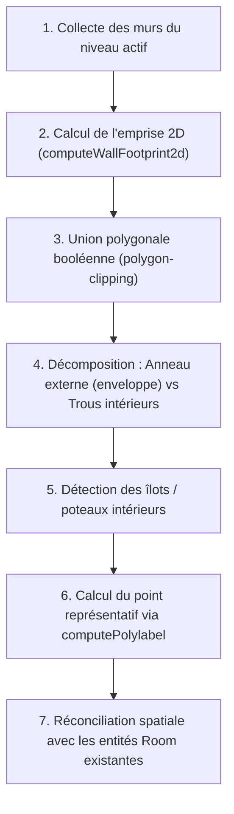

# SPÉCIFICATION TECHNIQUE DU MODULE DE PIÈCES (ROOMS_SPEC.md)

**Statut :** Spécification de Référence — Phase 4  
**Date :** 14 novembre 2026  
**Auteur :** Lead Software Architect & Computational Geometry Engineer  
**Packages d'implémentation :** `@mini-bim/core`, `@mini-bim/geometry`, `@mini-bim/view-2d`, `@mini-bim/view-3d`

---

## 1. Principes Fondamentaux et Axiomes BIM

Le module de pièces architecturales (_Rooms_) obéit aux règles fondatrices de Mini-BIM :

1. **La Pièce est un Élément Dérivé (Règle d'Or 1) :**  
   L'entité `Room` stocke uniquement son identifiant (`id`), sa catégorie (`room`), son niveau d'attachement (`levelId`), un point de repère intérieur (`seed: Vec2`) et un nom (`name: string`).  
   **Aucun polygone n'est persisté dans `BimDocument`**. Le contour géométrique, la surface utile, le périmètre et le volume sont recalculés dynamiquement à la demande à partir de la géométrie courante des murs hôtes.
2. **Détection par Union Booléenne et Extraction de Trous (Règle d'Or 2) :**  
   La fermeture d'une pièce est calculée via l'union booléenne des emprises 2D au sol des murs (`polygon-clipping`). Un trou intérieur dans l'union solide des murs constitue une pièce candidate.
3. **Partitionnement Strict par Niveau (Règle d'Or 3) :**  
   Les murs doivent appartenir au même niveau pour clore un espace. Les espaces à cheval sur plusieurs niveaux sont partitionnés par niveau.
4. **Calcul Strictement Intérieur des Surfaces :**  
   La surface calculée est celle délimitée par la face intérieure des murs (nu intérieur fini). Pour un contour de 4 murs d'axe 4 m × 3 m avec une épaisseur de 200 mm :
   $$\text{Largeur intérieure} = 4\,000 - 200 = 3\,800\text{ mm}$$
   $$\text{Longueur intérieure} = 3\,000 - 200 = 2\,800\text{ mm}$$
   $$\text{Surface intérieure} = 3,8\text{ m} \times 2,8\text{ m} = 10,64\text{ m}^2 \quad (\text{et non l'enveloppe extérieure } 4,2 \times 3,2 = 13,44\text{ m}^2)$$

---

## 2. Modèle de Données et Typage (`@mini-bim/core`)

### 2.1 Interface `Room`

```typescript
export interface Room {
  readonly id: ElementId;
  readonly category: 'room';
  readonly levelId: ElementId;
  readonly seed: Vec2; // Coordonnées 2D mondes intérieures garantissant la réconciliation
  readonly name: string; // "Séjour", "Chambre 1", "Bureau", etc.
}
```

Le document `BimState` intègre la collection indexée :

```typescript
export interface BimState {
  // ...
  readonly rooms: Record<ElementId, Room>;
}
```

### 2.2 Interface `DetectedRoom` (Géométrie Recalculée)

```typescript
export interface DetectedRoom {
  readonly polygon: Vec2[]; // Contour extérieur CCW en mm
  readonly holes?: Vec2[][]; // Îlots intérieurs (ex. piliers / poteaux)
  readonly areaMm2: number; // Surface intérieure nette en mm²
  readonly perimeterMm: number; // Périmètre intérieur en mm
  readonly seed: Vec2; // Point intérieur calculé via polylabel
  readonly existingRoomId?: ElementId; // Identifiant du Room associé
}
```

---

## 3. Algorithme de Détection Automatique (`detectRooms`)

L'algorithme s'exécute en 7 étapes déterministes :



1. **Collecte des Murs :**  
   Sélectionne tous les murs du document associés au `levelId` spécifié.
2. **Génération des Emprises :**  
   Chaque mur génère son polygone d'emprise au sol 2D via `computeWallFootprint2d(wall, thickness)`.
3. **Union Booléenne (`unionPolygonFootprints`) :**  
   L'union multi-polygones produit un ou plusieurs polygones à trous (`MultiPolygon`).
4. **Extraction des Vides Intérieurs :**  
   Tout anneau interne de l'union correspond à un espace clos par des murs. Les anneaux sont orientés dans le sens trigonométrique direct (CCW), garantissant une aire signée positive :
   $$A = \frac{1}{2} \sum_{i=0}^{n-1} (x_i y_{i+1} - x_{i+1} y_i) > 0$$
5. **Association des Poteaux / Îlots :**  
   Si un mur ou un poteau isolé est érigé à l'intérieur d'un vide, son polygone est identifié comme un anneau intérieur (`holes`) et sa surface est automatiquement déduite de la surface de la pièce.
6. **Positionnement du Libellé via `computePolylabel` :**  
   Pour chaque pièce, le centre visuel optimal est déterminé par l'algorithme Polylabel (pôle d'inaccessibilité de Mapbox). Ce point garantit que le texte du libellé ne chevauchera jamais une arête de mur, y compris pour des pièces concaves (en forme de L ou de U).
7. **Réconciliation Sémantique :**  
   Chaque `Room` déclaré dans `state.rooms` est testé via `isPointInPolygon(room.seed, polygon)`. S'il est inclus, le trou adopte son identifiant et son nom. Les pièces détectées sans entité déclarée reçoivent le statut de pièce candidate anonyme.

---

## 4. Cycle de Vie et Statut Dérivé Non-Destructif (ADR-039)

### 4.1 Validation Métier (`rules.ts`)

- `INVALID_ROOM_NAME` : le nom de la pièce doit être une chaîne non vide (après suppression des espaces).
- `UNKNOWN_LEVEL` : le niveau hôte spécifié doit exister dans `state.levels`.
- `ROOM_SEED_NOT_IN_CLOSED_AREA` : lors de la création d'une pièce (`AddRoomCommand`), le `seed` spécifié doit obligatoirement être situé à l'intérieur d'un contour clos détecté sur ce niveau.
- `LEVEL_HAS_ATTACHED_ROOMS` : rejet formel de la suppression d'un niveau si des pièces y sont encore rattachées (`canDeleteLevel`).

### 4.2 Cycle de Vie Non-Destructif des Pièces (Amendant ADR-032 / Aligné sur Revit)

Lorsqu'un mur est supprimé via `DeleteWallCommand` :

1. Le mur est retiré du document et ses ouvertures hébergées sont supprimées en cascade (Phase 3.1).
2. L'espace intérieur peut se retrouver ouvert (perte de la fermeture physique).
3. **Non-destruction de l'entité (`ADR-039`) :** L'entité `Room` n'est **pas** supprimée de `state.rooms`. Elle passe dynamiquement au statut dérivé `unenclosed` (_Non délimitée_) avec surface = 0.
4. Si l'utilisateur redessine un mur fermant l'espace, la pièce retrouve automatiquement son statut `enclosed` et sa surface calculée, sans perte de son nom ni de son identifiant.
5. Seule une commande explicite `DeleteRoomCommand(roomId)` détruit la pièce du modèle.

### 4.3 Statuts Dérivés et Traitement des Doublons (`redundant`) dans les Métrés

Chaque pièce évaluée par `detectRooms` possède l'un des trois statuts spatiaux :

- **`enclosed` :** Pièce unique dans son contour fermé. Sa surface nette, son périmètre et son volume sont calculés et inclus dans le total des surfaces habitables du bâtiment.
- **`unenclosed` :** L'enceinte est ouverte (ou le seed est à l'extérieur). La pièce est annotée _« Non délimitée »_, sa surface est de $0\text{ m}^2$ et n'impacte pas le métré.
- **`redundant` :** Plusieurs graines (`seed`) distinctes se trouvent dans la même enceinte fermée :
  - La première pièce (par ordre chronologique de création ou tri d'identifiant ULID) se voit attribuer la surface de la pièce et est comptabilisée dans la somme totale.
  - La seconde pièce (et les suivantes) reçoit le statut `redundant`. Son libellé est annoté _« Redondante / Doublon »_. **Sa surface est strictement exclue de la somme totale du projet** dans le tableau de métrés (`MetricsPanel`) et les exports CSV pour éradiquer tout double comptage de surface.

---

## 5. Performance, DAG et Invalidation Réactive du Cache (Phase 6 / Phase 9 MEP)

Actuellement, l'algorithme `detectRooms` s'exécute à la demande en $< 2\text{ ms}$ pour une distribution d'étage standard.  
En prévision du dimensionnement multi-niveaux (Phase 6) et des **réseaux MEP (Phase 9)** :

- Une stratégie de mise en cache topologique par niveau (`levelId`) est intégrée au `BimDocument`.
- **Invalidation par le DAG (ADR-041) :** Le cache d'un niveau est invalidé dès que `getChangedIds()` contient un élément de ce niveau :
  - Modification de géométrie de mur (`AddWallCommand`, `UpdateWallCommand`, `DeleteWallCommand`),
  - Modification de type de mur (`UpdateWallTypeCommand` : changement d'épaisseur affectant l'emprise intérieure),
  - Déplacement de sommet ou mur (`MoveWallTool` avec étirement de jonctions),
  - Opérations d'historique Undo / Redo.
- Les requêtes en lecture (affichage plan 2D, tableau de métrés, cotations associatives, passage de gaines MEP) accèdent au résultat pré-calculé en temps constant $\mathcal{O}(1)$.
