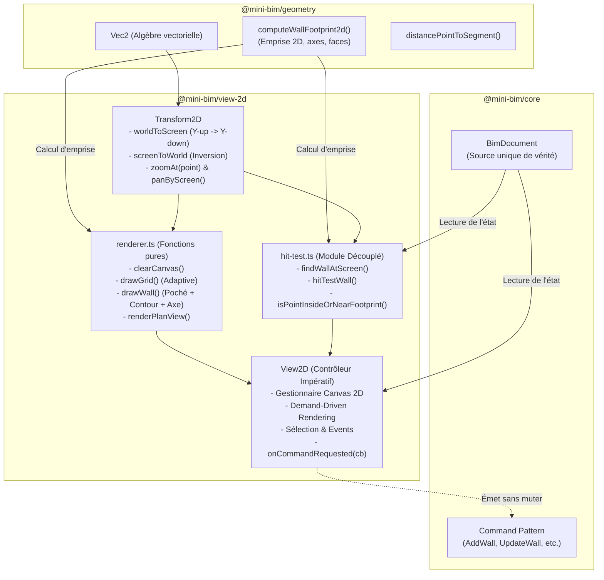

# SPÉCIFICATION TECHNIQUE — PACKAGE `@mini-bim/view-2d`

## Moteur de Visualisation en Plan 2D Impératif (Canvas 2D API) pour Mini-BIM

**Version :** 0.1.0 (Phase 2.1)  
**Date :** 13 Novembre 2026  
**Auteur :** Lead Software Architect & Computational Geometry Engineer  
**Statut :** Spécifié, implémenté et certifié par tests automatisés

---

## 1. Principes Fondamentaux et Règles d'Or

Le package `@mini-bim/view-2d` constitue le visualiseur et moteur de dessin en plan bidimensionnel de l'application Mini-BIM. Il respecte cinq axiomes stricts :

1. **Indépendance Totale envers React, Three.js et Frameworks UI :**  
   `@mini-bim/view-2d` n'importe **aucun** composant ou hook React (`react`, `react-dom`), ni aucun module Three.js. Il s'agit d'une couche impérative pure exploitant la standard Canvas 2D API native du navigateur (`HTMLCanvasElement`, `CanvasRenderingContext2D`). L'intégration dans l'interface web (composant `<Viewport2D />`) relève des couches supérieures (`apps/web` en Phase 2.2).
2. **RÈGLE D'OR : Non-Mutation du Document (`BimDocument`) :**  
   `View2D` ne mute **JAMAIS** directement le document BIM. Pour toute modification sollicitée (tracé, déplacement, suppression), il émet une intention sous forme d'instance de `Command` via le callback `onCommandRequested(cb)`. Le contrôleur applicatif est seul habilité à invoquer `doc.execute(command)`.
3. **Consommation Obligatoire du Noyau Géométrique (`@mini-bim/geometry`) :**  
   Le visualiseur ne réimplémente aucun calcul d'emprise de mur. Il délègue le tracé du poché et des arêtes vues/coupées à la fonction pure `computeWallFootprint2d` de `@mini-bim/geometry`.
4. **Convention d'Axe Vertical Tranchée (ADR-021) :**
   - **Monde architectural :** repère cartésien en millimètres (mm) avec **axe Y vers le haut (Y-up)**, où $+X$ va vers l'Est, $+Y$ vers le Nord, et $Z$ est l'élévation.
   - **Écran Canvas :** repère en pixels avec **axe Y vers le bas (Y-down)**, où $(0,0)$ est le coin supérieur gauche.
   - La classe `Transform2D` prend en charge l'inversion géométrique avec une précision mathématique $\Delta < 10^{-9}$.
5. **Rendu à la Demande (_Demand-Driven Rendering_) :**  
   Aucune boucle continue `requestAnimationFrame` n'est démarrée au repos. Le canvas est repeint uniquement lors des mutations de document, des interactions de caméra (pan, zoom), ou des changements de sélection.

---

## 2. Architecture des Composants



---

## 3. Spécification Mathématique de la Transformation 2D (`Transform2D`)

### 3.1 Définition des Repères

Soit un point du monde architectural $P_w = (x_w, y_w) \in \mathbb{R}^2$ en millimètres, et un point écran $P_s = (x_s, y_s) \in \mathbb{R}^2$ en pixels.  
Soit $(c_x, c_y) = (W / 2, H / 2)$ le centre géométrique du viewport écran de dimensions $W \times H$.  
Soit $\text{origin} = (x_0, y_0)$ les coordonnées monde positionnées au centre de l'écran, et $s > 0$ l'échelle en pixels par millimètre (`scale`).

### 3.2 Formules Directes (`worldToScreen`)

$$ \begin{cases}
x_s = c_x + (x_w - x_0) \cdot s \\
y_s = c_y - (y_w - y_0) \cdot s
\end{cases}$$

> [!NOTE]
> Le signe négatif sur $y_s$ assure l'inversion rigoureuse : un point situé au Nord ($y_w > y_0$) possède une coordonnée écran $y_s < c_y$ (plus haut sur le canvas).

### 3.3 Formules Inverses (`screenToWorld`)

$$\begin{cases}
x_w = x_0 + \dfrac{x_s - c_x}{s} \\
y_w = y_0 - \dfrac{y_s - c_y}{s}
\end{cases}$$

### 3.4 Preuve d'Inversibilité Mathématique

$$\begin{aligned}
x_w' &= x_0 + \frac{(c_x + (x_w - x_0) \cdot s) - c_x}{s} = x_0 + (x_w - x_0) = x_w \\
y_w' &= y_0 - \frac{(c_y - (y_w - y_0) \cdot s) - c_y}{s} = y_0 - (-(y_w - y_0)) = y_w
\end{aligned}$$

La transformation est strictement bijective. Dans l'implémentation en virgule flottante IEEE 754 double précision (`Float64`), l'erreur résiduelle $|P - \text{screenToWorld}(\text{worldToScreen}(P))|$ est inférieure à $10^{-9}\text{ mm}$.

### 3.5 Zoom Centré sur le Curseur (Point Invariant)

Lors d'un zoom multiplicatif par un facteur $k > 0$ centré sur la position écran de la souris $S = (x_s, y_s)$ :
1. Calcul du point monde sous le curseur avant changement d'échelle : $W = \text{screenToWorld}(S)$.
2. Mise à l'échelle bornée : $s' = \mathrm{clamp}(s \cdot k, s_{\min}, s_{\max})$.
3. Recalcul de l'origine pour préserver l'invariance $S = \text{worldToScreen}(W)$ :
   $$x_0' = W_x - \frac{x_s - c_x}{s'}, \quad y_0' = W_y + \frac{y_s - c_y}{s'}$$

### 3.6 Déplacement (Pan)

Lors d'un glissement du pointeur de $\Delta S = (\Delta x_s, \Delta y_s)$ en pixels écran :
$$x_0' = x_0 - \frac{\Delta x_s}{s}, \quad y_0' = y_0 + \frac{\Delta y_s}{s}$$

---

## 4. Pipeline Graphique et Normes Architecturales (`renderer.ts`)

Le pipeline de rendu 2D suit l'ordre de superposition standard des plans d'architecture :

```
┌─────────────────────────────────────────────────────────────┐
│ 1. Effacement et Fond (Canvas Clear + Background Color)    │
├─────────────────────────────────────────────────────────────┤
│ 2. Grille de Repérage & Axes (Minor Grid, Major Grid, Axes) │
├─────────────────────────────────────────────────────────────┤
│ 3. Poché Architectural des Murs (Fill fermé, gris/bleu)    │
├─────────────────────────────────────────────────────────────┤
│ 4. Arêtes Vues / Coupées (Stroke fort, épaisseur 2-3 px)    │
├─────────────────────────────────────────────────────────────┤
│ 5. Lignes d'Axe de Référence (Trait fin pointillé [6, 4])   │
└─────────────────────────────────────────────────────────────┘
```

### 4.1 Grille Adaptative Anti-Saturation

Pour éviter l'apparition d'artefacts de moirage ou la saturation visuelle lors de forts dézooms :
- Un seuil `minPixelSpacing` (défaut : $10\text{ px}$) est imposé.
- Si le pas mineur à l'écran ($\text{minorStepMm} \times s$) est inférieur au seuil, le tracé de la grille mineure est automatiquement neutralisé au profit de la seule grille majeure.

### 4.2 Poché et Graphisme Architectural

- **Poché :** Remplissage plein gris neutre (`#d1d5db`), ou bleu pastel (`#bfdbfe`) pour les éléments sélectionnés.
- **Arêtes vues / coupées :** Tracé noir soutenu (`#111827`) en trait plein (2 px). En sélection, surbrillance bleu roi (`#2563eb`) en 3 px.
- **Ligne d'axe :** Tracé fin (1 px) gris (`#9ca3af`) en tirets alternés `[6, 4]`.

---

## 5. Spécification de l'API Publique de `View2D`

### 5.1 Options d'Initialisation (`View2DOptions`)

```typescript
export interface View2DOptions {
  readonly transform?: Transform2DOptions;
  readonly renderConfig?: Partial<View2DRenderConfig>;
  readonly activeLevelId?: string | null;
  readonly enableInternalSelection?: boolean; // Défaut: true
}
```

### 5.2 Méthodes Publiques Clés

| Méthode | Rôle |
|---|---|
| `render(doc?, selectedIds?)` | Exécute immédiatement le rendu du document sur le Canvas 2D. |
| `update()` | Rafraîchit l'affichage avec l'état et la sélection courants. |
| `setDocument(doc)` | Associe un nouveau `BimDocument` et déclenche un rafraîchissement. |
| `zoomToFit(paddingPx?)` | Cadre automatiquement la vue sur la boîte englobante de tous les murs. |
| `resize(width, height)` | Met à jour la résolution du canvas et le viewport de transformation. |
| `hitTest(screenPos)` | Détecte l'élément architectural sous le curseur en coordonnées écran. |
| `getTransform()` | Retourne l'instance courante de `Transform2D` (repère monde $\leftrightarrow$ écran, échelle, pan). Méthode publique exposée pour les outils interactifs et les tests d'intégration. |
| `setRooms(rooms)` | Définit la liste des pièces détectées (`DetectedRoomFor2D[]`) pour le tracé du poché pastel et des libellés de surface. |
| `getRooms()` | Retourne la liste courante des pièces associées à la vue. |
| `setSelectedIds(ids)` | Met à jour la liste des éléments sélectionnés et notifie les abonnés. |
| `setSelection(ids)` | Alias standardisé de `setSelectedIds` pour conformité avec l'API des Tools. |
| `setPreview(shape)` | Définit ou efface la forme de prévisualisation temporaire (`PreviewShape`). |
| `getPreview()` | Retourne la forme de prévisualisation courante (ou `null`). |
| `onCommandRequested(cb)` | Enregistre un écouteur notifié lors d'une demande de mutation par la vue. |
| `onSelectionChanged(cb)` | Enregistre un écouteur notifié lors d'un changement de sélection. |
| `emitCommand(command)` | Émet une commande vers les écouteurs sans JAMAIS muter le document. |
| `dispose()` | Libère tous les écouteurs d'événements DOM et observateurs de redimensionnement. |

### 5.3 Typage des Formes Temporaires de Prévisualisation (`PreviewShape`)

Les formes géométriques éphémères affichées pendant le tracé ou la sélection sont modélisées par l'union discriminée `PreviewShape` dans le repère monde architectural (mm, Y-up) :

```typescript
export type PreviewShape =
  | { readonly kind: 'line'; readonly start: Vec2; readonly end: Vec2 }
  | { readonly kind: 'rect'; readonly min: Vec2; readonly max: Vec2 }
  | { readonly kind: 'polygon'; readonly points: readonly Vec2[] };
```

- **`line` (WallTool) :** Segment élastique pointillé bleu (`#2563eb`, tirets `[6, 6]`) avec pastilles aux extrémités.
- **`rect` (SelectTool) :** Boîte englobante de sélection rectangulaire (`rgba(37, 99, 235, 0.1)`, contour tirets `[4, 4]`).
- **`polygon` (SlabTool) :** Polygone de prévisualisation élastique semi-transparent (`rgba(37, 99, 235, 0.15)`, contour tirets `[6, 6]`) fermant dynamiquement le polygone entre le premier point et le curseur.

### 5.4 Module de Hit-Testing Découplé (`hit-test.ts`)

Conformément aux principes de modularité, la logique de détection de clic est extraite dans un module pur et indépendant (`hit-test.ts`), exporté par l'API publique du package pour être directement réutilisé par les outils interactifs (`WallTool`) en Phase 2.2 sans aucune duplication de code.

La détection combine deux critères géométriques rigoureux :
1. **Distance au segment d'axe :** Calcul via `distancePointToSegment` de `@mini-bim/geometry`. Le clic est pré-sélectionné si $\text{dist} \le \frac{e}{2} + \text{toleranceMm}$.
2. **Inclusion dans l'emprise polygonale (Poché) :** Test des 4 demi-plans CCW formés par les sommets $[V_0, V_1, V_2, V_3]$ du rectangle d'emprise issu de `computeWallFootprint2d`.
3. **Ordre de parcours :** Les murs sont testés en ordre inverse de création (du plus récent au plus ancien) pour sélectionner l'élément visible au premier plan.

### 5.4 Délégation de Sélection & Mode Dual (`enableInternalSelection`)

L'introduction des machines à états de Tools en Phase 2.3 (`SelectTool`, `WallTool`) a conduit à formaliser deux modes de fonctionnement pour `View2D` :

- **`enableInternalSelection: false` (Mode Recommandé en Production pour `apps/web`) :**
  Dans l'application complète, la gestion des clics, des états d'interaction et de la sélection est exclusivement confiée à `SelectTool` et orchestrée par le hook `useActiveTool`. `View2D` désactive son écouteur interne de clic gauche, évitant tout conflit de sélection ou double-traitement lors du tracé avec `WallTool`.
- **`enableInternalSelection: true` (Mode Autonome / Standalone — Défaut par rétrocompatibilité) :**
  Ce mode autonome permet à `View2D` d'être instancié et utilisé isolément dans des contextes simples (ex: visualiseur en lecture seule ou tests unitaires directs du package sans la stack d'outils applicatifs).

---

## 7. Rendu des Ouvertures Architecturales (Phase 3.2)

Le module `renderer.ts` implémente les représentations normalisées du dessin d'architecture 2D pour les ouvertures hébergées :

```typescript
export function drawOpeningDoor(
  ctx: CanvasRenderingContext2D,
  transform: Transform2D,
  door: DoorFor2D,
  wall: WallFor2D,
  wallThickness: number,
  isSelected?: boolean,
  config?: WallRenderConfig,
  backgroundColor?: string,
): void;

export function drawOpeningWindow(
  ctx: CanvasRenderingContext2D,
  transform: Transform2D,
  window: WindowFor2D,
  wall: WallFor2D,
  wallThickness: number,
  isSelected?: boolean,
  config?: WallRenderConfig,
  backgroundColor?: string,
): void;

export function drawOpenings(
  ctx: CanvasRenderingContext2D,
  transform: Transform2D,
  walls: Record<string, WallFor2D>,
  wallTypes: Record<string, WallTypeFor2D>,
  openings: readonly OpeningFor2D[],
  selectedIds: ReadonlySet<string>,
  config?: WallRenderConfig,
  backgroundColor?: string,
  levelFilter?: string | null,
): void;
```

### Détails des Tracés Normalisés :
1. **Évidement du Poché (Cutout) :**
   Avant de dessiner la menuiserie, un polygone correspondant à la réservation brute est rempli avec `backgroundColor` pour effacer le poché gris du mur.
2. **Portes (`drawOpeningDoor`) :**
   - Ébrasements transversaux fermant la baie de part et d'autre.
   - Vantail de porte orienté à 90° par rapport au mur hôte.
   - Arc de débattement en pointillé de 90° (rayon = largeur d'ouverture). Le sens de rotation écran (`counterclockwise`) est déterminé analytiquement pour gérer l'inversion de l'axe Y et toutes les orientations du mur.
3. **Fenêtres (`drawOpeningWindow`) :**
   - Ébrasements transversaux de baie.
   - Lignes fines d'allège/appui le long des deux parements du mur.
   - Deux lignes parallèles de vitrage bleu architectural (`#3b82f6`) au centre de l'épaisseur du mur.

---

## 9. Rendu des Dalles Structurelles et Réservations (Phase 6.1b)

Le module `renderer.ts` implémente la représentation graphique normalisée des planchers et dalles horizontales (`SlabFor2D`) :

```typescript
export interface SlabFor2D {
  readonly id: string;
  readonly boundary: readonly Vec2[];
  readonly holes?: readonly (readonly Vec2[])[];
  readonly openings?: readonly (readonly Vec2[])[];
  readonly levelId: string;
}

export function drawSlab(
  ctx: CanvasRenderingContext2D,
  transform: Transform2D,
  slab: SlabFor2D,
  isSelected?: boolean,
  colorScheme?: SlabRenderColorScheme,
): void;

export function drawSlabs(
  ctx: CanvasRenderingContext2D,
  transform: Transform2D,
  slabs: readonly SlabFor2D[],
  selectedIds: ReadonlySet<string>,
  levelFilter?: string | null,
): void;
```

### Détails des Tracés Normalisés :
1. **Poché Béton & Hachures à 45° :**
   - Remplissage de fond en gris très clair (`#f3f4f6`).
   - Règle de remplissage `evenodd` découpant proprement les trémies et trémies intérieures (`holes`, `openings`).
   - Hachures techniques à 45° espacées de 20px écran (`#9ca3af`, épaisseur 1px), clippées rigoureusement selon l'empreinte effective de la dalle (`ctx.clip('evenodd')`).
2. **Contour Extérieur & Trémies :**
   - Contour extérieur en trait continu (`#4b5563`, épaisseur 1.5px).
   - En cas de sélection active, surbrillance bleutée (`#2563eb`, épaisseur 2.5px).
   - Trémies et réservations détourées en trait plein fin (`#6b7280`).
3. **Croix de Réservation Normalisée :**
   - Chaque trou intérieur ou réservation de trémie reçoit deux diagonales croisées reliant ses sommets opposés (`#9ca3af`, trait continu fin), conformément aux conventions graphiques du dessin d'architecture pour les réservations dans les planchers.

---

## 10. Couverture de Tests Automatisés

Le package est validé à 100% en environnement headless Vitest / JSDOM (75 tests unitaires et d'intégration) :
- `transform.test.ts` (12 tests) : inversion mathématique $\Delta < 10^{-9}$, Y-up $\to$ Y-down, bijection sur cas asymétriques (+Y, -Y, +X/+Y, -X/-Y), zoom centré invariant, zoomToFit, pan, limites d'échelle.
- `hit-test.test.ts` (4 tests) : test de footprint polygonale, hitTestWall, findWallAtScreen avec filtre de niveau, findOpeningAtScreen.
- `renderer.test.ts` (17 tests) : clearCanvas, grille adaptative avec seuil anti-saturation, axes, poché, contour, axe pointillé, surbrillance de sélection, filtre de niveau, évidement et arc 90° pour portes, évidement et vitrage double pour fenêtres, extraction automatique des ouvertures du document, non-déclenchement sur mur plein.
- `slabs-2d.test.ts` (5 tests) : poché béton, hachures 45°, découpe des trémies avec règle evenodd, croix de réservation normalisée, filtrage par niveau actif.
- `underlay/UnderlayCache.test.ts` (12 tests) : compilation 1 mur, 2 murs, portes avec battant/arc, fenêtres avec ébrasements, niveau vide, hit-cache consécutif, invalidation ciblée par ID de mur ou baie, préservation sur ID externe, purge totale, tolérance segments dégénérés.
- `underlay-view2d.test.ts` (5 tests) : intégration View2D + renderer, tracé normalisé (#9ca3af, tireté 4px, opacité 0.5, lineWidth 1/scale), accesseurs get/setUnderlayLevelId, hit-cache sur pan/zoom, recompilation automatique sur mutation de mur.
- `View2D.test.ts` (16 tests) : initialisation, rendu à la demande, hit-testing, sélection interactive (mode autonome), désactivation de la sélection interne (`enableInternalSelection: false`), prévisualisation temporaire (`setPreview` / `getPreview`), règle d'or d'émission de commande sans mutation de document, immutabilité stricte du document au clic (`doc.toJSON()` invariant), molette, pan, zoomToFit, resize, dispose, déconnexion du ResizeObserver.
- `svg-exporter.test.ts` (4 tests) : export SVG vectoriel multi-échelles.

---

## 11. Vue Fantôme (Underlay) Vectorielle & Cache Path2D (Phase 6.2 / ADR-047)

### 11.1 Principes Architecturaux
1. **Module pur dédié (`UnderlayCache`)** :
   - Totalement découplé de View2D, React et du DOM.
   - Compile l'empreinte vectorielle des murs et des baies hébergées du niveau N-1 en un `Path2D` composé unique en coordonnées monde architecturales (mm).
   - Invalidation ciblée basée sur les identifiants modifiés (`changedIds`) : aucune recompilation inutile lors d'un pan ou zoom (seule la matrice Canvas change).
2. **Contenu normalisé (ADR-047 Décision D2 = Option α)** :
   - Murs porteurs et cloisons sous-jacents (empreinte polygonale rectangulaire).
   - Portes avec trait de battant à 90° et arc de débattement.
   - Fenêtres avec montants d'ébrasement et traits d'allège/vitrage.
   - Exclut délibérément les dalles, pièces et cotations pour une lisibilité optimale.
3. **Représentation graphique (ADR-047)** :
   - Trait fantôme gris neutre : `strokeStyle = '#9ca3af'`.
   - Épaisseur écran constante : `lineWidth = 1 / scale` (toujours 1 pixel à l'écran).
   - Pointillé régulier : `setLineDash([4 / scale, 4 / scale])`.
   - Opacité : `globalAlpha = 0.5`.

---

## 12. Rendu 2D des Escaliers & Prévisualisation (`drawStair`, `drawStairs` — Phase 6.4 / ADR-048)

Livré en Phase 6.4 pour assurer la représentation graphique normalisée des circulations verticales en vue en plan 2D :

```typescript
export interface StairRenderConfig {
  readonly strokeColor: string; // '#4b5563' standard
  readonly strokeWidth: number; // 1.5px
  readonly selectedColor: string; // '#2563eb'
  readonly selectedStrokeWidth: number; // 2.5px
  readonly walklineColor: string; // '#1d4ed8'
  readonly walklineWidth: number; // 1.5px
  readonly riserColor: string; // '#6b7280'
  readonly riserWidth: number; // 1.0px
  readonly startDotRadius: number; // 3.0px
  readonly arrowSize: number; // 6.0px
}

export function drawStair(
  ctx: CanvasRenderingContext2D,
  stair: StairFor2D,
  stairType: StairTypeFor2D,
  transform: Transform2D,
  isSelected: boolean,
  config?: Partial<StairRenderConfig>,
): void;

export function drawStairs(
  ctx: CanvasRenderingContext2D,
  stairs: readonly StairFor2D[],
  stairTypes: Readonly<Record<string, StairTypeFor2D>>,
  transform: Transform2D,
  selectedIds: ReadonlySet<string>,
  config?: Partial<StairRenderConfig>,
): void;
```

### Conventions Graphiques Normalisées (Norme NF P 01-010 / ISO 128) :

1. **Ligne de foulée axiale fléchée :**
   - Axe médian centré sur la largeur de l'escalier allant du pied (`start`) vers l'arrivée (`end`).
   - Pastille circulaire pleine au départ au niveau bas (`startDotRadius = 3.0px`).
   - Flèche directionnelle d'orientation à l'arrivée au niveau haut (`arrowSize = 6.0px`).
2. **Nez de marches transversaux :**
   - $N$ nez de marches espacés de la valeur du giron calculé $g$, perpendiculaires à la trajectoire de l'escalier.
   - Tracé fin (`#6b7280`, épaisseur 1.0px).
3. **Contour périphérique & sélection :**
   - Contour rectangulaire d'emprise totale de la volée (`#4b5563`, épaisseur 1.5px).
   - En cas de sélection active, surbrillance bleutée (`#2563eb`, épaisseur 2.5px).
4. **Vue fantôme (Underlay N-1) :**
   - Si un escalier est situé sur le niveau inférieur N-1, ses contours et ses marches sont projetés en pointillé neutre (`#9ca3af`, tiret 4px / scale) avec opacité 0.5 via `UnderlayCache`.
5. **Prévisualisation interactive (`PreviewShape.kind === 'stair'`) :**
   - Tracé en temps réel lors de l'interaction à deux clics de `StairTool`, avec affichage dynamique des nez de marches et de la ligne de foulée prévisionnels.


