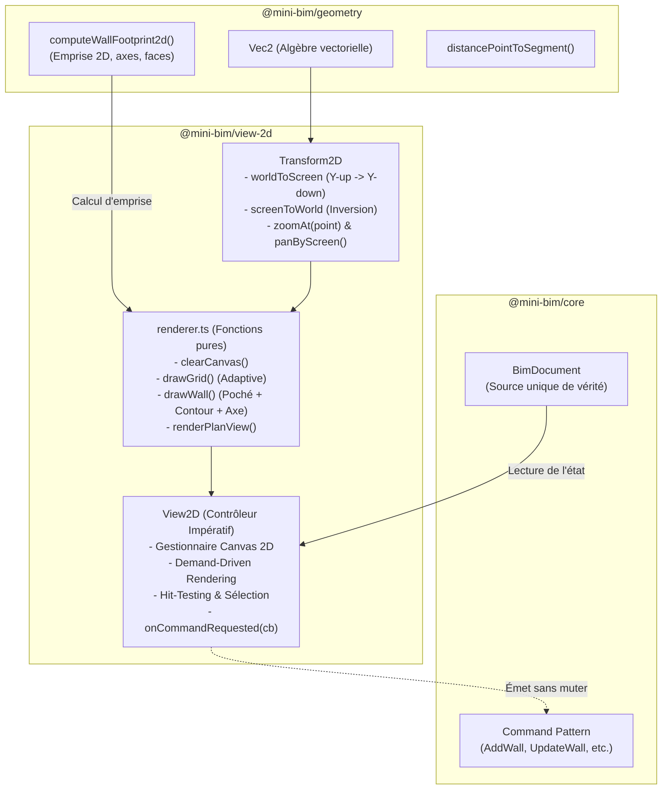

# SPÉCIFICATION TECHNIQUE — PACKAGE `@mini-bim/view-2d`

## Moteur de Visualisation en Plan 2D Impératif (Canvas 2D API) pour Mini-BIM

**Version :** 0.1.0 (Phase 2.1)  
**Date :** 13 Novembre 2026  
**Auteur :** Lead Software Architect & Computational Geometry Engineer  
**Statut :** Spécifié, implémenté et certifié par tests automatisés

---

## 1. Principes Fondamentaux et Règles d'Or

Le package `@mini-bim/view-2d` constitue le visualiseur et moteur de dessin en plan bidimensionnel de l'application Mini-BIM. Il respecte cinq axiomes stricts :

1. **Indépendance Totale envers React, Three.js et Frameworks UI :**  
   `@mini-bim/view-2d` n'importe **aucun** composant ou hook React (`react`, `react-dom`), ni aucun module Three.js. Il s'agit d'une couche impérative pure exploitant la standard Canvas 2D API native du navigateur (`HTMLCanvasElement`, `CanvasRenderingContext2D`). L'intégration dans l'interface web (composant `<Viewport2D />`) relève des couches supérieures (`apps/web` en Phase 2.2).
2. **RÈGLE D'OR : Non-Mutation du Document (`BimDocument`) :**  
   `View2D` ne mute **JAMAIS** directement le document BIM. Pour toute modification sollicitée (tracé, déplacement, suppression), il émet une intention sous forme d'instance de `Command` via le callback `onCommandRequested(cb)`. Le contrôleur applicatif est seul habilité à invoquer `doc.execute(command)`.
3. **Consommation Obligatoire du Noyau Géométrique (`@mini-bim/geometry`) :**  
   Le visualiseur ne réimplémente aucun calcul d'emprise de mur. Il délègue le tracé du poché et des arêtes vues/coupées à la fonction pure `computeWallFootprint2d` de `@mini-bim/geometry`.
4. **Convention d'Axe Vertical Tranchée (ADR-021) :**
   - **Monde architectural :** repère cartésien en millimètres (mm) avec **axe Y vers le haut (Y-up)**, où $+X$ va vers l'Est, $+Y$ vers le Nord, et $Z$ est l'élévation.
   - **Écran Canvas :** repère en pixels avec **axe Y vers le bas (Y-down)**, où $(0,0)$ est le coin supérieur gauche.
   - La classe `Transform2D` prend en charge l'inversion géométrique avec une précision mathématique $\Delta < 10^{-9}$.
5. **Rendu à la Demande (_Demand-Driven Rendering_) :**  
   Aucune boucle continue `requestAnimationFrame` n'est démarrée au repos. Le canvas est repeint uniquement lors des mutations de document, des interactions de caméra (pan, zoom), ou des changements de sélection.

---

## 2. Architecture des Composants



---

## 3. Spécification Mathématique de la Transformation 2D (`Transform2D`)

### 3.1 Définition des Repères

Soit un point du monde architectural $P_w = (x_w, y_w) \in \mathbb{R}^2$ en millimètres, et un point écran $P_s = (x_s, y_s) \in \mathbb{R}^2$ en pixels.  
Soit $(c_x, c_y) = (W / 2, H / 2)$ le centre géométrique du viewport écran de dimensions $W \times H$.  
Soit $\text{origin} = (x_0, y_0)$ les coordonnées monde positionnées au centre de l'écran, et $s > 0$ l'échelle en pixels par millimètre (`scale`).

### 3.2 Formules Directes (`worldToScreen`)

$$ \begin{cases}
x_s = c_x + (x_w - x_0) \cdot s \\
y_s = c_y - (y_w - y_0) \cdot s
\end{cases}$$

> [!NOTE]
> Le signe négatif sur $y_s$ assure l'inversion rigoureuse : un point situé au Nord ($y_w > y_0$) possède une coordonnée écran $y_s < c_y$ (plus haut sur le canvas).

### 3.3 Formules Inverses (`screenToWorld`)

$$\begin{cases}
x_w = x_0 + \dfrac{x_s - c_x}{s} \\
y_w = y_0 - \dfrac{y_s - c_y}{s}
\end{cases}$$

### 3.4 Preuve d'Inversibilité Mathématique

$$\begin{aligned}
x_w' &= x_0 + \frac{(c_x + (x_w - x_0) \cdot s) - c_x}{s} = x_0 + (x_w - x_0) = x_w \\
y_w' &= y_0 - \frac{(c_y - (y_w - y_0) \cdot s) - c_y}{s} = y_0 - (-(y_w - y_0)) = y_w
\end{aligned}$$

La transformation est strictement bijective. Dans l'implémentation en virgule flottante IEEE 754 double précision (`Float64`), l'erreur résiduelle $|P - \text{screenToWorld}(\text{worldToScreen}(P))|$ est inférieure à $10^{-9}\text{ mm}$.

### 3.5 Zoom Centré sur le Curseur (Point Invariant)

Lors d'un zoom multiplicatif par un facteur $k > 0$ centré sur la position écran de la souris $S = (x_s, y_s)$ :
1. Calcul du point monde sous le curseur avant changement d'échelle : $W = \text{screenToWorld}(S)$.
2. Mise à l'échelle bornée : $s' = \mathrm{clamp}(s \cdot k, s_{\min}, s_{\max})$.
3. Recalcul de l'origine pour préserver l'invariance $S = \text{worldToScreen}(W)$ :
   $$x_0' = W_x - \frac{x_s - c_x}{s'}, \quad y_0' = W_y + \frac{y_s - c_y}{s'}$$

### 3.6 Déplacement (Pan)

Lors d'un glissement du pointeur de $\Delta S = (\Delta x_s, \Delta y_s)$ en pixels écran :
$$x_0' = x_0 - \frac{\Delta x_s}{s}, \quad y_0' = y_0 + \frac{\Delta y_s}{s}$$

---

## 4. Pipeline Graphique et Normes Architecturales (`renderer.ts`)

Le pipeline de rendu 2D suit l'ordre de superposition standard des plans d'architecture :

```
┌─────────────────────────────────────────────────────────────┐
│ 1. Effacement et Fond (Canvas Clear + Background Color)    │
├─────────────────────────────────────────────────────────────┤
│ 2. Grille de Repérage & Axes (Minor Grid, Major Grid, Axes) │
├─────────────────────────────────────────────────────────────┤
│ 3. Poché Architectural des Murs (Fill fermé, gris/bleu)    │
├─────────────────────────────────────────────────────────────┤
│ 4. Arêtes Vues / Coupées (Stroke fort, épaisseur 2-3 px)    │
├─────────────────────────────────────────────────────────────┤
│ 5. Lignes d'Axe de Référence (Trait fin pointillé [6, 4])   │
└─────────────────────────────────────────────────────────────┘
```

### 4.1 Grille Adaptative Anti-Saturation

Pour éviter l'apparition d'artefacts de moirage ou la saturation visuelle lors de forts dézooms :
- Un seuil `minPixelSpacing` (défaut : $10\text{ px}$) est imposé.
- Si le pas mineur à l'écran ($\text{minorStepMm} \times s$) est inférieur au seuil, le tracé de la grille mineure est automatiquement neutralisé au profit de la seule grille majeure.

### 4.2 Poché et Graphisme Architectural

- **Poché :** Remplissage plein gris neutre (`#d1d5db`), ou bleu pastel (`#bfdbfe`) pour les éléments sélectionnés.
- **Arêtes vues / coupées :** Tracé noir soutenu (`#111827`) en trait plein (2 px). En sélection, surbrillance bleu roi (`#2563eb`) en 3 px.
- **Ligne d'axe :** Tracé fin (1 px) gris (`#9ca3af`) en tirets alternés `[6, 4]`.

---

## 5. Spécification de l'API Publique de `View2D`

### 5.1 Options d'Initialisation (`View2DOptions`)

```typescript
export interface View2DOptions {
  readonly transform?: Transform2DOptions;
  readonly renderConfig?: Partial<View2DRenderConfig>;
  readonly activeLevelId?: string | null;
}
```

### 5.2 Méthodes Publiques Clés

| Méthode | Rôle |
|---|---|
| `render(doc?, selectedIds?)` | Exécute immédiatement le rendu du document sur le Canvas 2D. |
| `update()` | Rafraîchit l'affichage avec l'état et la sélection courants. |
| `setDocument(doc)` | Associe un nouveau `BimDocument` et déclenche un rafraîchissement. |
| `zoomToFit(paddingPx?)` | Cadre automatiquement la vue sur la boîte englobante de tous les murs. |
| `resize(width, height)` | Met à jour la résolution du canvas et le viewport de transformation. |
| `hitTest(screenPos)` | Détecte l'élément architectural sous le curseur en coordonnées écran. |
| `setSelectedIds(ids)` | Met à jour la liste des éléments sélectionnés et notifie les abonnés. |
| `onCommandRequested(cb)` | Enregistre un écouteur notifié lors d'une demande de mutation par la vue. |
| `onSelectionChanged(cb)` | Enregistre un écouteur notifié lors d'un changement de sélection. |
| `emitCommand(command)` | Émet une commande vers les écouteurs sans JAMAIS muter le document. |
| `dispose()` | Libère tous les écouteurs d'événements DOM et observateurs de redimensionnement. |

### 5.3 Algorithme de Hit-Testing

La détection d'un clic sur un mur combine deux critères complémentaires :
1. **Distance au segment d'axe :** Calcul via `distancePointToSegment` de `@mini-bim/geometry`. Le clic est pré-sélectionné si $\text{dist} \le \frac{e}{2} + \text{toleranceMm}$.
2. **Inclusion dans l'emprise polygonale (Poché) :** Test des 4 demi-plans CCW formés par les sommets $[V_0, V_1, V_2, V_3]$ du rectangle d'emprise issu de `computeWallFootprint2d`.
3. **Ordre de parcours :** Les murs sont testés en ordre inverse de création (du plus récent au plus ancien) pour sélectionner l'élément visible au premier plan.

---

## 6. Couverture de Tests Automatisés

Le package est validé à 100% en environnement headless Vitest / JSDOM (29 tests unitaires et d'intégration) :
- `transform.test.ts` (11 tests) : inversion mathématique $\Delta < 10^{-9}$, Y-up $\to$ Y-down, zoom centré invariant, zoomToFit, pan, limites d'échelle.
- `renderer.test.ts` (8 tests) : clearCanvas, grille adaptative, axes, poché, contour, axe pointillé, surbrillance de sélection, filtre de niveau.
- `View2D.test.ts` (10 tests) : initialisation, rendu à la demande, hit-testing, sélection interactive, règle d'or d'émission de commande sans mutation de document, molette, pan, zoomToFit, resize, dispose.
$$
