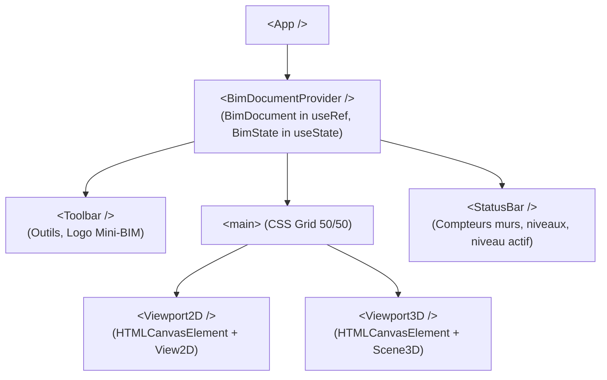

# SPÉCIFICATION TECHNIQUE — APPLICATION WEB MINI-BIM (`apps/web`)

**Statut :** Spécification de Référence  
**Date :** 14 novembre 2026  
**Auteur :** Lead Software Architect & BIM Specialist

---

## 1. Vue d'Ensemble et Périmètre

L'application web (`apps/web`) est le point d'entrée utilisateur et l'interface graphique (GUI) de Mini-BIM. Elle orchestre la double visualisation synchronisée :

- **Vue 2D (Plan d'étage architectural) :** Canvas 2D impératif via `@tabax/view-2d`.
- **Vue 3D (Maquette orbitale Z-up) :** Scène Three.js impérative via `@tabax/view-3d`.

L'application est construite avec **React 19**, **Vite** et **TypeScript**.

---

## 2. Règles d'Or Architecturales de `apps/web`

1. **Règle d'or 1 — Frontières d'importation :**
   - `apps/web` peut importer : `react`, `react-dom`, `@tabax/core`, `@tabax/view-2d`, `@tabax/view-3d`.
   - `apps/web` n'importe **JAMAIS** `@tabax/geometry` directement.
2. **Règle d'or 2 — Isolation géométrique :**
   - Toutes les conversions géométriques vers des maillages 3D passent par `@tabax/view-3d` (ex. `createWallMesh`).
   - Toutes les logiques de tracé et poché 2D sont internes à `@tabax/view-2d`.
3. **Règle d'or 3 — Cycle de vie des contrôleurs graphiques :**
   - Les instances impératives `View2D` et `Scene3D` sont créées **une seule et unique fois** lors du montage du composant dans un `useEffect(..., [])`.
   - Elles sont conservées dans des `useRef` et ne sont **jamais recréées** lors des re-renders React.
   - Leur méthode `dispose()` est obligatoirement appelée dans la fonction de nettoyage (cleanup) lors du démontage (unmount).
4. **Règle d'or 4 — Pureté de l'état React et modèle documentaire :**
   - Le document `BimDocument` est une instance impérative stockée dans un `useRef` persistant dans `BimDocumentProvider`.
   - Le state React (`useState`) ne contient **QUE** la projection immuable `BimState` obtenue via `doc.getState()`.
   - La synchronisation s'effectue via l'abonnement réactif `doc.subscribe()`.
5. **Règle d'or 5 — Composants d'observation et de délégation :**
   - Les composants React ne contiennent aucune logique métier CAO/BIM.
   - Ils observent `state` et délèguent toutes les mutations transactionnelles à `execute(command)`.

---

## 3. Architecture des Composants



---

## 4. Gestion du Contexte Documentaire (`BimDocumentContext`)

Le contexte `BimDocumentContext` expose une API réactive et typée aux composants descendants :

```typescript
export interface BimDocumentContextValue {
  readonly doc: BimDocument;
  readonly state: BimState;
  readonly execute: (cmd: Command) => CommandResult;
  readonly undo: () => boolean;
  readonly redo: () => boolean;
  readonly canUndo: () => boolean;
  readonly canRedo: () => boolean;
}
```

### Comportement Réactif

- Lors de l'exécution d'une commande (`execute(cmd)`), `doc` produit un nouveau `BimState` via Immer et notifie ses abonnés.
- Le callback de souscription exécute `setState(doc.getState())`.
- React déclenche alors un re-render ciblé des composants observant le contexte (`StatusBar`, les effets de synchronisation des viewports).

---

## 5. Cycle de Vie des Viewports

### 5.1 `<Viewport2D />`

- **Montage :**
  - Mesure des dimensions du conteneur parent.
  - Instanciation de `new View2D(canvas, options)`.
  - Appel de `view2d.setDocument(doc)`.
  - Cadrage automatique initial `view2d.zoomToFit(60)`.
- **Mises à jour :**
  - Un `useEffect([state, doc])` appelle `view2d.render(doc)`.
  - Aucune réinstanciation de `View2D`.
- **Démontage :**
  - Appel de `view2d.dispose()`.

### 5.2 `<Viewport3D />`

- **Montage :**
  - Mesure des dimensions du conteneur parent.
  - Instanciation de `new Scene3D(canvas, options)`.
  - Initialisation de la caméra orbitale Z-up et de la grille de sol.
- **Mises à jour (différentielles) :**
  - Un `useEffect([state])` compare l'ensemble des `wallId` actuels avec `renderedWallIdsRef`.
  - Pour les murs supprimés : `scene.removeMesh(id)`.
  - Pour les murs nouveaux : `scene.addMesh(rawMesh)`.
  - Pour les murs modifiés : `scene.updateMesh(rawMesh)`.
  - Appel de `scene.render()`.
- **Démontage :**
  - Appel de `scene.dispose()`.

---

## 6. Layout Applicatif et Rendu Visuel

L'interface adopte une disposition en grille CSS plein écran (`100vw` $\times$ `100vh`) sans barres de défilement parasites :

```
+-----------------------------------------------------------------------------+
| Mini-BIM | Projet Demo | Mode : Consultation (Squelette v2.2)               | (Toolbar, 48px)
+--------------------------------------+--------------------------------------+
| Vue 2D (Plan Y-up -> Y-down)         | Vue 3D (Perspective Z-up orbitale)   |
|                                      |                                      |
|                                      |                                      |
|            [ Canvas 2D ]             |           [ Canvas WebGL ]           |
|                                      |                                      |
|                                      |                                      |
+--------------------------------------+--------------------------------------+
| Niveau actif : Niveau 0 (0.00 m)  |  Murs : 4  |  Niveaux : 1  |  Mini-BIM   | (StatusBar, 28px)
+-----------------------------------------------------------------------------+
```

---

## 7. Prévention des Fuites Mémoire

L'absence de fuite mémoire est validée par des tests d'intégration simulant 10 cycles consécutifs de montage et de démontage complet de l'arbre `<App />`. Chaque cycle vérifie que :

1. Les écouteurs d'événements DOM (ResizeObserver, pointer events) sont déconnectés.
2. Les contextes et ressources GPU (buffers, géométries Three.js) sont libérés via `dispose()`.
3. Aucune exception console React ou mémoire n'est levée.

---

## 8. Support et Validation de React.StrictMode

En environnement de développement (`npm run dev`), React enveloppe l'arbre applicatif dans `<StrictMode>` (`apps/web/src/main.tsx`). Cette configuration force un double montage (`mount` $\rightarrow$ `unmount` $\rightarrow$ `mount`) pour chaque composant afin de révéler les effets secondaires non nettoyés.

Mini-BIM supporte nativement et valide `StrictMode` :

1. Le premier cycle de montage initialise `View2D` et `Scene3D`.
2. Le cycle de nettoyage déclenché par StrictMode appelle immédiatement `view.dispose()` et `scene.dispose()`, libérant les écouteurs et tampons WebGL.
3. Le second montage réinstancie des contrôleurs sains sans superposition de canvas, sans écouteurs orphelins et sans fuite mémoire.
4. Cette résilience est couverte et validée par un test d'intégration automatisé (`App.test.tsx`).
