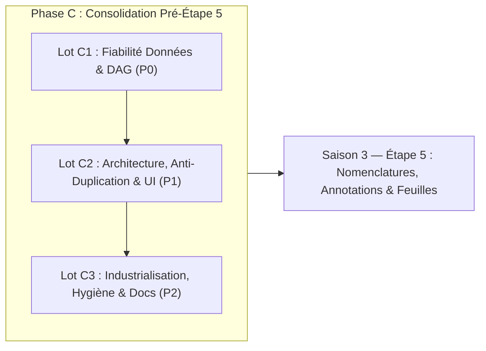
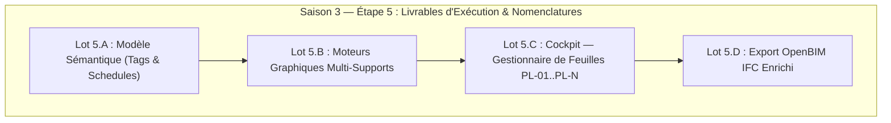

# TABAX — Synthèse d'Audit Consolidée & Feuille de Route Technique
*Document de référence — Consolidation Pré-Étape 5 & Vision v1.0*  
*Date : 22 novembre 2026 | Version de référence : HEAD `5217a0a` | État : 1 305 tests verts*

---

## 1. Synthèse Exécutive & Verdict des Audits Externes

L'analyse croisée des audits indépendants (Gemini, ChatGPT, Kimi, Claude Sonnet 3.5/5.5, DeepSeek) confirme que **TABAX a franchi le cap d'un simple éditeur de plans pour devenir un véritable moteur BIM paramétrique local-first en TypeScript pur**. 

### 1.1 Métriques objectives vérifiées
* **Codebase :** 509 fichiers, 256 fichiers sources (~52 870 LOC), 137 fichiers de tests (~37 400 LOC). Ratio test/code = **0,71**.
* **Qualité statique :** 0 erreur TypeScript strict, 0 warning ESLint, 0 `any` en code de production, 0 `TODO/FIXME`, 0 `@ts-ignore`.
* **CI & Validation :** 1 305 tests Vitest unitaires et d'intégration à 100 % passants sur 136 suites, 11 tests Playwright E2E réels sur Chromium.
* **Performances palier 10k entités :** Résolution globale de 4 000 murs en **56 ms** (cible < 100 ms), mutation unitaire en **15,3 ms** (cible < 50 ms).

### 1.2 Le diagnostic partagé : Le contrecoup de la croissance
Le projet souffre d'une dette d'industrialisation et de cohérence suite à l'enchaînement ultra-rapide des Phases 8, 9, 10 et des Étapes 1 à 4 de la Saison 3 :
1. **Divergences silencieuses de données** sur la maquette étalon (`demo-immeuble-r4.json` : angles en degrés au lieu de radians, dalle à `baseOffset: -200`).
2. **Fuite d'invalidation du DAG dans la 3D** : `Viewport3D.tsx` recalcule son propre graphe d'invalidation ; la suppression d'un mur ne met pas à jour le maillage des murs adjacents en mode incrémental.
3. **Quadruple duplication du rendu plan 2D** : Canvas, SVG, DXF et PDF recalculent chacun séparément la même géométrie d'étage.
4. **Réapparition de 4 gros monolithes (> 1 000 LOC)** dans le domaine MEP et IFC.
5. **Gouvernance & Roadmap** : L'Étape 5 n'est définie dans aucun document officiel.

---

## 2. Matrice d'Audit Consolidée (24 Points Clés)

| ID | Domaine | Gravité | Constat & Diagnostic Technique | Solution Recommandée |
|---|---|:---:|---|---|
| **A-01** | **Géométrie / Données** | **P0** | Angles en degrés au lieu de radians dans `demo-immeuble-r4.json` (ex: `rotation: 180` interprété en 180 rad = 236°). | Normaliser en radians (`Math.PI`) dans le générateur et le JSON. |
| **A-02** | **Modèle / Données** | **P0** | `baseOffset: -200` sur dalles de 200 mm dans R+4 créant un vide d'air de 200 mm sous les cloisons. | Corriger `baseOffset: 0` dans la maquette R+4 conforme à l'ADR-035. |
| **A-03** | **Rendu 3D / DAG** | **P0** | `Viewport3D.tsx` n'invalide pas les murs voisins lors de `DeleteWall` / `UpdateWall` (jonctions fantômes persistantes). | Exposer `getInvalidationSet()` depuis `core` et propager l'adjacence. |
| **A-04** | **Packaging / Build** | **P0** | `web-ifc` est en `devDependencies` dans `packages/core/package.json` alors que `core/src/federation/loader.ts` l'importe en production. | Basculer `web-ifc` dans les `dependencies` de `packages/core`. |
| **A-05** | **Garde-fous CI** | **P0** | Le test de pureté `T-PUR-02` vérifiait encore `@mini-bim/geometry` (test mort depuis le renommage). | Mettre à jour avec `@tabax/geometry` et ajouter `no-restricted-imports` ESLint. |
| **B-01** | **Rendu 2D / Livrables** | **P1** | Quadruple duplication de la projection plan : `plan-view.ts`, `svg-exporter.ts`, `plan-dxf.ts`, `render-plan-page.ts`. | Introduire le modèle intermédiaire `PlanScene` (analogue à `SectionScene`). |
| **B-02** | **Architecture Core** | **P1** | `getDependencyGraph()` expose directement `this._dag` mutable en écriture (`addEdge`, `removeEdge`). | Retourner une interface en lecture seule `ReadonlyDependencyGraph`. |
| **B-03** | **Monolithes Code** | **P1** | Réapparition de 4 fichiers > 1 000 LOC : `mep/commands.ts` (1 374 LOC), `routing.ts` (1 061), `Scene3D.ts` (1 042), `ifc/generator.ts` (986). | Scinder par sous-domaine fonctionnel conforme à l'ADR-055. |
| **B-04** | **UI / Cockpit** | **P1** | Absence d'`ErrorBoundary` React : tout plantage d'un viewport ou modal provoque un écran blanc. | Ajouter 3 `ErrorBoundary` modulaires avec bouton de restauration IDB. |
| **B-05** | **UI / Outils** | **P1** | Sélection de type figée : `activeWallTypeId` forcé sur le premier type du document (`[0]`) dans `Viewport2D`. | Ajouter le sélecteur de type d'élément actif dans la Toolbar. |
| **B-06** | **Performance Web** | **P1** | `minify: false` dans `apps/web/vite.config.ts` produisant un bundle initial brut de 3,1 Mo. | Activer la minification ESBuild / Terser (gain 3× à 4× sur le transfert). |
| **B-07** | **Clash Detection** | **P1** | Primitives de clash simplifiées en OBB pleines (ignore réservations et trémies -> faux positifs). | Raffiner les primitives avec soustraction des ouvertures hôtes. |
| **B-08** | **Interopérabilité IFC** | **P1** | Toits inclinés et escaliers exportés en solides extrudés verticaux simplifiés ; pas d'export MEP natif. | Formaliser les limites OpenBIM et affiner les profils triangulés de versants. |
| **C-01** | **Transactions / Historique** | **P2** | `HistoryStack` non borné en mémoire, sans nom de commande métier et sans coalescence des drags. | Plafonner la pile (500 ops), nommer les commandes et ajouter la coalescence. |
| **C-02** | **Transactions / DAG** | **P2** | `undo()` / `redo()` mutent le DAG in-place sans le clonage atomique de `execute()`. | Aligner la stratégie de rollback du DAG pour garantir l'atomicité stricte. |
| **C-03** | **Persistance multi-onglets** | **P2** | Stratégie "Last-Write-Wins" sur IndexedDB exposant à des écrasements silencieux. | Implémenter Web Locks API + `BroadcastChannel` pour alerter l'utilisateur. |
| **C-04** | **Couverture de tests** | **P2** | Taux de couverture inconnu ; aucune commande `coverage` configurée ni seuil CI. | Configurer `@vitest/coverage-v8` avec seuil bloquant (ex: 80 % sur core). |
| **C-05** | **CI & Stabilité** | **P2** | Benchmarks temps réel (`< 50 ms`) dans la suite unitaire sur runners CI variables ; pas de `--frozen-lockfile`. | Isoler la suite de perf dans un job dédié et figer le lockfile. |
| **C-06** | **Qualité E2E** | **P2** | `smoke.spec.ts` monolithique (462 LOC, 11 tests dans un seul fichier, sélecteurs à double fallback). | Découper par domaine fonctionnel et stabiliser les `data-testid`. |
| **C-07** | **Sécurité Exports** | **P2** | Pas de sanitization stricte sur les labels de pièces/projets injectés dans le SVG/PDF. | Échapper systématiquement les chaînes utilisateur contre les injections SVG. |
| **C-08** | **Branding & Registre IDB** | **P2** | Base IndexedDB toujours nommée `mini_bim_autosave` ; extensions `.mbim.json`. | Définir un pont de migration vers `tabax_autosave` et `.tabax.json`. |
| **C-09** | **Hygiène Dépôt Git** | **P2** | Fixture `demo-immeuble-r4.json` de 1,31 Mo (48k lignes) et fichiers générés orphelins à la racine. | Minifier le JSON et purger les images/exports à la racine du dépôt. |
| **C-10** | **Gouvernance & Specs** | **P2** | Incohérences documentaires (`ADR-061` absent du corps de `DECISIONS.md`, ROADMAP sans Étape 5). | Synchroniser le registre ADR, les specs de domaine et officialiser l'Étape 5. |
| **C-11** | **Composant orphelin** | **P2** | `LevelSelector.tsx` résiduel dans `apps/web/src/components/` alors que la Toolbar l'intègre. | Supprimer le composant et son test unitaire associé. |

---

## 3. Feuille de Route : Phase C — Sprint de Consolidation Pré-Étape 5

Avant d'ouvrir de nouveaux chantiers fonctionnels, un sprint de durcissement structuré en **3 lots autonomes** permet d'assainir 100 % de la dette critique.



### Lot C1 — Fiabilité des Données, Intégrité du DAG & Garde-fous (Priorité P0)
*Objectif : Éliminer 100 % des bugs silencieux et sécuriser les contrats fondamentaux du monorepo.*
1. **Normalisation de `demo-immeuble-r4.json` :**
   * Correction des rotations en radians (`Math.PI` au lieu de `180`, `Math.PI / 2` au lieu de `90`) dans `scripts/generate-immeuble-r4.cjs` et régénération.
   * Correction de `baseOffset: 0` sur toutes les dalles courantes (élimination du vide de 200 mm sous les cloisons).
2. **Propagation de l'invalidation d'adjacence 3D (Correctif P1.1) :**
   * Enrichir `getChangedIds()` ou introduire `getInvalidationSet(changedIds)` dans `@tabax/core` pour inclure les murs connectés topologiquement lors d'un `DeleteWall` ou `UpdateWall`.
   * Supprimer le scan d'invalidation ad-hoc dans `Viewport3D.tsx`. Test de non-régression validant le re-maillage immédiat des murs voisins.
3. **Packaging & Garde-fous CI :**
   * Déplacer `web-ifc` des `devDependencies` vers `dependencies` dans `packages/core/package.json`.
   * Corriger `T-PUR-02` dans `purity.test.ts` (`@tabax/geometry`) et verrouiller par une règle ESLint `no-restricted-imports`.
4. **Encapsulation du DAG :**
   * Remplacer le retour mutable direct de `BimDocument.getDependencyGraph()` par une interface `ReadonlyDependencyGraph`.

### Lot C2 — Architecture, Anti-Duplication & Robustesse Cockpit (Priorité P1)
*Objectif : Diviser par 4 le coût de maintenance 2D, aérer le code et sécuriser l'expérience utilisateur.*
1. **Modèle intermédiaire `PlanScene` dans `@tabax/view-2d` :**
   * Extraire un résolveur géométrique unique `computePlanScene(doc, levelId, options)` qui rassemble murs résolus, baies avec arcs d'ouverture, dalles, trémies, escaliers, pièces et MEP.
   * Brancher les 4 moteurs (`plan-view.ts`, `svg-exporter.ts`, `plan-dxf.ts`, `render-plan-page.ts`) sur `PlanScene`.
2. **Découpage des 4 monolithes majeurs :**
   * `packages/core/src/mep/commands.ts` (1 374 LOC) $\to$ éclater en `commands/mep/segments.ts`, `fittings.ts`, `systems.ts`, `routing.ts`.
   * `packages/core/src/ifc/generator.ts` (986 LOC) $\to$ isoler `ifc/walls.ts`, `slabs.ts`, `roofs.ts`, `spaces.ts`, `openings.ts`.
   * `packages/view-3d/src/Scene3D.ts` (1 042 LOC) $\to$ extraire `ClashOverlayManager` et `SectionClippingController`.
3. **Robustesse Cockpit & UI :**
   * Encadrer l'arbre React de 3 `ErrorBoundary` (`ViewportArea`, `DockPanels`, `Modals`) avec fallback graphique et bouton de restauration d'urgence.
   * Implémenter le sélecteur de type d'élément actif (`TypeSelector`) dans la `Toolbar` (choix du type de mur et de dalle avant tracé).
4. **Contrôle mémoire de l'historique :**
   * Ajouter une limite maximale (ex: 500 opérations) dans `HistoryStack` avec éviction FIFO et étiquetage métier du libellé de commande.

### Lot C3 — Industrialisation, Hygiène Dépôt & Gouvernance (Priorité P2)
*Objectif : Clôturer la dette technique périphérique et aligner les standards d'ingénierie.*
1. **Performance Web & Build :**
   * Activer la minification dans `apps/web/vite.config.ts` (`minify: 'esbuild'`).
   * Mesurer le gain sur le bundle de distribution.
2. **Sécurité multi-onglets :**
   * Ajouter un verrou Web Locks API (`navigator.locks`) au chargement d'un projet pour prévenir les écrasements simultanés sur le même store IndexedDB.
3. **Pipeline de Couverture & CI :**
   * Ajouter le script `pnpm coverage` via `@vitest/coverage-v8`.
   * Figer les installations CI avec `pnpm install --frozen-lockfile`.
   * Isoler les tests de performance synthétique derrière `RUN_PERF_BENCHMARKS=true` pour fiabiliser la CI standard.
4. **Hygiène Git & Documentation :**
   * Purger les artefacts racine résiduels (`demo-roof-plan.json`, `.png`, `.ifc`, `.svg`).
   * Supprimer le composant orphelin `LevelSelector.tsx` et son test.
   * Réinsérer `ADR-061` dans le corps de `DECISIONS.md`, aligner les specs racine (`CORE_SPEC.md`, `ARCHITECTURE.md`) et officialiser l'Étape 5 dans `ROADMAP.md`.

---

## 4. Cadrage Technique Formel de la Saison 3 — Étape 5

### Titre : **« Nomenclatures Paramétriques, Étiquettes Associatives & Gestion des Feuilles »**
*Orientation : Parachever la chaîne de production documentaire pour transformer Tabax en suite complète d'exécution architecturale.*



### 4.1 Lot 5.A : Modèle sémantique & Noyau (`@tabax/core`)
* **Entité `AnnotationTag` :** Étiquette 2D associative liée à un élément hôte (`hostId`, catégorie mur/porte/fenêtre/pièce/MEP). Calcule dynamiquement son libellé via un gabarit paramétrique (ex: `"{type.name} — L:{width} H:{height}"` ou `"{room.name} : {room.netArea} m²"`). Déplacement libre avec ligne de repère (leader line).
* **Entité `Schedule` (Nomenclature paramétrique) :** Tableau de métriques et quantitatifs filtrable par catégorie et par niveau, avec tri, regroupement par type et totalisation automatique (surfaces de pièces, linéaires de murs par type, décompte de menuiseries, linéaires et diamètres de réseaux MEP).
* **Commandes transactionnelles & DAG :** Intégration dans `BimDocument`, `validateDirty` différentiel et propagation automatique des changements géométriques vers les étiquettes et tableaux.

### 4.2 Lot 5.B : Moteur de Rendu Multi-Supports (`@tabax/view-2d`)
* **Parité graphique stricte :** Rendu des étiquettes associatives et tableaux de nomenclature sur les 4 sorties unifiées via `PlanScene` :
  1. **Canvas 2D interactif :** Affichage avec anti-collision et accrochage.
  2. **SVG :** Groupes `<g id="TAGS">` et `<g id="SCHEDULES">` stylisés.
  3. **DXF R12 :** Calques normalisés `ARCH-TAGS` et `ARCH-TABLES` avec blocs et textes formatés.
  4. **PDF 1.4 vectoriel :** Pagination multi-tableaux et insertion propre au-dessus du cartouche.

### 4.3 Lot 5.C : Cockpit — Gestionnaire de Feuilles & Cartouches (`apps/web`)
* **Gestionnaire de Feuilles (`SheetManager`) :** Navigation et réorganisation visuelle des planches d'exécution (`PL-01` Plan de masse, `PL-02` RDC, `PL-03` R+1, etc.).
* **Cartouche Paramétrique Dynamique :** Champs éditables (titre d'affaire, phase PRO/DCE, indice de révision, date automatique, échelle par vue).
* **Export PDF Multi-Planches Personnalisé :** Sélection des planches à inclure dans le carnet relié A3/A4.

### 4.4 Lot 5.D : Qualification OpenBIM & Clôture de Saison
* **Extension de l'export IFC :** Intégration des propriétés quantitatives standardisées (`Qto_WallBaseQuantities`, `Qto_SpaceBaseQuantities`, `Qto_DoorBaseQuantities`).
* **Test de qualification E2E complet :** Validation du cycle complet de production d'un carnet d'exécution sur la maquette étalon R+4 et sur la Résidence Horizon R+2.

---

## 5. Calendrier Recommandé d'Exécution

```
Semaine 1 (J1 - J3)  : Phase C — Lot C1 (Correctifs P0, invalidation voisins 3D, packaging web-ifc)
Semaine 1 (J4 - J5)  : Phase C — Lot C2 (Moteur PlanScene, découpage monolithes, ErrorBoundary)
Semaine 2 (J6 - J7)  : Phase C — Lot C3 (Minification, locks IDB, couverture de tests, hygiène doc)
Semaine 2 (J8 - J10) : Étape 5 — Lot 5.A & 5.B (Modèle Tags/Schedules & Rendu multi-moteurs)
Semaine 3 (J11 - J13): Étape 5 — Lot 5.C & 5.D (Gestionnaire de feuilles, cartouches & qualification)
```
