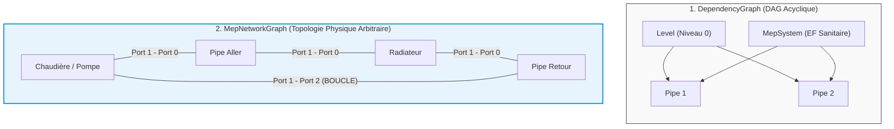

# Note d'Architecture Préalable — Phase 9.2
## Noyau Métier MEP & Modèle Topologique des Réseaux Techniques

**Projet :** Mini-BIM (`mini-Revit`)  
**Phase :** 9.2 — Noyau MEP (`feat/phase-9-2-mep-core`)  
**Date :** Novembre 2026  
**Auteurs :** Ingénieur Principal & Architecte Logiciel  
**Statut :** Cadrage Validé — Conception du Noyau  

---

## 1. Principes Directeurs & Cadre Contractuel

Conformément à l'**ADR-009** (*Extensibilité du Modèle pour les Réseaux MEP*), le domaine du génie climatique, de la plomberie et des courants techniques ne doit ni polluer ni fragiliser le noyau architectural de Mini-BIM.

### Périmètre strict de la Phase 9.2 :
- **Autorisé & Obligatoire :** Modèle sémantique typé, ports et connecteurs, typage des domaines et fluides, graphe topologique physique (`MepNetworkGraph`), validation transactionnelle, cascade de suppression, sérialisation et Undo/Redo.
- **Strictement Proscrit :** Routage géométrique automatique, calculs de coudes/tés 3D, rendu Canvas 2D ou Three.js 3D, détection de collisions 3D (BVH/OBB), dimensionnement hydraulique ou aéraulique (débits/pertes de charge).

---

## 2. État des Lieux de l'Infrastructure Existante

| Composant | État Actuel | Stratégie d'Intégration MEP |
| :--- | :--- | :--- |
| **`BimState`** | 18 dictionnaires typés indexés par `ElementId` (schéma v2). | Ajout des dictionnaires optionnels : `pipes`, `ducts`, `cableTrays`, `mepFittings`, `mepEquipments`, `mepSystems`, `mepConnectors`. |
| **`ENTITY_CATEGORY_DESCRIPTORS`** | 18 descripteurs déclaratifs unifiant catégorie, champ d'état et libellé. | Extension déclarative avec 7 nouvelles catégories : `pipe`, `duct`, `cableTray`, `mepFitting`, `mepEquipment`, `mepSystem`, `mepConnector`. |
| **`RELATIONS_REGISTRY`** | Registre déclaratif régissant `onDelete` (`cascade`, `restrict`, `detach`). | Enregistrement des rattachements de niveau (`levelId`), de système (`systemId`) et de ports pour automatiser les suppressions cohérentes sans orphelins. |
| **`DependencyGraph` (DAG)** | Graphe orienté **strictement acyclique** pour la propagation d'invalidation. | **Aucune arête de flux/connexion physique entre éléments MEP.** Le DAG ne gère que les dépendances structurelles (`levelId`, `systemId`). |
| **`BimDocument`** | Moteur transactionnel basé sur Immer (`produceWithPatches`) + `HistoryStack`. | Commandes dédiées (`AddPipe`, `UpdatePipe`, `DeletePipe`, `ConnectPorts`, etc.) garantissant l'atomicité et l'inversion stricte des patches. |
| **`validateDirty`** | Validation différentielle post-condition. | Ajout de `checkMepViolations` pour les éléments modifiés uniquement. **Zéro boucle $\mathcal{O}(N^2)$ globale** (pas de collision exhaustive). |
| **Sérialisation JSON** | Schéma v2 validé avec migration automatique. | Rétrocompatibilité totale garantie : les anciennes maquettes sans section MEP se chargent sans altération. |

---

## 3. Séparation Fondamentale des Deux Graphes

L'enseignement majeur de la Phase 9.1 et de l'analyse architecturale est la **distinction conceptuelle et structurelle absolue** entre le graphe de dépendances BIM et le graphe physique de réseau MEP :



### Justification :
1. **`DependencyGraph` :** Sa responsabilité est la propagation des invalidations géométriques et documentaires. Tout cycle dans ce graphe constitue une erreur fatale (`CYCLE_DETECTED`).
2. **`MepNetworkGraph` :** Sa responsabilité est la continuité physique des fluides, le calcul des composantes connexes (réseaux/sous-réseaux), la détection des extrémités ouvertes et le parcours topologique. **Les boucles hydrauliques fermées (aller/retour chauffage, boucles de recyclage ECS) y sont naturelles et courantes.** Il ne doit donc jamais être soumis à la contrainte d'acyclicité.

---

## 4. Modèle Sémantique MEP

### 4.1 Entités Sémantiques
- **`Pipe` (Tuyauterie) :** Segment linéaire de transport de liquide sous pression ou gravitaire (diamètre nominal, matériau, pente optionnelle).
- **`Duct` (Gaine aéraulique) :** Conduit de transport d'air (section circulaire ou rectangulaire, isolation, débit indicatif).
- **`CableTray` (Chemin de câbles) :** Support physique de câblage électrique ou télécom (largeur, hauteur de rebord).
- **`MepFitting` (Raccord) :** Élément de jonction géométrique ou transitionnelle (coude, té, réduction, bouchon).
- **`MepEquipment` (Équipement technique) :** Appareil actif ou passif raccordé aux réseaux (chaudière, ballon ECS, pompe, centrale de traitement d'air, radiateur, vanne).
- **`MepSystem` (Système technique) :** Regroupement sémantique d'éléments partageant une fonction fluide unifiée (ex: Réseau Eau Froide Générale, Boucle Chauffage RDC).
- **`Port` (Point de connexion) :** Contrat géométrique et fonctionnel porté par un équipement, un fitting ou un segment.
- **`Connector` (Liaison effective) :** Relation topologique unissant deux ports physiques compatibles.

### 4.2 Typage des Domaines et Fluides
Le modèle proscrit les chaînes de caractères libres pour les propriétés physiques :

| Domaine (`MepDomain`) | Types de Systèmes / Fluides (`MepSystemType`) | Formes de section autorisées |
| :--- | :--- | :--- |
| **`plumbing`** (Plomberie sanitaire) | `domestic_cold_water`, `domestic_hot_water`, `drainage_waste`, `drainage_soil` | `round` |
| **`hvac`** (Ventilation / CVC) | `supply_air`, `return_air`, `exhaust_air` | `round`, `rectangular` |
| **`hydronic`** (Génie climatique à eau) | `hydronic_supply`, `hydronic_return` | `round` |
| **`electrical`** (Courants forts / faibles) | `power`, `telecom` | `rectangular` |

### 4.3 Contrat Formel d'un Port (`Port`)
Chaque port est défini par :
- `id` : Identifiant stable (`ElementId`).
- `elementId` : Identifiant de l'élément porteur (`Pipe`, `Duct`, `MepEquipment`, etc.).
- `position` : Coordonnées 3D relatives ou absolues en millimètres (`{ x, y, z }`).
- `direction` : Vecteur normal unitaire 3D orienté vers l'extérieur (`{ x, y, z }`).
- `domain` : `MepDomain`.
- `systemType` : `MepSystemType`.
- `shape` : `'round' | 'rectangular'`.
- `diameter` (si rond) ou `width` / `height` (si rectangulaire) en millimètres.
- `flowDirection` : `'in' | 'out' | 'bidirectional'`.

### 4.4 Règles de Compatibilité d'une Connexion
Deux ports $P_A$ et $P_B$ peuvent être connectés si et seulement si :
1. **Éléments distincts :** $P_A.\text{elementId} \neq P_B.\text{elementId}$.
2. **Domaine identique :** $P_A.\text{domain} == P_B.\text{domain}$.
3. **Fluide compatible :** $P_A.\text{systemType} == P_B.\text{systemType}$ (ou fluides neutres/compatibles définis).
4. **Forme identique :** $P_A.\text{shape} == P_B.\text{shape}$.
5. **Dimensions nominales conformes :** $|P_A.\text{size} - P_B.\text{size}| \le \text{MEP\_DIMENSION\_TOLERANCE}$.
6. **Coïncidence spatiale 3D :** $\|\text{pos}(P_A) - \text{pos}(P_B)\| \le \text{MEP\_POSITION\_TOLERANCE}$ ($1.0\text{ mm}$).
7. **Orientation opposée :** $\vec{d}_A \cdot \vec{d}_B \approx -1.0$ ($|\vec{d}_A \cdot \vec{d}_B + 1.0| \le \text{MEP\_ANGLE\_TOLERANCE}$).
8. **Disponibilité :** Ni $P_A$ ni $P_B$ ne doit être déjà engagé dans une autre connexion.

---

## 5. Tolérances Numériques Centralisées (`MEP_TOLERANCES`)

Pour éviter toute disparité ou bruit d'arrondi numérique :
```typescript
export const MEP_TOLERANCES = {
  POSITION_MM: 1.0,           // 1.0 mm de tolérance d'accostage physique
  ANGLE_RAD: 0.05,            // ~2.86° de tolérance angulaire d'alignement opposé
  DIMENSION_MM: 0.5,          // 0.5 mm de tolérance sur le diamètre ou la section
  SLOPE_PERCENT: 0.001,       // Tolérance sur la pente hydraulique
} as const;
```

---

## 6. Plan d'Implémentation & Tests de Qualification

1. **Module de Types & Tolérances (`packages/core/src/mep/types.ts`, `tolerances.ts`) :** Définition stricte sans ambiguïté.
2. **Graphe Réseau Topologique (`packages/core/src/mep/graph.ts`) :** Structure indépendante avec algorithmes de graphe (BFS/DFS, composantes connexes, détection de cycles/boucles).
3. **Enregistrement des Catégories & Relations :** Extension de `ENTITY_CATEGORY_DESCRIPTORS`, `RELATIONS_REGISTRY` et `BimState`.
4. **Commandes Métier Transactionnelles :** Création des 12 commandes MEP avec support de l'inversion Immer.
5. **Règles de Validation Différentielle :** Intégration dans `validateDirty` avec coût local strict $\mathcal{O}(1)$.
6. **Persistance & Migration :** Désérialisation robuste et compatibilité ascendante v1/v2 sans régression.
7. **Suite Complète de Tests :** Les 15 cas contractuels + benchmarks synthétiques à 100, 1 000 et 10 000 connexions.
8. **ADR-056 :** Rédaction de la décision formelle d'architecture.
