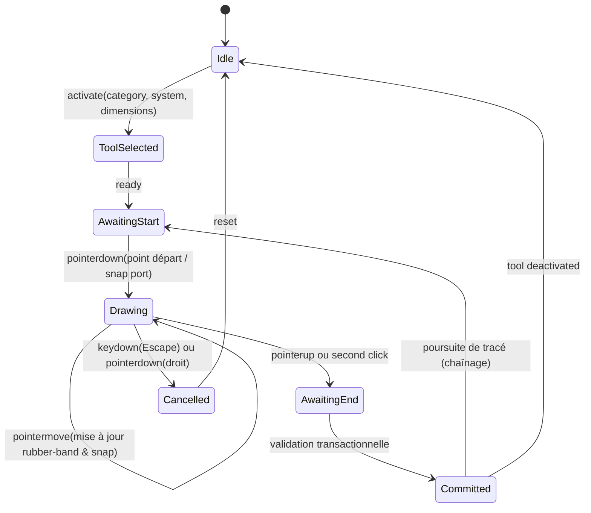

# Note d'Architecture — Sous-phase 9.3.2
# Outils Interactifs de Dessin et d'Édition MEP (MepTool, Snapping Magnétique Écran & UI)

**Date :** 19 Novembre 2026  
**Branche Git :** `feat/phase-9-3-2-mep-interactive-tools`  
**Statut :** En cours de mise en œuvre  
**Cadre de Conception :** Conforme à l'ADR-009 (Découplage Vue/Noyau), l'ADR-047 (Snapping proportionnel à l'échelle écran), l'ADR-056 (Découplage Graphe Physique vs DAG) et l'ADR-057 (Architecture modulaire des moteurs graphiques).

---

## 1. Objectifs & Délimitation Stricte du Périmètre

La Sous-phase 9.3.2 introduit l'expérience interactive de modélisation MEP dans Mini-BIM en fournissant à l'utilisateur :
1. Une machine à états finis pure et robuste (`MepTool`) pour le dessin de segments de réseaux techniques.
2. Un système d'accrochage magnétique intelligent (*magnetic port snapping*) sur les ports ouverts compatibles, régi par une tolérance en pixels écran (`tolerancePx / scale`) conformément à l'**ADR-047**.
3. Une prévisualisation élastique temps réel (*rubber-band*) avec retour visuel immédiat de compatibilité (vert/rouge/neutre).
4. Le raccordement transactionnel au noyau MEP (`AddPipeCommand`, `AddDuctCommand`, `AddCableTrayCommand`, `ConnectPortsCommand`, `UpdateMepElementCommand`, `DeleteMepElementCommand`).
5. L'intégration complète dans `apps/web` :
   - Ruban MEP interactif (`MepRibbon`) avec sélecteur de catégorie, système/fluide, dimensions et bascule d'affichage Unifilaire / Bifilaire.
   - Inspecteur de propriétés dédié (`MepInspector`) permettant l'édition réversible des paramètres.
   - Raccordement incrémental `Viewport3D` via `lastChangedIds` (maintien du gain 20× de la Phase 8.6).
   - Picking 2D (`hit-test.ts`) et 3D (raycast `userData.elementId`).
   - Test Playwright E2E réel en navigateur.

### Frontières Explicites (Exclusions strictes de la 9.3.2)
- **AUCUN routage automatique, AUCUN coude automatique, AUCUN té automatique :** chaque interaction crée un segment unitaire rectiligne. Le routage automatique et l'insertion d'accessoires de déviation sont formellement réservés à la **Sous-phase 9.3.3**.
- **AUCUNE détection de collision 3D MEP / Structure :** réservée à la **Phase 9.4**.
- **AUCUN calcul de débit / perte de charge ou simulation thermodynamique.**
- **AUCUN import IFC MEP.**

---

## 2. Machine à États Finis Pure (`MepTool`)

L'outil de modélisation MEP est conçu comme une machine à états stricte évitant tout drapeau booléen dispersé pouvant engendrer des états asynchrones incohérents :



### Définition des États (`MepToolState`)
```typescript
export type MepToolState =
  | { readonly kind: 'idle' }
  | {
      readonly kind: 'awaiting-start';
      readonly category: MepCategory;
      readonly snappedPort?: SnappedPortInfo | null;
    }
  | {
      readonly kind: 'drawing';
      readonly category: MepCategory;
      readonly startPoint: Point3D;
      readonly currentPoint: Point3D;
      readonly startPort?: Port | null;
      readonly currentSnappedPort?: SnappedPortInfo | null;
    }
  | { readonly kind: 'committed'; readonly elementId: string }
  | { readonly kind: 'cancelled' };
```

---

## 3. Accrochage Magnétique aux Ports (Snapping ADR-047)

### A. Règle métrologique : Tolérance en pixels écran
Pour éviter l'écueil d'une tolérance fixe en millimètres monde (inutilisable à fort dézoom, hyper-agressive à fort zoom sur collecteurs denses) :
$$\text{toleranceMonde} = \min\left(\frac{\text{tolerancePx}}{\text{scale}}, \text{maxToleranceMm}\right)$$
- `tolerancePx` = 14 px (défaut).
- `maxToleranceMm` = 300 mm (plafond maximal de capture pour éviter l'accrochage intempestif à très faible échelle).

### B. Matrice de Compatibilité Stricte
Lorsqu'un port ouvert est détecté dans le rayon de capture, sa compatibilité est évaluée avant toute validation visuelle :
1. **Disponibilité :** Le port ne doit pas figurer dans `state.mepConnectors` (aucun connecteur incident).
2. **Domaine :** Le domaine du port (`plumbing`, `hvac`, `electrical`) doit correspondre à celui de la catégorie active.
3. **Système :** Le système/fluide du port doit être compatible avec celui configuré dans l'outil.
4. **Dimensions :** Pour les conduites circulaires, $\Delta \text{diamètre} \le 1\text{ mm}$ ; pour les sections rectangulaires, $\Delta \text{largeur} \le 1\text{ mm}$ et $\Delta \text{hauteur} \le 1\text{ mm}$.
5. **Orientation angulaire :** Le vecteur incident du nouveau segment doit être opposé (antiparallèle) au vecteur normal du port cible avec une tolérance angulaire $\le 15^\circ$ ($\cos \theta \le -0,966$).

### C. Retours Visuels Immédiats
- **Halo Vert (`#22c55e`) :** Port libre, compatible et prêt pour la connexion.
- **Halo Rouge barré (`#ef4444`) :** Port détecté mais incompatible (incompatibilité de fluide, de section ou port déjà saturé).
- **Point Neutre :** Accrochage libre dans l'espace ou sur la grille.
> **Règle absolue :** L'accrochage visuel n'altère en aucun cas le graphe topologique. La connexion n'est scellée que lors du `commit()` transactionnel.

---

## 4. Rendu de Prévisualisation Temps Réel (Rubber-band)

La prévisualisation est totalement découplée du `BimDocument` :
- Étend `PreviewShape` dans `@mini-bim/view-2d` avec `{ kind: 'mep', ... }`.
- Restitue le tracé central et l'enveloppe dimensionnelle (bifilaire) selon la catégorie active.
- Affiche en surimpression la pastille d'accrochage et l'indicateur d'angle (orthogonalité / 45°).
- Disparaît instantanément lors de la validation ou de l'annulation (`Escape`).

---

## 5. Raccordement Incrémental & Synchronisation des Vues

### A. Viewport3D & Maintien du Gain 20×
`Viewport3D.tsx` s'abonne à `lastChangedIds` :
- Lorsque `lastChangedIds` contient un identifiant d'élément MEP, seul le mesh Three.js correspondant est régénéré (`scene.addMepMesh` / `scene.removeMepMesh`).
- Si un système MEP est modifié (`state.mepSystems`), seuls ses éléments membres sont marqués sales.
- Les maillages architecturaux (murs, dalles, toits, escaliers) ne subissent aucune recompilation inutile.

### B. Picking Unifié 2D / 3D
- **2D :** Fonction pure `findMepElementAtScreen(screenPos, transform, doc, options)` dans `hit-test.ts` détectant la proximité du segment avec le rayon/largeur de l'élément.
- **3D :** Exploitation native du raycaster Three.js avec `mesh.userData.elementId`.
- **Sélection :** `SelectTool` interroge en priorité les éléments MEP avant les murs architecturaux.

---

## 6. Interface Utilisateur & Intégration Web

1. **`Toolbar.tsx` :** Ajout du bouton `Réseaux MEP (P)` activant `activeToolKind = 'mep'`.
2. **`MepRibbon.tsx` :** Barre d'options contextuelle affichée uniquement en mode MEP :
   - Sélecteur de type d'élément : Tuyau (`pipe`), Gaine ronde (`duct-round`), Gaine rectangulaire (`duct-rect`), Chemin de câbles (`cable-tray`).
   - Sélecteur de système technique : EF (`domestic_cold_water`), ECS (`domestic_hot_water`), Chauffage (`hydronic_supply`/`return`), VMC Soufflage (`supply_air`), VMC Reprise (`return_air`), Électricité (`power`).
   - Saisie des dimensions nominales : Diamètre (mm), Largeur (mm), Hauteur (mm), Élévation (mm).
   - Bascule de mode d'affichage 2D : Bouton bascule Unifilaire / Bifilaire agissant sur `MepRenderConfig.mode`.
3. **`MepInspector.tsx` :** Inspecteur de propriétés dédié affichant et modifiant transactionnellement :
   - Dimensions (diamètre, largeur, hauteur).
   - Longueur calculée (lecture seule).
   - Système rattaché (menu déroulant réversible via `AssignToMepSystemCommand`).
   - Niveau hôte (`levelId`).
   - Ports et état des connexions physiques.
   - Bouton de suppression avec nettoyage automatique des connecteurs incidents via `DeleteMepElementCommand`.

---

## 7. Plan de Qualification & Smoke Test Playwright E2E

1. **Tests unitaires & intégration Vitest :**
   - Machine à états `MepTool` : transitions, reset, Escape, création de segments simples.
   - Calcul du snapping magnétique en pixels/scale avec matrice de compatibilité.
   - Refus strict des connexions incompatibles ou sur ports déjà occupés.
   - Picking 2D et 3D sur tuyaux, gaines et chemins de câbles.
   - Undo/Redo sur les créations et modifications MEP (zéro connecteur orphelin).
   - Bascule Unifilaire / Bifilaire.
2. **Test E2E Playwright Réel (`e2e/smoke.spec.ts`) :**
   - Activation de l'outil MEP dans l'UI.
   - Clic de départ et clic d'arrivée sur le Canvas 2D pour créer un tuyau d'eau froide.
   - Vérification de la création de l'élément dans le document et de son affichage 2D.
   - Clic de sélection et vérification de l'ouverture de `MepInspector`.
   - Vérification du rendu sans exception WebGL en 3D.
